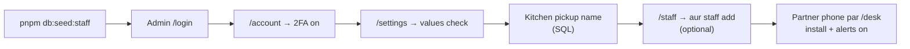

# 01 · Pehli baar Setup — Admin, Kitchen Partner, Kitchen, Settings

> Yeh kaam **ek hi baar** hota hai (ya jab naya staff / naya kitchen jude). Iske baad hi products list honge aur orders chalenge.
> Pichhla: [README.md](README.md) · Agla: [02-product-listing-catalog.md](02-product-listing-catalog.md)



---

## 1. Pehla Admin + Kitchen Partner (seed script)

### System khud kya karta hai

`pnpm db:seed:staff` ([`apps/backend/scripts/seed-staff.ts`](../apps/backend/scripts/seed-staff.ts)) ek transaction me yeh banata hai:

| Kya banta hai             | Details                                                                                                                  |
| :------------------------ | :----------------------------------------------------------------------------------------------------------------------- |
| Pehla **ADMIN** user      | Full name, email, password (min 12 characters)                                                                           |
| Pehla **KITCHEN_PARTNER** | Full name, email, mobile `+91XXXXXXXXXX`, password (min 12)                                                             |
| Kitchen (pickup location) | Code **`HP-KULLU-01`**, naam **"Kullu Kitchen"**, city Kullu, Himachal Pradesh, PIN 175101, address = `ADDRESS PENDING — update before Shiprocket setup`, contact = partner ka naam + phone |
| Mapping                   | Partner ↔ HP-KULLU-01 (`user_pickup_locations`) — partner sirf isi kitchen ke orders/batches dekhega                     |

- Values terminal me poochhi jaati hain (password chhupa rehta hai), ya env se: `SEED_ADMIN_NAME`, `SEED_ADMIN_EMAIL`, `SEED_ADMIN_PASSWORD`, `SEED_PARTNER_NAME`, `SEED_PARTNER_EMAIL`, `SEED_PARTNER_PHONE`, `SEED_PARTNER_PASSWORD`.
- Script **idempotent** hai: same email dobara chalao toh user "already existed — left unchanged" — password kabhi overwrite nahi hota.
- End me warning: `⚠ Update the kitchen address before Phase 6 (Shiprocket pickup).`

---

## 2. Admin login + 2FA

### Admin side

1. `http://localhost:5173/login` kholo → heading **"Sign in"** ("For Pahadi Khatki admins and kitchen partners.").
2. **Work email** + **Password** → button **Sign in**.
3. Agar 2FA on hai → screen **"Two-factor check"** → **6-digit authentication code** → **Verify and sign in**.
4. Login ke baad: ADMIN → **Dashboard** (`/`); KITCHEN_PARTNER → seedha **Packing desk** (`/desk`).

**Galat password:** 5 galat koshish 15 minute me → woh email **15 minute ke liye lock** ([`auth.service.ts`](../apps/backend/src/modules/auth/auth.service.ts) `LOGIN_MAX_FAILURES = 5`). Screen par: _"Too many sign-in attempts. Please wait … and try again."_

**Password bhool gaye:** login page par likha hai _"Forgot your password? Ask an admin to reset it."_ → Admin: **Staff** → us person ki row → **Edit** → **Reset password** → temporary password (Generate / Copy) → reset. Woh har jagah se sign out ho jaata hai aur login lock bhi hat jaata hai (audit `STAFF_PASSWORD_RESET`). Apna password admin khud reset nahi kar sakta — woh **Account** page se badalta hai.

**Password badalna (khud):** **Account** (`/account`) → **Change password** card → current + new (12–200 characters) + confirm. Is device par signed-in rehte ho, baaki saare devices sign out ho jaate hain.

### 2FA (Two-factor authentication) set karna — `/account`

Header me apne naam par click → **Account & security** → page **"Your account"**.

1. Card **"Two-factor authentication"** (badge **Off**) → button **Set up two-factor**.
2. **"1. Scan with your authenticator app"** — QR code (Google Authenticator / 1Password / Authy). Scan na ho toh _"Can't scan? Enter this key instead:"_ wali key copy karo.
3. **"2. Enter the 6-digit code it shows"** → **Turn on two-factor** → _"Two-factor authentication is on."_

| Environment | 2FA rule                                                                                                                                                                                                      |
| :---------- | :------------------------------------------------------------------------------------------------------------------------------------------------------------------------------------------------------------ |
| Local       | **Optional.** `.env` me `ADMIN_TOTP_REQUIRED=true` daalo toh local me bhi mandatory.                                                                                                                         |
| Production  | **Hamesha mandatory** (D-19, D-57). `ADMIN_TOTP_REQUIRED=false` production me config error deta hai. Bina 2FA admin ko API `TOTP_ENROLLMENT_REQUIRED` deta hai aur portal `/account?required=2fa&next=…` par bhej deta hai — banner: _"Two-factor authentication is required for admin accounts — set it up to continue."_ |

Kitchen partner ke liye 2FA zaroori nahi.

Header menu me aur options: **Sign out**, **Sign out of all devices**.

---

## 3. Kitchen / pickup location

Kitchen = `pickup_locations` table ki row (Shiprocket ka pickup address). Har order ek kitchen se jaata hai, aur partner sirf apne kitchen dekhta hai.

| Kaam                                         | Kaise hota hai (abhi)                                                                                                                         |
| :------------------------------------------- | :-------------------------------------------------------------------------------------------------------------------------------------------- |
| Pehla kitchen banana                         | `pnpm db:seed:staff` (HP-KULLU-01)                                                                                                            |
| **Naya kitchen banana / address edit / FSSAI no.** | Admin → **Kitchens** (`/kitchens`) → **Add kitchen** / row → **Edit**. Code (jaise `HP-MANDI-01`) baad me nahi badalta; FSSAI 14 digit; **Active** off = naye batches nahi ban sakte, purana stock bikta rahega. Audit `KITCHEN_CREATE` / `KITCHEN_UPDATE` |
| **Shiprocket pickup nickname**               | Admin → **Kitchens** (`/kitchens`) → HP-KULLU-01 → **Edit** → **Shiprocket pickup name** — Shiprocket panel ke pickup address nickname se **exactly** match (S-2). Khali ho toh row par badge **"Shiprocket not linked"** + upar banner. Bina iske Shiprocket booking job `PermanentJobError` ("kitchen … has no Shiprocket pickup name") deta hai aur admin ko alert jaata hai |
| Partner ko kitchen assign karna              | **Admin UI hai** — Staff page → partner → **Edit** → **Kitchens** checkboxes (neeche §4)                                                      |

Local par SQL se bhi kar sakte ho (same kaam):

```bash
docker compose exec postgres psql -U pk -d pahadi_khatki \
  -c "UPDATE pickup_locations SET shiprocket_pickup_name = 'Kullu Kitchen' WHERE code = 'HP-KULLU-01';"
```

> Production me nickname wahi hona chahiye jo Shiprocket panel me registered + verified pickup location ka hai ([`requirement/pending-requirements.md`](../requirement/pending-requirements.md) S-2). Table columns: [`packages/database/migrations/0001_foundation.sql`](../packages/database/migrations/0001_foundation.sql) (`code`, `name`, `contact_name`, `contact_phone`, `address_line1/2`, `city`, `state`, `pincode`, `shiprocket_pickup_name`, `fssai_license_no`, …).

---

## 4. Staff page — naya admin / partner jodna (`/staff`)

Sidebar → **System → Staff**. Page title **"Staff"** — _"Who can sign in to the portal and the packing desk. Partners only ever see their own kitchen."_ Source: [`StaffListPage.tsx`](../apps/admin/src/modules/staff/pages/StaffListPage.tsx), [`StaffDialogs.tsx`](../apps/admin/src/modules/staff/components/StaffDialogs.tsx).

**Upar KPI cards:** Active staff · Admins · Kitchen partners · **Admins without 2FA** (warning — _"Ask them to turn it on"_).
**Filters:** All · Admins · Kitchen partners · Inactive · search _"Name, email or phone"_.
**Table columns:** Name · Role · Kitchens (admin = "All") · 2FA (On/Off) · Last sign-in · Status · **Edit**.

### Naya staff — button **Add staff** → dialog **"Add a staff member"**

| Field                  | Notes                                                                                     |
| :--------------------- | :---------------------------------------------------------------------------------------- |
| **Role**               | **Kitchen partner** ("Packing desk + own statements") ya **Admin** ("Everything, with 2FA") |
| **Full name**          | min 2 characters                                                                           |
| **Work email**         | login ke liye                                                                              |
| **Mobile** (optional)  | `+91` — _"For WhatsApp alerts"_ (partner ko push na mile toh new-order alert isi par, M-7) |
| **Temporary password** | Auto-generate 16 characters (button **New** se naya); min 12                               |
| **Kitchens**           | Checkboxes — **Kitchen partner ke liye kam se kam ek zaroori** (_"A kitchen partner needs at least one kitchen"_) |

Button **Add staff member** → toast _"… added"_ — temporary password privately share karo; woh sign in karke **Account** se badal leta hai.

> Naya staff sign in karke **Account → Change password** se apna password rakh leta hai (upar §2).

### Edit dialog (row par click / **Edit**)

- **Full name**, **Mobile**, **Kitchens** (sirf partner), **Active** switch (_"Inactive staff can't sign in."_ — apna khud ka account deactivate nahi kar sakte).
- **Force logout** → confirm _"Sign … out everywhere?"_ — saare sessions revoke, 15 minute me screens band (phone kho gaya / team chhodi).
- **Save changes**. Sab audit log me jaata hai.

---

## 5. Settings page (`/settings`)

Sidebar → **System → Settings**. _"Shipping, checkout, stock and settlement rules. Changes apply at once and are written to the audit log."_
Filters: All · Shipping · Orders · Inventory · Finance + search. Row par click → dialog (field **Value**, nullable wale par checkbox **"Not decided yet"**) → **Save**. Paise wale settings ₹ me type karte ho, system paise me save karta hai; % wale basis points me (50 % = `5000`).

Source: [`packages/shared/src/settings/schemas.ts`](../packages/shared/src/settings/schemas.ts) (validation), [`settingMeta.ts`](../apps/admin/src/modules/settings/components/settingMeta.ts) (labels), defaults [`0001_foundation.sql`](../packages/database/migrations/0001_foundation.sql).

| Screen label                        | Key                              | Default            | Allowed      | Kya karta hai (code me kahan use hota hai)                                                                                                     |
| :---------------------------------- | :------------------------------- | :----------------- | :----------- | :--------------------------------------------------------------------------------------------------------------------------------------------- |
| **Free shipping above**             | `free_shipping_threshold_paise`  | Not set (`null`)   | ₹ ya null    | Cart subtotal ≥ yeh value → shipping ₹0; storefront par "free shipping" progress (cart service)                                                 |
| **Flat shipping fee**               | `flat_shipping_fee_paise`        | Not set (`null`)   | ₹ ya null    | Free shipping na mile toh yeh fee lagti hai. **Null = ₹0 shipping** (D-50, Q-03 abhi open)                                                     |
| **Courier pickup cut-off**          | `pickup_cutoff_hour_ist`         | 11 (`:00 IST`)     | 6–20         | Is ghante ke baad Mark Packed hua toh pickup **agle din** (Sunday off) (D-36)                                                                   |
| **Minimum courier rating**          | `min_courier_rating`             | 4.0 / 5            | 0–5          | Shiprocket booking me isse kam rating wale courier nahi chune jaate                                                                            |
| **Slowest courier allowed**         | `max_courier_etd_days`           | 7 days             | 1–30         | Isse zyada delivery-days wale courier skip                                                                                                     |
| **Shiprocket wallet alert below**   | `shiprocket_wallet_min_paise`    | ₹2,000             | ₹            | Wallet isse kam → admin alert (low wallet)                                                                                                     |
| **Checkout stock hold**             | `reservation_ttl_minutes`        | 15 minutes         | 5–60         | Checkout par stock itni der RESERVED; payment na aaye toh order EXPIRED + stock wapas (D-22)                                                   |
| **Max jars per product per order**  | `max_qty_per_item`               | 10 jars            | 1–50         | Cart me ek product ki max quantity                                                                                                             |
| **Cash on delivery**                | `cod_enabled`                    | Off                | sirf `false` | _"Off — prepaid only (COD is v2)"_. **COD abhi system me nahi hai (v2, D-25)** — on karne ka option hi nahi                                    |
| **COD fee**                         | `cod_fee_paise`                  | ₹50                | ₹            | Kahin use nahi hota (COD v2)                                                                                                                   |
| **Minimum shelf life at sale**      | `min_remaining_shelf_days`       | 45 days            | 0–365        | Batch tabhi bikega jab expiry ≥ aaj + yeh + transit buffer (D-24)                                                                              |
| **Transit buffer**                  | `transit_buffer_days`            | 7 days             | 0–30         | Upar wale rule me jodta hai (45 + 7 = 52 din bacha hona chahiye)                                                                               |
| **Low-stock warning at**            | `low_stock_threshold`            | 20 jars            | 0–1000       | Storefront par "Only X left" badge isse kam stock par                                                                                          |
| **Packaging cost per jar**          | `packaging_cost_per_jar_paise`   | ₹32                | ₹            | Settlement me har jar par packaging cost minus (D-41) — real value pending (A-4)                                                               |
| **Kitchen partner profit share**    | `partner_split_bp`               | 50 %               | 0–100 %      | Settlement me net profit ka partner hissa (D-41, pending sign-off A-3)                                                                         |
| **Seller details (invoices)**       | `seller_details`                 | Not set            | object/null  | Invoice par seller: **Legal name, GSTIN, State code, Address, City, State, PIN code**. Not set → local me invoice par _"DRAFT - NOT A TAX INVOICE"_; production me invoice banta hi nahi (G-4) |

Notes:

- **Free shipping + flat fee ka asli rule** ([`cart.service.ts`](../apps/backend/src/modules/cart/cart.service.ts)): `shipping = 0` agar subtotal ≥ threshold (threshold set ho), warna `flat fee ?? 0`. Matlab sirf flat fee set ho aur threshold null ho toh har order par flat fee lagegi. Settings dialog ka hint ab yahi asli rule batata hai (fixed).
- Storefront ke footer / legal pages ka seller naam, address, FSSAI, GSTIN, phone, WhatsApp, grievance officer **settings se nahi**, storefront env `NEXT_PUBLIC_SELLER_*` / `NEXT_PUBLIC_POLICY_*` ([`apps/storefront/.env.example`](../apps/storefront/.env.example)) se aate hain — khaali ho toh "Pending" dikhta hai (G-6).
- Har change **Audit log** (`/audit-log`) me jaata hai.

---

## 6. Kitchen Partner ka pehla din (phone par)

### Partner side

1. Phone browser me admin URL kholo → **Work email** + **Password** → **Sign in** → seedha **Packing desk** (`/desk`). Language default **Hindi** (header me HI/EN toggle, har device par yaad rehta hai).
2. Bottom nav: **Orders** · **Batches** · **Hisaab** · **Settings**.
3. **Settings** (`/desk/settings`):
   - **Naye order ka alert** → **🔔 Naye order ka alert chalu karein** (web push). Server par VAPID keys na hon toh: _"Server par phone alert abhi set nahi hain — naye order WhatsApp par aayenge."_
   - **App install karein** — Android: Chrome ⋮ menu → "Install app"; iPhone: Safari → Share → "Add to Home Screen" (iPhone par alert sirf Home Screen app se).
   - Theme (Light / Dark / Auto), **Sign out**.
4. Partner ko admin portal ka **Inventory** (`/batches`) bhi dikhta hai (apne kitchen ke batches), lekin Products, Orders console, Settings, Staff **nahi**.

Partner kya **nahi** dekh sakta (D-40): live revenue, dusre kitchen, customers list, settings.

Packing ka poora kaam: [05-order-fulfilment-admin-partner.md](05-order-fulfilment-admin-partner.md). Batch entry: [03-inventory-batches-stock.md](03-inventory-batches-stock.md).

---

## ✅ Setup checklist (short)

- [ ] `pnpm db:seed:staff` chala, admin + partner + HP-KULLU-01 bane
- [ ] Admin login hua, `/account` par 2FA on (production me zaroori)
- [ ] `/settings` me shipping (Q-03), packaging cost, partner share, seller details check kiye
- [ ] **Kitchens** page par HP-KULLU-01 ka asli address, FSSAI no. aur **Shiprocket pickup name** bhara ("Shiprocket not linked" badge hat gaya)
- [ ] Partner ka mobile number Staff page par bhara (WhatsApp fallback)
- [ ] Partner ne phone par `/desk` khola, alerts on kiye, app install kiya
