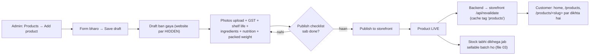

# 02 — Product listing (Catalog): admin product kaise banayega, website par kaise dikhega

> Index: [README.md](README.md) · Pichla: [01 — Setup](01-setup-admin-partner-kitchen.md) · Agla: [03 — Inventory / batches](03-inventory-batches-stock.md)

Is file me: admin **naya pickle (product) kaise banata hai**, har field ka matlab, **draft → publish** ke rules, unpublish / edit, aur customer ko **website par kya dikhta hai** (home, `/products`, product page).

Short me flow:



> **Zaroori baat:** Product LIVE hone ke baad bhi agar koi **sellable batch** nahi hai, toh website par **"Sold out"** dikhega aur "Add to cart" band rahega. Stock batches se aata hai — [03-inventory-batches-stock.md](03-inventory-batches-stock.md).

---

## 1. Kaun kar sakta hai?

| Kaam                                  | Kaun                          | Code reference                                                                                   |
| :------------------------------------ | :---------------------------- | :----------------------------------------------------------------------------------------------- |
| Product banana / edit / publish       | Sirf **ADMIN** (`catalog:manage`) | [`packages/shared/src/auth/permissions.ts`](../packages/shared/src/auth/permissions.ts)       |
| Kitchen partner                       | Product nahi bana sakta — sirf batch log karta hai (file 03) | same                                                               |

Admin portal me left menu → group **"Catalog & stock"** → **Products** (`/products`). Source: [`apps/admin/src/components/navigation/nav-items.ts`](../apps/admin/src/components/navigation/nav-items.ts).

---

## 2. Products list page (`/products`)

### Admin side — screen par kya hai

Source: [`apps/admin/src/modules/products/pages/ProductsListPage.tsx`](../apps/admin/src/modules/products/pages/ProductsListPage.tsx)

- Heading: **Products** (eyebrow "Catalog"), button **"Add product"** (upar right).
- 4 KPI cards:

| Card              | Matlab                                                                        |
| :---------------- | :---------------------------------------------------------------------------- |
| **Live**          | Kitne product website par visible hain                                        |
| **Drafts**        | Kitne hidden drafts hain; hint "`N` need info to publish" agar kuch fields missing |
| **Sold out**      | Live products jinka sellable stock 0 hai ("Live with 0 sellable jars")          |
| **Sellable jars** | Saare products ke bikne-layak jars; hint me "`N` on hand in all batches"      |

- Tabs (filter): **All / Live / Draft / Sold out** (count ke saath). URL me `?status=live` waghera.
- Search box: **"Search name or SKU"** (name, SKU ya product group se dhoondta hai).
- Table columns: **Product · SKU · Price · Stock · Status**. Stock column me "`X` sellable" aur neeche "`Y` on hand · `Z` not sellable" ([`StockCell.tsx`](../apps/admin/src/modules/products/components/StockCell.tsx)). Status badge **LIVE** ya **DRAFT**.
- Order: `Sort order` (chhota pehle) → product group → weight.
- Khaali list par: "No products yet" + **Add product**.

> Product **delete** karne ka option abhi system me nahi hai (na UI, na API — routes me sirf create / update / publish / unpublish hain: [`catalog.routes.ts`](../apps/backend/src/modules/catalog/catalog.routes.ts)). Product hataana ho toh **Unpublish** karo.

---

## 3. Naya product banana — step by step

Route: **`/products/new`** → [`ProductEditorPage.tsx`](../apps/admin/src/modules/products/pages/ProductEditorPage.tsx). Page title **"New product"**.

### Step 1 — "Add product" dabao

Form 5 sections me hai (cards): **Basics → Pricing & tax → Food safety & label → Shipping → Photos**. Right side (mobile par upar) ek card **"How publishing works"** batata hai ki live hone ke liye kya chahiye.

### Step 2 — Saare fields (exact labels code se)

Source: [`ProductFormSections.tsx`](../apps/admin/src/modules/products/components/ProductFormSections.tsx), validation: [`productForm.ts`](../apps/admin/src/modules/products/components/productForm.ts) + [`packages/shared/src/contracts/catalog.ts`](../packages/shared/src/contracts/catalog.ts).

#### A) Basics

| Field (label)         | Zaroori? | Rule / matlab                                                                                                                             |
| :-------------------- | :------- | :---------------------------------------------------------------------------------------------------------------------------------------- |
| **Product name**      | Haan     | Max 150 akshar. e.g. "Himachali Chicken Pickle"                                                                                           |
| **SKU**               | Haan     | 2–20 capital letters/digits (e.g. `CHK250`). **Baad me change nahi hota** ("Locked — batch codes include it.") — batch code me SKU aata hai |
| **Meat**              | Haan     | Dropdown: **Chicken / Mutton / Fish / Prawn**. Na chuno toh error "Choose the meat"                                                       |
| **Product group**     | Haan     | Same group = ek hi achaar ke size variants (250 g ↔ 500 g). Lowercase + hyphen. Naam likhte hi auto-fill hota hai                          |
| **Net weight**        | Haan     | grams me, default `250`. Ek group me ek weight ek hi baar (duplicate par error "already has a 250 g variant")                             |
| **URL slug**          | Haan     | Auto: `<naam>-<weight>g`, e.g. `himachali-chicken-pickle-250g`. Hint me poora URL `pahadikhatki.in/products/<slug>` dikhta hai. Unique hona chahiye |
| **Short description** | Optional | Max 300, counter dikhta hai. Product card aur PDP par title ke neeche                                                                     |
| **Description**       | Haan     | Max 5000. PDP par "About this pickle" me                                                                                                  |

> Har listing par **non-veg mark** apne aap lagta hai (koi field nahi).

#### B) Pricing & tax

| Field                       | Zaroori?                | Rule                                                                                       |
| :-------------------------- | :---------------------- | :----------------------------------------------------------------------------------------- |
| **Price (MRP incl. GST)**   | Haan                    | ₹ me likho (e.g. `399` ya `399.50`). **DB me paise me save** hota hai (₹399 = `39900` paise) |
| **Compare-at price**        | Optional                | Kaata hua (strike-through) dikhta hai. **Price se zyada** hona chahiye                       |
| **GST rate**                | Draft me nahi, **publish ke liye haan** | % me (e.g. `5`). DB me basis points (`5%` = `500`). CA confirmation pending (Q-01)   |
| **HSN code**                | Haan                    | 4–8 digits, default `2001`                                                                   |

> Price hamesha **MRP inclusive of all taxes** hai (D-26). GST invoice par isi price ke andar se nikala jata hai.

#### C) Food safety & label (FSSAI)

| Field                    | Zaroori?                         | Rule                                                                                                      |
| :----------------------- | :------------------------------- | :-------------------------------------------------------------------------------------------------------- |
| **Ingredients**          | Publish ke liye haan             | Wazan ke ghatte order me, jaisa jar par chhapa hai. Max 2000                                              |
| **Allergens**            | Optional                         | e.g. "Mustard". Khaali ho toh PDP par **"Pending"** badge                                                  |
| **Shelf life**           | Publish ke liye haan             | Din me (manufacture se). **Isi se har batch ki expiry banti hai.** Iske bina **batch log nahi ho sakta** (lab report Q-07) |
| **Storage instructions** | Optional                         | Khaali ho toh PDP par default text dikhta hai ("Always use a clean, dry spoon…")                          |
| **Spice level**          | Optional                         | 1 Mild · 2 Gentle · 3 Medium · 4 Hot · 5 Fiery · ya "Not set"                                              |
| **Nutrition per 100 g**  | Publish ke liye haan (sab 6 ek saath) | Energy (kcal), Protein (g), Total fat (g), Carbohydrate (g), Total sugars (g), Sodium (mg). Ya **saare 6** bharo ya **saare khaali** — aadhe par error |

#### D) Shipping

| Field                              | Zaroori?             | Rule                                                                                                            |
| :--------------------------------- | :------------------- | :-------------------------------------------------------------------------------------------------------------- |
| **Packed weight**                  | Publish ke liye haan | grams me (jar + box + bubble wrap). Net weight se kam nahi ho sakta. 250 g jar ke liye hint: ≤ 500 g rakho taaki pehle courier slab me rahe (D-34) |
| **Box size** — Length / Breadth / Height | Haan           | cm me, default **15 × 10 × 10** (D-33). Courier rate ke liye                                                    |
| **Sort order**                     | Haan                 | Default `0`. **Chhota number website par pehle** dikhta hai                                                     |

> Multi-jar box ka size code me alag rule se banta hai ([`packages/shared/src/logistics/box-rules.ts`](../packages/shared/src/logistics/box-rules.ts)) — file [05](05-order-fulfilment-admin-partner.md) dekho.

#### E) Photos

- Naye product par photos section me likha aata hai **"Save the draft first"** — photo sirf saved product par lagti hai.

### Step 3 — "Save draft"

- Neeche sticky bar me button **"Save draft"** + text "Saved as a draft — hidden until you publish."
- Save hote hi toast **"Draft saved"** — "Add photos and the lab details, then publish." aur page `/products/<id>` (edit mode) par chala jata hai.
- Galti hone par: "Some fields need attention." aur pehla galat field focus hota hai. SKU/slug duplicate par: "That clashes with an existing product — see the highlighted field."

**System khud kya karta hai:** naya product hamesha **draft** (`is_active = false`) banta hai, aur `PRODUCT_CREATE` type ki **audit log** entry likhi jaati hai ([`catalog.service.ts`](../apps/backend/src/modules/catalog/catalog.service.ts)).

### Step 4 — Photos upload karo (edit page par)

Source: [`ImageManager.tsx`](../apps/admin/src/modules/products/components/ImageManager.tsx)

- Box par likha: **"Add photos"** — "Drop here or tap to choose · JPG, PNG or WebP · up to 5 MB each · first photo is the storefront cover".
- **Max 8 photos** per product. Zyada daalo toh toast "Only 8 photos per product".
- Har photo par buttons: ← (pehle), ★ (**primary banao**), → (baad me), 🗑 (remove). Pehli photo par **"Primary"** badge — yahi website ka cover hai.
- Upload ke time "Uploading `N`%" → "Saving…" dikhta hai.

**System khud kya karta hai (local vs production):**

| Environment                     | Photo kahan jaati hai                                                                                                      |
| :------------------------------ | :------------------------------------------------------------------------------------------------------------------------- |
| **Local** (`STORAGE_DRIVER=local`) | API ki local disk par (`apps/backend/.uploads`), dev route se serve hoti hai ([`dev-storage.routes.ts`](../apps/backend/src/modules/dev-storage/dev-storage.routes.ts)) |
| **Production** (`STORAGE_DRIVER=r2`) | Cloudflare R2 public bucket me presigned PUT se (D-11). R2 buckets abhi pending — `requirement/pending-requirements.md` **I-3** |

### Step 5 — Baaki compliance details bharo → "Save changes"

Edit mode me button **"Save changes"** (sirf tab enable jab kuch badla ho). Text: "You have unsaved changes." / "All changes saved." Toast: **"Changes saved"**.

---

## 4. Publish karna — "Storefront status" panel

Source: [`PublishPanel.tsx`](../apps/admin/src/modules/products/components/PublishPanel.tsx), rules: `PUBLISH_REQUIREMENTS` in [`packages/shared/src/contracts/catalog.ts`](../packages/shared/src/contracts/catalog.ts).

Edit page par right side card **"Storefront status"** — status badge (DRAFT/LIVE), **Price (MRP incl. GST)** aur **Sellable jars** ("`X` / `Y` on hand").

### Publish checklist (yeh 6 cheezein bina publish nahi hoga)

| Checklist item (UI label)     | Kis section me bharna hai |
| :---------------------------- | :------------------------ |
| **GST rate**                  | Pricing & tax             |
| **Shelf life (lab tested)**   | Food safety & label       |
| **Ingredients list**          | Food safety & label       |
| **Nutrition per 100 g**       | Food safety & label       |
| **Packed weight**             | Shipping                  |
| **At least one photo**        | Photos                    |

- Har item ke aage ✓ (done) ya ○ (missing). Item par click → us section par scroll.
- Button **"Publish to storefront"** tabhi enable hota hai jab:
  1. checklist ke saare items done ho, **aur**
  2. form me koi unsaved change na ho ("Save your changes first.").
- Neeche text: "`N` items left before this can go live." ya "Everything required is in. Publishing makes it visible and buyable."
- Success toast: **"`<title>` is live"** — "Customers can now see and buy it."
- Agar server mana kare: lal alert "Can’t publish yet — fill: …".

**System khud kya karta hai:**

1. Product row lock karke dobara check karta hai ki sab fields hain (API `422 VALIDATION_FAILED { missing }`). DB me bhi `products_publishable` CHECK hai — bypass possible nahi ([`0002_catalog_inventory.sql`](../packages/database/migrations/0002_catalog_inventory.sql)).
2. `is_active = true` + audit `PRODUCT_PUBLISH`.
3. COMMIT ke baad storefront ko `POST /api/revalidate` (tag `products`) bhejta hai → website ka cache turant stale ho jata hai, agla visitor fresh data dekhta hai (D-49 i).

### Unpublish

- Live product par button **"Unpublish"** → dialog **"Hide `<title>`?"** — "It disappears from the storefront straight away. Batches and stock stay as they are, and you can publish again any time."
- Buttons: **"Keep it live"** / **"Unpublish"**. Toast: "`<title>` is hidden".
- Audit: `PRODUCT_UNPUBLISH`. Batches/stock nahi badalte.

### Live product ko edit karna

- Price, description, photos waghera live product par bhi edit ho sakte hain → **Save changes** → website automatically revalidate.
- **Lekin** live product se koi publish-required field (GST, shelf life, ingredients, nutrition, packed weight, ya saari photos) **khaali nahi kar sakte** — error: "A live product needs these details. Unpublish it first."
- **SKU kabhi change nahi hota** (edit mode me lock icon).
- Price badalne se purane orders par asar nahi — order banne ke time price snapshot ho jata hai. Cart me pada item agli **cart quote** par naya price dikhata hai (file [04](04-customer-journey-storefront.md)).

---

## 5. Customer side — website par kya dikhega

Storefront sirf **LIVE** (`is_active`) products dikhata hai. Draft ka URL kholo toh **404 "not found"** ([`products/[slug]/page.tsx`](<../apps/storefront/src/app/(shop)/products/[slug]/page.tsx>)).

### 5.1 Home page (`/`)

Source: [`app/(shop)/(home)/page.tsx`](<../apps/storefront/src/app/(shop)/(home)/page.tsx>), [`HomeHero.tsx`](../apps/storefront/src/modules/home/components/HomeHero.tsx), [`FeaturedProducts.tsx`](../apps/storefront/src/modules/home/components/FeaturedProducts.tsx)

- **Hero:** pehle live product ki pehli photo. Agar koi sellable batch hai toh **"Current batch"** badge — batch code + product naam + "made `<date>`" (sabse naya sellable batch, real data; batch na ho toh badge gayab).
- **"This season's jars — Pickles from the hills":** pehle **3 product groups** ke cards + button **"See all pickles"**.
- Koi live product nahi: "The next batch is curing". Backend down: "Our pantry is taking a breather".

### 5.2 Catalog page (`/products`)

Source: [`CatalogListing.tsx`](../apps/storefront/src/modules/catalog/components/CatalogListing.tsx), [`ProductCard.tsx`](../apps/storefront/src/modules/catalog/components/ProductCard.tsx)

- Heading "Himachali non-veg pickles" (eyebrow "The pantry").
- **Ek card = ek product group.** 250 g / 500 g ka toggle card ke andar — toggle se price, stock aur link badal jaata hai. Default woh variant jo sold out nahi.
- Card par: cover photo, non-veg mark, "`<Meat>` pickle", spice level, title, short description, price (+ kaata hua compare-at price), "Net wt.", **Add to cart**.
- Stock badge (sirf jab IN_STOCK na ho): **"Only `N` jars left"** ya **"Sold out"**. Sold out par button bhi **"Sold out"** (disabled).
- Sab sold out / koi product nahi: "The next batch is curing".

### 5.3 Product page — PDP (`/products/<slug>`)

Source: [`ProductDetailView.tsx`](../apps/storefront/src/modules/catalog/components/ProductDetailView.tsx), [`PurchasePanel.tsx`](../apps/storefront/src/modules/catalog/components/PurchasePanel.tsx)

| Hissa                    | Kya dikhta hai                                                                                                                         |
| :----------------------- | :------------------------------------------------------------------------------------------------------------------------------------- |
| Breadcrumb               | Home › Pickles › `<title>`                                                                                                             |
| Gallery                  | Saari photos (primary pehle)                                                                                                           |
| Upar                     | "Non-veg · `<Meat>` pickle", title, short description, "Net wt.", spice level                                                          |
| **Jar size**             | Same group ke variants (250 g jar / 500 g jar) price ke saath; sold out variant par "· Sold out"                                       |
| Price                    | MRP + compare-at (strike) + tax note; stock badge **In stock / Only `N` jars left / Sold out**                                          |
| Quantity + **Add to cart** | Quantity picker max 10 (ya sellable stock, jo kam ho). Add karne par "In your cart." + **"View cart & checkout"**. Mobile par sticky bar ("Add") |
| **Ships from batch**     | FIFO wala current sellable batch: batch code, **Manufactured**, **Best before**                                                        |
| **Check delivery to your pincode** | 6-digit pincode → "We deliver to `<pin>`" + "Usually X–Y days after dispatch", ya "Sorry, we can’t deliver to `<pin>` yet.", ya courier down par "We’ll confirm delivery to `<pin>` at checkout" (order rukta nahi) |
| Assurances               | Cold-pressed mustard oil · No added preservatives · Small batches, Himachal kitchen · Prepaid, tracked delivery                         |
| About this pickle        | Description                                                                                                                            |
| Ingredients / Allergens  | Value, ya khaali par **"Pending"** badge                                                                                               |
| Shelf life & storage     | e.g. "6 months (180 days) from manufacture" + storage text                                                                             |
| Nutrition (per 100 g)    | Table                                                                                                                                  |
| **Label information**    | Food type Non-vegetarian, Net weight, MRP "Inclusive of all taxes", **FSSAI Lic. No.**, Batch no., Mfg. date, Best before, Country of origin India, Marketed by |

- **FSSAI number** kahan se aata hai: current batch ki kitchen (`pickup_locations.fssai_license_no`), warna kisi active kitchen ka, warna env `NEXT_PUBLIC_SELLER_FSSAI_NO`. Kuch bhi na ho toh "Pending" ([`catalog.service.ts`](../apps/backend/src/modules/catalog/catalog.service.ts), [`apps/storefront/src/config/site.ts`](../apps/storefront/src/config/site.ts)). Seller legal name bhi isi tarah env se — pending items: `requirement/pending-requirements.md` (G-1/G-2, B-7).
- **SEO:** page title "`<title>` (`<weight>`)", canonical URL, Open Graph image, aur **Product JSON-LD** (`offers.availability` = InStock / LimitedAvailability / OutOfStock, price INR) — [`apps/storefront/src/lib/seo.ts`](../apps/storefront/src/lib/seo.ts). Sitemap me live products ([`sitemap.ts`](../apps/storefront/src/app/sitemap.ts)). Google Rich Results test pending (**I-5**).

### Stock badge ka rule

[`packages/shared/src/catalog/shelf-life.ts`](../packages/shared/src/catalog/shelf-life.ts) → `stockBadgeFor()`:

| Sellable jars                                   | Badge         | Website text           |
| :---------------------------------------------- | :------------ | :--------------------- |
| 0                                               | `SOLD_OUT`    | Sold out               |
| 1 se `low_stock_threshold` se kam (default 20)  | `LOW_STOCK`   | Only `N` jars left     |
| Baaki                                           | `IN_STOCK`    | In stock               |

`low_stock_threshold` admin **Settings** page se badal sakte ho (file [01](01-setup-admin-partner-kitchen.md)). "Sellable" ka matlab file [03](03-inventory-batches-stock.md) me hai — expiry ke kareeb wale batch gine nahi jaate.

---

## 6. Website kab update hoti hai? (revalidate)

| Kya badla                                                        | Website par kab dikhega                                                                                       |
| :--------------------------------------------------------------- | :------------------------------------------------------------------------------------------------------------ |
| Product create/edit/publish/unpublish, photo change              | **Turant** (backend COMMIT ke baad `POST /api/revalidate` → `revalidateTag('products')`)                      |
| Batch log / stock adjust (file 03)                               | **Turant** (inventory service bhi revalidate karta hai)                                                       |
| Customer ka order (stock reserve), expiry sweeper release        | Product pages par **max ~5 min** baad (fallback cache 300 sec, [`server-api.ts`](../apps/storefront/src/lib/server-api.ts)). Cart quote / checkout hamesha **live** stock check karta hai, isliye oversell nahi hota |
| Koi batch din guzarne par "not sellable" ho gaya                 | Agli revalidation / max 5 min me                                                                              |

**Local par dhyan do:** revalidation tabhi chalta hai jab backend `.env` me `STOREFRONT_REVALIDATE_URL` (e.g. `http://localhost:3000/api/revalidate`) **aur** `REVALIDATE_SECRET` dono set ho, aur storefront `.env.local` me same `REVALIDATE_SECRET` ho ([`apps/backend/src/config/env.ts`](../apps/backend/src/config/env.ts), [`apps/storefront/.env.example`](../apps/storefront/.env.example)). Khaali ho toh revalidate skip hota hai — website max 5 min me update hogi (ya dev mode me refresh par).

---

## 7. Shortcut: demo catalog seed (sirf local)

```bash
pnpm db:seed:catalog                    # 6 launch SKUs as DRAFT (CHK250/500, MTN250/500, TRT250/500)
pnpm db:seed:catalog -- --demo          # + placeholder GST/shelf-life/nutrition + demo batches
pnpm db:seed:catalog -- --demo --publish  # + placeholder photos (local storage) + PUBLISH
```

Source: [`apps/backend/scripts/seed-catalog.ts`](../apps/backend/scripts/seed-catalog.ts). Rules:

- Bina flag: products **draft** banenge, GST / shelf life / packed weight khaali — admin ko bharna hai.
- `--demo` production me **refuse**; `--demo` se pehle `pnpm db:seed:staff` chahiye (batches ke liye ADMIN actor).
- `--publish` sirf `--demo` ke saath aur sirf `STORAGE_DRIVER=local`.
- Idempotent: existing SKU ko touch nahi karta.

> Demo values **placeholder** hain — production me real lab/CA values admin UI se hi daalni hain.

---

## 8. Abhi system me nahi hai (v2 / pending)

| Cheez                                         | Status                                                                                       |
| :-------------------------------------------- | :------------------------------------------------------------------------------------------- |
| Product delete / archive                      | Nahi hai — Unpublish use karo                                                                |
| Categories / collections / tags               | Nahi hai — grouping sirf `Product group` (size variants) se                                   |
| Coupon / discount code                        | Nahi hai (order me `discountPaise` field hai par admin UI/flow nahi) — v2                     |
| Product reviews / ratings                     | Nahi hai                                                                                      |
| "Notify me when back in stock"                | Nahi hai                                                                                      |
| Bulk import (CSV) of products                 | Nahi hai — sirf seed script (local)                                                          |
| Real GST rate, shelf life (lab), packed weight | Business inputs pending: `requirement/pending-requirements.md` **G-3, B-5, S-13, H-11**      |
| R2 image storage production setup             | Pending **I-3**                                                                               |

Puri list: [`requirement/pending-requirements.md`](../requirement/pending-requirements.md).

---

Aage: [03 — Inventory, batches, stock](03-inventory-batches-stock.md) · Customer ka poora safar: [04](04-customer-journey-storefront.md) · Test script: [09](09-end-to-end-test-checklist.md)
