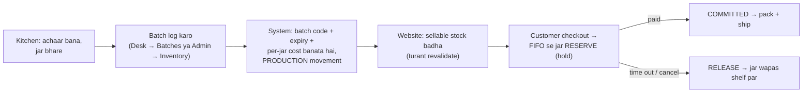

# 03 — Inventory: batches, stock, expiry, FIFO aur checkout hold

> Index: [README.md](README.md) · Pichla: [02 — Product listing](02-product-listing-catalog.md) · Agla: [04 — Customer journey](04-customer-journey-storefront.md)

Is system me **stock product par nahi, batch par hota hai.** Kitchen me jab bhi achaar bane aur jar bhare jaayein, ek **batch** log hota hai (kitne jar, kul kharcha, kab bana). Website par jo "In stock / Only N jars left / Sold out" dikhta hai, woh in batches ke **sellable** jars ka total hai.

---

## 1. Kaun kya kar sakta hai?

| Kaam                                | ADMIN                                             | KITCHEN_PARTNER                                                              |
| :---------------------------------- | :------------------------------------------------ | :--------------------------------------------------------------------------- |
| Batch log karna                     | Haan, kisi bhi kitchen ka (Admin → **Inventory** `/batches`) | Haan, **sirf apne kitchen** ka (Desk app → **Batches** `/desk/batches`) |
| Stock adjust (Wastage / Correction) | Haan (`/batches` → **Adjust**)                     | API allow karti hai (apna kitchen, D-49 c), **lekin Desk app me Adjust button nahi hai** — practically admin karega |
| Ledger dekhna, notes edit           | Haan                                              | Desk me sirf "My stock" list                                                 |
| Expiry alerts                       | Haan (Inventory → **Expiry alerts** tab)          | Nahi                                                                         |

Permission: `batches:manage` = ADMIN + KITCHEN_PARTNER, location-scoped ([`packages/shared/src/auth/permissions.ts`](../packages/shared/src/auth/permissions.ts)). Partner ko kis kitchen se joda gaya hai — file [01](01-setup-admin-partner-kitchen.md).

> **Pehle product me "Shelf life" bharna zaroori hai.** Iske bina woh product batch form me grey/disabled dikhta hai: "Shelf life not set — ask the admin to add it". Draft product ke liye bhi batch log ho sakta hai (option me "· draft" likha aata hai).

---

## 2. Batch log karna

### 2.1 Admin side — Inventory page (`/batches`)

Menu: **"Catalog & stock" → Inventory**. Source: [`BatchesListPage.tsx`](../apps/admin/src/modules/inventory/pages/BatchesListPage.tsx), form: [`CreateBatchModal.tsx`](../apps/admin/src/modules/inventory/components/CreateBatchModal.tsx)

1. Upar right button **"Log batch"** dabao → dialog **"Log a new batch"** ("Batch code, expiry and per-jar cost are worked out for you.").
2. Fields:

| Field (label)  | Zaroori?                            | Rule                                                                                       |
| :------------- | :---------------------------------- | :----------------------------------------------------------------------------------------- |
| **Product**    | Haan                                | Radio cards — `<title>` + `SKU · weight`. Ek hi loggable product ho toh auto-select         |
| **Jars**       | Haan                                | Whole number, 1 se **10,000** tak ("At most 10000 jars per batch")                         |
| **Total cost** | Haan                                | Poore batch ka kharcha ₹ me (e.g. `6000`). DB me **paise** (`600000`)                      |
| **Made on**    | Optional ("More options")           | Default **aaj (IST)**. Future date nahi ("Can’t be in the future")                          |
| **Kitchen**    | Sirf jab 1 se zyada active kitchen ho | Dropdown `<name> · <city>`                                                                |
| **Notes**      | Optional                            | Max 500, e.g. "Extra garlic in this lot"                                                   |

3. Form ke andar live preview: **Per jar** (₹), **Expires** (date), **Batch code** (e.g. `PK-2610-CHK250-··`).
4. **"Log batch"** dabao → toast **"Batch `PK-2610-CHK250-01` logged"** — "`50` jars of `<title>` · expires `<date>`".

### 2.2 Kitchen partner side — Desk app (`/desk/batches`)

Source: [`BatchLoggerPage.tsx`](../apps/admin/src/modules/packing-desk/pages/BatchLoggerPage.tsx), [`BatchLoggerForm.tsx`](../apps/admin/src/modules/packing-desk/components/BatchLoggerForm.tsx), labels: [`apps/admin/src/i18n/en/desk.json`](../apps/admin/src/i18n/en/desk.json) / [`hi/desk.json`](../apps/admin/src/i18n/hi/desk.json)

Desk app Hindi/English dono me hai. Tabs: **New batch / My stock** (Hindi: **Naya batch / Mera stock**).

| English label              | Hindi label               |
| :------------------------- | :------------------------ |
| Which pickle?              | Kaunsa achaar?            |
| Jars made                  | Kitne jar bane            |
| Total cost of this batch   | Is batch ka kul kharcha   |
| More: date, notes          | Aur: tareekh, note        |
| Made on                    | Kab bana                  |
| **Save batch**             | **Batch save karein**     |

Save hone par screen: **"Batch saved"** + bada batch code + **"Stamp this batch code on every jar"** ("Har jar par ye batch code stamp karein"), buttons **Copy code**, **Log another batch**, **See my stock**.

> Offline me batch log **nahi** hota: "No internet — nothing was saved. Try again when online." (Desk ka offline outbox sirf packing ke liye hai — file [05](05-order-fulfilment-admin-partner.md).)

### 2.3 System khud kya karta hai (ek hi DB transaction)

Source: [`apps/backend/src/modules/inventory/inventory.service.ts`](../apps/backend/src/modules/inventory/inventory.service.ts) → `createBatch()`

1. Kitchen check — partner sirf apna kitchen (`FORBIDDEN` "You can only log batches for your own kitchen."). Kitchen inactive ho toh error.
2. Product me shelf life nahi → error "Add the lab-tested shelf life to this product before logging batches."
3. **Expiry = Made on + product ka Shelf life (din).** Agar batch already expired ban raha ho → "This batch would already be expired."
4. **Batch code** server banata hai (D-42): `PK-<YYMM>-<SKU>-<seq>` — e.g. Oct 2026 me CHK250 ka pehla batch = `PK-2610-CHK250-01` ([`packages/shared/src/catalog/batch-code.ts`](../packages/shared/src/catalog/batch-code.ts)). Seq har product har mahine 01 se.
5. **Cost per jar** = total cost ÷ jars (DB generated column). Yeh settlement/profit me use hota hai — file [07](07-money-settlements-reports.md).
6. Stock ledger me **PRODUCTION** movement (+jars), audit `BATCH_CREATE`.
7. COMMIT ke baad storefront revalidate → website par stock turant badhta hai.

---

## 3. Shelf status: FRESH / AGING / NOT_SELLABLE / EXPIRED

Rule (D-24): batch tabhi bikega jab **expiry tak bache din ≥ `min_remaining_shelf_days` + `transit_buffer_days`** (default **45 + 7 = 52 din** — "sellable buffer"). Dono settings admin **Settings** page se badal sakte ho ([`packages/shared/src/settings/schemas.ts`](../packages/shared/src/settings/schemas.ts), defaults [`0001_foundation.sql`](../packages/database/migrations/0001_foundation.sql)).

Source: [`packages/shared/src/catalog/shelf-life.ts`](../packages/shared/src/catalog/shelf-life.ts), labels [`batchMeta.ts`](../apps/admin/src/modules/inventory/components/batchMeta.ts)

| Status         | Admin label     | Desk (Hindi)       | Kab                                         | Website par bikega? |
| :------------- | :-------------- | :----------------- | :------------------------------------------ | :------------------ |
| `FRESH`        | **Fresh**       | Taaza              | Bache din ≥ buffer + 30                     | Haan                |
| `AGING`        | **Sell first**  | Pehle bechein      | buffer ≤ bache din < buffer + 30            | Haan (pehle yahi jaata hai) |
| `NOT_SELLABLE` | **Not sellable**| Bikne layak nahi   | 0 < bache din < buffer                      | **Nahi** (website se chhupa) |
| `EXPIRED`      | **Expired**     | Expire ho gaya     | Bache din ≤ 0                               | **Nahi** — "log as wastage" |

**Example (default buffer 52 din):** shelf life 180 din, batch 1 Jan ko bana → expiry 30 Jun. 9 Apr tak FRESH (≥ 82 din bache), 10 Apr–9 May "Sell first", 10 May se "Not sellable" (website se hat gaya), 30 Jun se Expired.

"Aaj" hamesha **IST calendar day** se gina jaata hai (D-49 b).

---

## 4. Inventory page — kya kya dikhta hai (Admin)

### KPI cards

| Card               | Matlab                                                       |
| :----------------- | :----------------------------------------------------------- |
| **Active batches** | Jinme jars bache hain                                        |
| **Sellable jars**  | Bikne layak jars; hint "≥ 52 days of shelf life"             |
| **Sell first**     | AGING jars                                                   |
| **Not sellable**   | NOT_SELLABLE + expired; hint "`N` expired — log as wastage"  |

### Tabs: **Batches** / **Expiry alerts**

- **Batches** table (oldest expiry pehle — "pack from the top of the list"): **Batch · Kitchen** (multi-kitchen par) **· Made / Expires · Shelf status · Jars left · Cost / jar** + buttons **Ledger** aur **Adjust**.
- Filters ([`BatchFilters.tsx`](../apps/admin/src/modules/inventory/components/BatchFilters.tsx)): product ("All products"), status ("Any status"), switch **"Show empty batches"** (0 jar wale bhi).
- Row/Ledger dabane par side sheet: movements, **notes edit** ("Notes saved"), **Full ledger** aur **Adjust**. (Batch me sirf notes edit hote hain; jars galat ho toh **Adjust** karo.)
- **Expiry alerts** tab ([`ExpiryAlertsTable.tsx`](../apps/admin/src/modules/inventory/components/ExpiryAlertsTable.tsx)): woh batches jo **agle 14 din me "Not sellable"** ho jaayenge (`GET /api/v1/admin/inventory/expiry-alerts`). Columns: **Batch · Kitchen · Jars left · Sell until · Expires · Window** + **Ledger**. Khaali ho toh "Nothing close to expiry".
  - **Kya karna hai:** in batches ko promote karo / pehle becho; "Sell until" ke baad website khud hata degi.
- Dashboard par bhi **"Sellable stock"** card me "`N` batches expire in 30 days" dikhta hai (file [07](07-money-settlements-reports.md)).

---

## 5. Stock adjust karna (Wastage / Correction)

Source: [`AdjustStockDialog.tsx`](../apps/admin/src/modules/inventory/components/AdjustStockDialog.tsx)

1. Batch row par **Adjust** → dialog **"Adjust stock"**.
2. **"What happened?"** chuno:

| Option           | Hint                           | Ledger type   | Stock      |
| :--------------- | :----------------------------- | :------------ | :--------- |
| **Wastage**      | Broken, leaked or spoiled jars | `WASTAGE`     | − jars     |
| **Correct down** | Fewer jars than recorded       | `ADJUSTMENT`  | − jars     |
| **Correct up**   | More jars than recorded        | `ADJUSTMENT`  | + jars     |

3. **Jars to remove / Jars to add** + "Now → After" preview.
4. **Reason** (zaroori, min 3 akshar, "Kept in the stock ledger for audits."). Wastage ke quick chips: **Broken jar · Seal failed / leaked · Spoiled · Tasting sample**.
5. Button **"Write off jars"** (wastage) / **"Save correction"**. Toast: "`N` jars written off" / "Stock corrected".

**System rules:** stock 0 se neeche nahi ja sakta ("Only `N` jars are left in this batch.") aur batch ke original jars se upar nahi ("A batch can't hold more than the `N` jars it was made with."). Row lock + movement + audit `STOCK_ADJUST`, sab ek transaction me; phir website revalidate.

> **Expired batch ke jars** apne aap 0 nahi hote — admin ko **Wastage** se write-off karna hai (UI hint: "Past expiry — log as wastage").

---

## 6. Stock ledger page (`/batches/<id>/ledger`)

Source: [`StockLedgerPage.tsx`](../apps/admin/src/modules/inventory/pages/StockLedgerPage.tsx)

- Title **"Ledger · `<batch code>`"**, product · kitchen · made date · shelf status.
- KPIs: **Jars left · Sold / reserved · Wastage · Corrections**.
- Movements (newest first), filter by type. Har row me type, ±qty, **balance after**, reason, order (agar order se juda), kisne kiya.

| Movement type | Label (admin)       | Kab banta hai                                    |
| :------------ | :------------------ | :----------------------------------------------- |
| `PRODUCTION`  | Produced            | Batch log hua                                    |
| `RESERVE`     | Reserved for order  | Checkout par order bana (ya late payment re-reserve) |
| `RELEASE`     | Released back       | Hold expire hua / order cancel hua (jar kitchen se nikla nahi) |
| `ADJUSTMENT`  | Correction          | Correct up / down                                |
| `WASTAGE`     | Wastage             | Write-off                                        |

Ledger **append-only** hai — kuch delete nahi hota. Mismatch ka runbook: [`docs/runbooks/stock-ledger-mismatch.md`](../docs/runbooks/stock-ledger-mismatch.md).

---

## 7. Checkout par stock hold (reservation) aur FIFO

Detail: [`architecture/07-order-state-machine.md`](../architecture/07-order-state-machine.md) §3–4.

### System khud kya karta hai

| Event                                                      | Stock par asar                                                                                         |
| :--------------------------------------------------------- | :----------------------------------------------------------------------------------------------------- |
| Cart me daala / cart quote                                 | **Kuch nahi** — sirf check. Cart browser (localStorage) me hai                                          |
| Checkout → order bana (`PENDING_PAYMENT`)                  | Jars **RESERVE** (batch se minus), hold **`reservation_ttl_minutes`** (default **15 min**, Settings me 5–60) |
| Payment success (`CONFIRMED`)                              | Allocation `COMMITTED` — stock me aur badlav nahi                                                       |
| 15 min me pay nahi kiya                                    | Har minute chalne wala sweeper (`EXPIRE_RESERVATIONS`) order ko `EXPIRED` karta hai aur jars **RELEASE** ([`jobs/sweepers.ts`](../apps/backend/src/jobs/sweepers.ts)). Pehle Razorpay se poochta hai ki payment to nahi hua |
| Expire ke baad payment aa gaya (late payment)              | Dobara reserve try; stock nahi mila → order `CANCELLED` + **auto refund** (`LATE_PAYMENT_STOCKOUT`) — file [06](06-exceptions-refunds-ndr-rto.md) |
| Cancel (CONFIRMED / AWAITING_PACKING / PACKED / PICKUP_SCHEDULED se) | Jars **RELEASE** — wapas shelf par (kitchen se nikle hi nahi)                                |
| RTO wapas aaya (`RTO_DELIVERED`)                           | **Restock nahi** (food safety, D-31) aur koi movement nahi (D-53 f)                                     |

**FIFO (D-23):** reserve hamesha **sabse pehle expire hone wale sellable batch** se (`ORDER BY expiry_date, manufactured_at`), zaroorat ho toh **kai batches me split**. Isliye PDP par "Ships from batch" wahi batch dikhata hai jo agla order lega. Packing ke time partner ko order card par batch code dikhta hai (`{batch} × {qty}`) aur checklist me "Correct batch jar" tick karna hota hai — file [05](05-order-fulfilment-admin-partner.md).

Agar beech me jars khatam ho gaye → customer ko "Some jars just sold out." (`OUT_OF_STOCK`) aur order nahi banta.

### Customer side (website par kya dikhega)

- Product card / PDP: **In stock / Only `N` jars left / Sold out** — sirf **sellable** jars se (NOT_SELLABLE / EXPIRED kabhi nahi gine jaate). Rule file [02](02-product-listing-catalog.md) §5.
- Checkout ke baad payment ke liye hold ka time limited hai; expire hone par order page "expired" dikhata hai — file [04](04-customer-journey-storefront.md).

### Website kab update hoti hai

| Badlav                                             | Kab                                                       |
| :------------------------------------------------- | :-------------------------------------------------------- |
| Batch log / adjust                                 | Turant (revalidate)                                       |
| Order reserve / release / sweeper                  | Product pages par max ~5 min (fallback cache); cart quote + checkout hamesha live |

---

## 8. Abhi system me nahi hai (v2 / pending)

| Cheez                                                         | Status / reference                                                                                                         |
| :------------------------------------------------------------ | :------------------------------------------------------------------------------------------------------------------------- |
| Expiry / low-stock **WhatsApp/push alert** admin ko           | **Nahi bana.** Phase 3 file ne ise "Phase 8" ko diya tha ([`Phases/phase-03-product-catalog-inventory.md`](../Phases/phase-03-product-catalog-inventory.md) line ~76), par Phase 8 me nahi hai. Abhi sirf Inventory → Expiry alerts tab + dashboard card |
| Expired jars ka auto write-off                                | Nahi — manual Wastage                                                                                                      |
| Desk app me stock adjust                                      | Nahi — admin `/batches` se                                                                                                 |
| Batch edit (jars / cost / date)                               | Nahi — sirf notes; jars galat ho toh Adjust. Cost galat ho toh koi UI nahi                                                 |
| Batch delete                                                  | Nahi (ledger append-only)                                                                                                  |
| Real shelf life (NABL lab) per product                        | Pending — `requirement/pending-requirements.md` **B-5**; min shelf days FSSAI se confirm (D-24 PROPOSED)                    |
| Partner 50-jar entry < 30 sec timed run                       | Pending **I-6**                                                                                                            |

Puri list: [`requirement/pending-requirements.md`](../requirement/pending-requirements.md).

---

Aage: [04 — Customer journey](04-customer-journey-storefront.md) · Exceptions (late payment, RTO): [06](06-exceptions-refunds-ndr-rto.md) · Test script: [09](09-end-to-end-test-checklist.md)
