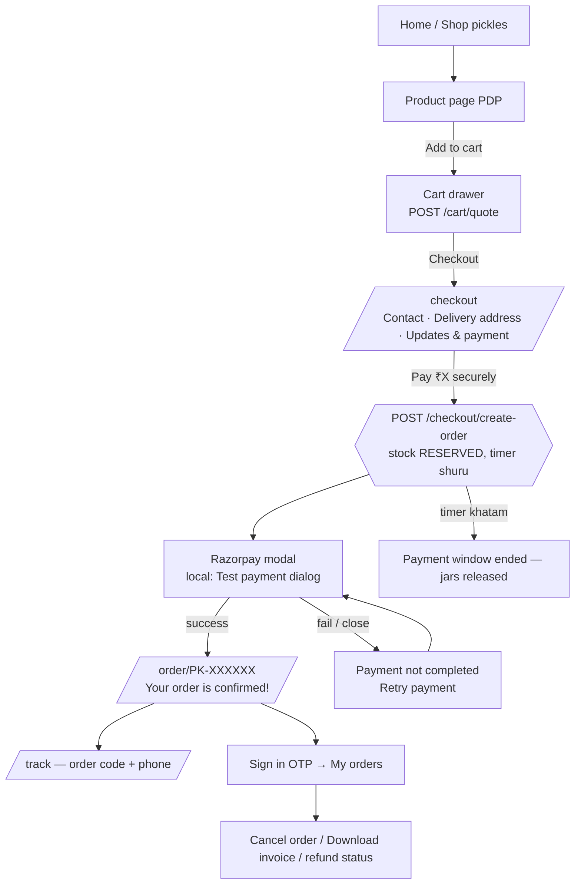

# 04 — Customer Journey (Storefront) — website par customer kya dekhta aur karta hai

> Yeh file customer ki taraf se poora safar batati hai: website kholne se le kar order deliver / cancel / refund hone tak.
> Har button, field aur message ka text **code se copy kiya gaya hai** (storefront me alag i18n file nahi hai — saare strings components me hi likhe hain, English me).
> Paise UI me ₹ me dikhte hain, lekin database / API me hamesha **integer paise** me store hote hain (D-26).
>
> Related files: [README](README.md) · [01 Setup](01-setup-admin-partner-kitchen.md) · [02 Product listing](02-product-listing-catalog.md) · [03 Inventory](03-inventory-batches-stock.md) · [05 Fulfilment](05-order-fulfilment-admin-partner.md) · [06 Exceptions](06-exceptions-refunds-ndr-rto.md) · [08 Notifications](08-notifications-alerts-monitoring.md) · [09 Test checklist](09-end-to-end-test-checklist.md)

---

## 0. Ek nazar me (overview)

| Customer ka step               | URL                                                     | Source                                                                                       |
| :----------------------------- | :------------------------------------------------------ | :------------------------------------------------------------------------------------------- |
| Home                           | `/`                                                     | [`app/(shop)/(home)/page.tsx`](<../apps/storefront/src/app/(shop)/(home)/page.tsx>)          |
| Products list                  | `/products`                                             | [`app/(shop)/products/(list)/page.tsx`](<../apps/storefront/src/app/(shop)/products/(list)/page.tsx>) |
| Product page (PDP)             | `/products/<slug>`                                      | [`modules/catalog/components/ProductDetailView.tsx`](../apps/storefront/src/modules/catalog/components/ProductDetailView.tsx) |
| Cart drawer (har page par)     | — (header ka bag icon)                                  | [`modules/cart/components/CartDrawer.tsx`](../apps/storefront/src/modules/cart/components/CartDrawer.tsx) |
| Checkout                       | `/checkout`                                             | [`modules/checkout/components/CheckoutView.tsx`](../apps/storefront/src/modules/checkout/components/CheckoutView.tsx) |
| Order status page              | `/order/<orderCode>`                                    | [`modules/orders/components/OrderStatusView.tsx`](../apps/storefront/src/modules/orders/components/OrderStatusView.tsx) |
| Track (bina login)             | `/track` (ya `/track?code=PK-XXXXXX`)                   | [`modules/tracking/components/TrackView.tsx`](../apps/storefront/src/modules/tracking/components/TrackView.tsx) |
| My orders (login ke baad)      | `/account/orders`, `/account/orders/<orderCode>`        | [`modules/orders/components/MyOrdersView.tsx`](../apps/storefront/src/modules/orders/components/MyOrdersView.tsx) |
| Content pages                  | `/about`, `/faq`, `/contact`                            | [`modules/content`](../apps/storefront/src/modules/content)                                  |
| Legal pages                    | `/privacy-policy`, `/terms`, `/refund-cancellation`, `/shipping-policy`, `/grievance` | [`app/(legal)`](<../apps/storefront/src/app/(legal)>)     |

Header menu (`config/navigation.ts`): **Shop pickles**, **Our story**, **FAQ**, **Contact** + account button (**Sign in**) + cart bag.
Footer: **Shop**, **Policies** (Privacy policy · Terms of service · Refund & cancellation · Shipping policy · Grievance redressal), **Customer care** (**Track your order**, phone / email / WhatsApp agar env me set hai) aur **Cookie preferences** button.

---

## 1. Website pehli baar kholna — cookie / consent banner

### Customer side (website par kya dikhega)

- Neeche ek banner: **"Your privacy, your choice"** — _"We use essential storage to run your cart. With your permission we'd also use analytics and marketing cookies (Google Analytics, Meta)…"_
- Teen buttons: **Accept all**, **Reject all**, **Choose cookies**. (Accept aur Reject barabar weight ke — DPDP, koi dark pattern nahi.)
- **Choose cookies** → dialog **"Cookie preferences"** me 3 rows:
  - **Strictly necessary** — cart, consent choice, theme, last-checked pincode (hamesha ON).
  - **Analytics** — Google Analytics 4.
  - **Marketing** — Meta Pixel + Conversions API.
  - Buttons: **Reject all**, **Save choices**, **Accept all**.
- Baad me choice badalni ho toh footer me **Cookie preferences** button.

### System khud kya karta hai

- Jab tak choice nahi hoti, GA4 / Meta script load hi nahi hote ([`modules/analytics`](../apps/storefront/src/modules/analytics)).
- Banner modal nahi hai — shop use karte rehna possible hai.

---

## 2. Browse — Home, Products list, Product page

### Customer side

- **Home (`/`)**: hero _"Taste the mountains, one small batch at a time."_, "Current batch" info, sections **Three pillars of purity**, origin story, **Pickles from the hills** (featured products). Stock na ho toh _"The next batch is curing"_ / _"Our pantry is taking a breather"_.
- **Products (`/products`)**: heading **"Himachali non-veg pickles"**, saare published products ka grid (har card par non-veg mark, price, stock badge).
  - Search / category filter / sort **abhi system me nahi hai** (listing bas groups dikhati hai). Pending list me bhi nahi likha — v2 idea.
- **Product page (`/products/<slug>`)**: photos, **Jar size** chooser (agar 250 g / 500 g jaise variants hain), price (MRP, _"Inclusive of all taxes"_), stock badge, quantity stepper, **Add to cart**, pincode checker, aur sections _About this pickle, Ingredients, Allergens, Shelf life & storage, Nutrition (per 100 g), Label information_, batch ka **Manufactured / Best before**.
  - Product ke fields admin kaise bharta hai — dekho [02 Product listing](02-product-listing-catalog.md).

**Stock badge ke text** ([`modules/catalog/lib/format.ts`](../apps/storefront/src/modules/catalog/lib/format.ts)):

| Badge       | Text jo dikhta hai                       | Kab                                                                                      |
| :---------- | :--------------------------------------- | :--------------------------------------------------------------------------------------- |
| `IN_STOCK`  | **In stock**                             | sellable stock > `low_stock_threshold`                                                   |
| `LOW_STOCK` | **Only 1 jar left** / **Only N jars left** | sellable stock ≤ `low_stock_threshold` (setting)                                       |
| `SOLD_OUT`  | **Sold out** (Add to cart button disabled, text bhi "Sold out") | sellable stock = 0 (sirf woh batches gine jaate hain jinki expiry ≥ aaj + `min_remaining_shelf_days` + `transit_buffer_days` — [03 Inventory](03-inventory-batches-stock.md)) |

**Pincode checker** (PDP par, label **"Check delivery to your pincode"**, placeholder `6-digit pincode`):

| Result                      | Message                                                                                         |
| :-------------------------- | :---------------------------------------------------------------------------------------------- |
| Galat pincode               | _Enter a valid 6-digit pincode_                                                                 |
| Check ho raha               | _Checking delivery…_                                                                            |
| Deliver hota hai            | _We deliver to 175101_ + _Usually 3–5 days after dispatch_ (courier ETD se)                     |
| Deliver nahi hota           | _Sorry, we can't deliver to 175101 yet._ _Try a nearby pincode (office or family address)._      |
| Courier API down (`null`)   | _We'll confirm delivery to 175101 at checkout_ — _you can still order._ (order block nahi hota) |

> Local / dev: serviceability **Shiprocket sandbox** se aati hai (`SHIPPING_PROVIDER=sandbox`), production me real Shiprocket. Result Redis me cache hota hai — serviceable 24 h, not-serviceable 6 h ([`shipping.service.ts`](../apps/backend/src/modules/shipping/shipping.service.ts)).

### System khud kya karta hai

- Product / stock pages server par cache hote hain; admin jab product edit / publish ya stock change karta hai toh backend `POST /api/revalidate` (tag `products`) bhejta hai, aur fallback ke liye bhi time-based revalidate hai ([`lib/server-api.ts`](../apps/storefront/src/lib/server-api.ts), [`app/api/revalidate/route.ts`](../apps/storefront/src/app/api/revalidate/route.ts)).

---

## 3. Add to cart aur Cart drawer

### Customer side

1. PDP par quantity choose karo → **Add to cart** dabao. Button thodi der ke liye **Added ✓** ban jata hai, header ka bag "pulse" karta hai, aur neeche _"In your cart."_ + link **View cart & checkout**.
   - Mobile par neeche ek sticky bar aata hai jisme chhota button **Add** hota hai.
2. Header ke bag icon se **cart drawer** khulta hai (mobile par neeche se sheet, desktop par right side drawer):
   - Title **Your cart** + "N jars"; subtitle _"Prices and stock are checked live with our kitchen."_
   - Har line: photo, non-veg mark, naam, `250 g jar · ₹X each`, quantity stepper, delete (trash) button.
   - Delete karne par _"Removed …"_ + **Undo** (6 second tak).
   - Free delivery bar (sirf jab threshold set ho): _"Add ₹X more for free delivery"_ → _"You've unlocked free delivery"_.
   - Neeche **Subtotal**, **Shipping** (`Free` ya ₹), **Total**, _"MRP inclusive of all taxes. Shipping is confirmed for your pincode at checkout."_
   - Button **Checkout →** aur _"Prepaid orders · UPI, cards & netbanking"_.
   - Khali cart: _"Your cart is empty"_ + **Shop pickles** button.
   - Server se price na mile: _"Couldn't load live prices"_ + **Try again**.

**Line par notices** (server quote ke hisaab se, [`useCartQuote.ts`](../apps/storefront/src/modules/cart/hooks/useCartQuote.ts)):

| Server issue   | Notice                                                                 | Customer ko kya karna hai                          |
| :------------- | :--------------------------------------------------------------------- | :------------------------------------------------- |
| `QTY_REDUCED`  | _Only 1 jar left — quantity updated_ / _Only N jars available — quantity updated_ | Kuch nahi — quantity apne aap kam ho gayi |
| `OUT_OF_STOCK` | _Sold out — this batch has run out_                                    | Item hatao (**Remove to continue**); Checkout disabled + _"Remove unavailable items to continue."_ |
| `INACTIVE`     | _No longer available_ (product unpublish ho gaya)                      | Same — item hatao                                  |

### System khud kya karta hai

- Cart **sirf browser me** (localStorage key `pk-cart-v1`) — sirf `{productId, quantity}` save hota hai, price kabhi nahi (D-15). Max 10 per item jab tak server ka `max_qty_per_item` na aaye.
- Drawer khulte hi aur har change par (350 ms debounce) **`POST /api/v1/cart/quote`** chalta hai ([`cart.service.ts`](../apps/backend/src/modules/cart/cart.service.ts)):
  - quantity = `min(maangi gayi, sellable stock, max_qty_per_item)`
  - **Shipping fee rule:**
    - subtotal = 0 → shipping 0
    - `free_shipping_threshold_paise` set hai aur subtotal ≥ threshold → **Free**
    - warna `flat_shipping_fee_paise` (null ho toh 0)
  - Abhi dono settings migration me `null` hain (Q-03 open, D-50) → **har order par ₹0 shipping aur free-delivery bar chhupa rehta hai**. Admin Settings page se dono set karte hi bina deploy ke chalu (dekho [01 Setup](01-setup-admin-partner-kitchen.md)).
  - Shipping fee pincode par depend **nahi** karti — flat hai.
  - Discount hamesha 0 — **coupons abhi system me nahi hai (v2)**.

---

## 4. Checkout page (`/checkout`)

Ek hi page, 3 numbered sections + right side **order summary**. Guest checkout allowed hai — login zaroori nahi (D-18).

### 4.1 Form fields (exact labels)

| Section                    | Field (label)                                            | Required? | Validation message                                                         |
| :------------------------- | :------------------------------------------------------- | :-------- | :------------------------------------------------------------------------- |
| **1 Contact**              | **Full name**                                            | Haan      | _Enter your full name_                                                     |
|                            | **Mobile number** (+91, 10 digit) — hint _"For courier updates and to look up your order."_ | Haan | _Enter your 10-digit mobile number_ / _Enter a valid Indian mobile number_ |
|                            | **Email** (optional) — hint _"For your tax invoice."_    | Nahi      | _Enter a valid email_                                                      |
| **2 Delivery address**     | **Pincode** (placeholder `175101`) — city/state auto-fill | Haan     | _Enter a valid 6-digit pincode_ / _Sorry, we don't deliver to this pincode yet._ |
|                            | **House no., building, street**                          | Haan      | _Enter house no. and street_                                               |
|                            | **Area / locality**                                      | Nahi      | —                                                                          |
|                            | **Landmark**                                             | Nahi      | —                                                                          |
|                            | **City** (auto-filled tag "Auto-filled")                 | Haan      | _Enter city_                                                               |
|                            | **State**                                                | Haan      | _Enter state_                                                              |
|                            | **Save this address for next time** (sirf signed-in)     | —         | —                                                                          |
| **3 Updates & payment**    | ☐ **Send me updates about this order by SMS and email \*** | Haan (pre-ticked nahi) | _Please allow order updates — we need them to deliver your jars_ |
|                            | ☐ **Also send them on WhatsApp** — _"Optional. Without it we use SMS only. No marketing messages either way."_ | Nahi (default OFF, DPDP) | — |

- Pincode type karte hi: India Post directory (`api.postalpincode.in`) se city/state bhar jaate hain (fail ho toh customer khud likhe), aur serviceability check: _"Delivers in 3–5 days after dispatch"_ / _"We deliver here"_. Courier API down ho toh: _"Couldn't confirm delivery to this pincode right now — we'll confirm after you order. If we can't deliver, you get a full refund."_ (yeh promise abhi automatic nahi hai — dekho §11 aur pending **R-5**).
- Signed-in customer ko upar **Saved addresses** (radio cards, "Default" badge) dikhte hain; default address apne aap bhar jata hai. Guest ko Contact section me **Sign in for saved addresses** (mobile par "Sign in") button.
- Payment box: _"Prepaid · secure payment by Razorpay"_ — chips **UPI — GPay, PhonePe, Paytm**, **Cards**, **Netbanking**; _"You choose the method in the next step. Your jars are reserved for 15 minutes while you pay."_
- **COD nahi hai** (D-25, setting `cod_enabled` sirf `false` ho sakti hai) — COD v2.
- Neeche legal line: _"By paying you agree to our Terms, Refund & Shipping policies."_

### 4.2 Pay button ke states

| Kab                                 | Button text                                  |
| :---------------------------------- | :------------------------------------------- |
| Normal                              | **Pay ₹X securely** (amount na ho toh "Pay securely") |
| Order ban raha / stock reserve      | _Reserving your jars…_                       |
| Razorpay load ho raha               | _Opening payment…_                           |
| Payment window khula                | _Complete payment in the window_             |
| Verify ho raha                      | _Confirming payment…_                        |

Order banne ke baad upar **"Jars reserved for MM:SS"** timer dikhta hai (last 2 minute me warning colour), aur form **"Details locked to order PK-XXXXXX"** ho jata hai.

### 4.3 Checkout par aane wale errors

| Error (API code)          | Customer ko kya dikhta hai                                                                               |
| :------------------------ | :------------------------------------------------------------------------------------------------------- |
| `OUT_OF_STOCK`            | **Some jars just sold out** — _"Another order took the last jars from this batch. Check your order summary, then pay again."_ (line par "Just sold out") |
| `PAYMENT_INIT_FAILED`     | **We couldn't start the payment** — _"Nothing was charged and your jars were released. Please try again."_ |
| `RATE_LIMITED`            | **Too many attempts** — _"Please wait N min and try again."_ (5 create-order / 10 min per phone)         |
| `VALIDATION_ERROR`        | **Please check your details** + field ke neeche message                                                 |
| Network                   | **You seem to be offline** — _"Your details are still here. Please try again."_                         |

### System khud kya karta hai (Pay dabane par)

1. Browser **`POST /api/v1/checkout/create-order`** bhejta hai (`Idempotency-Key` ke saath — double tap = ek hi order) ([`checkout.service.ts`](../apps/backend/src/modules/checkout/checkout.service.ts)).
2. Server dobara cart quote karta hai (wahi price jo drawer me dikha), ek transaction me order `PENDING_PAYMENT` banata hai, order code `PK-` + 6 characters (jaise `PK-7KQ2M9`), aur stock **FIFO-by-expiry RESERVE** karta hai.
3. Reservation ka time = setting **`reservation_ttl_minutes`** (default **15**, range 5–60).
4. Transaction ke **baad** Razorpay order banta hai (D-30). Fail ho toh stock turant release.
5. Order code aur phone browser ke **sessionStorage** me rakha jata hai taaki `/order/<code>` page bina phone puche khul sake.

---

## 5. Payment — Razorpay (production) vs Test dialog (local)

### 5.1 Production / staging (`PAYMENT_GATEWAY=razorpay`)

- Razorpay Standard Checkout modal khulta hai — naam/phone/email prefill, theme colour site ke `--primary` token se, mobile par **UPI pehle** ("Pay using UPI"), modal ka `timeout` = reservation ka bacha hua time.
- Success → browser `POST /api/v1/payments/verify` (signature check) → `/order/<code>`.
- Razorpay webhook `payment.captured` bhi order confirm karta hai — browser band ho jaye tab bhi.
- Real keys abhi nahi lagi — pending **P-1…P-4** ([pending-requirements](../requirement/pending-requirements.md) §4).

### 5.2 Local / dev (`PAYMENT_GATEWAY=mock`, default) — Test payment dialog

Real Razorpay ki jagah ek dialog aata hai ([`MockPaymentDialog.tsx`](../apps/storefront/src/modules/checkout/components/MockPaymentDialog.tsx)):

- Badge **Test mode**, title **"Test payment (no real money)"**, order code + amount.
- 3 options:

| Button                        | Kya hota hai                                                                                                     |
| :---------------------------- | :--------------------------------------------------------------------------------------------------------------- |
| **Pay successfully**          | Payment sign + verify hota hai (jaise Razorpay success handler) → order page _"Your order is confirmed!"_; ~2 s baad mock webhook bhi aata hai |
| **Fail payment**              | Bank decline → checkout par **Payment not completed** + **Retry payment**                                       |
| **Pay, then close browser**   | Payment captured, lekin browser verify **nahi** karta — sirf webhook (≈2 s delay) order confirm karta hai. Order page pehle _"Confirming your payment…"_ dikhata hai |

- Dialog bina choose kiye band karna = "Payment not completed" state.
- Backend route: `POST /api/v1/dev/payments/simulate` ([`dev-payments.routes.ts`](../apps/backend/src/modules/dev-payments/dev-payments.routes.ts)). Production me `PAYMENT_GATEWAY=mock` env validation hi fail kar deta hai — yeh dialog live site par kabhi nahi aa sakta.

### 5.3 Payment fail / band kiya — checkout par

- **Payment not completed** — _"No money was taken. Your jars are still reserved for MM:SS — retry with UPI, a card or netbanking."_ Buttons **Retry payment** aur **Change details** (purana reservation release karke naya order).
- Razorpay script load na ho: **Payment couldn't continue** — _"The payment window didn't load. Check your connection (or turn off an ad blocker) and try again."_ + **Try again**.
- Signature reject (`INVALID_SIGNATURE`): _"We couldn't confirm this payment with the bank. If money was debited, it is refunded automatically — please contact us with your order code."_
- Timer khatam: **"Your jars were held for N minutes"** (N = Settings → Checkout stock hold, cart quote ka `reservationTtlMinutes`) — _"The payment window for PK-XXXXXX ended and the jars went back on the shelf. Nothing was charged — please start again."_ + **Start again**.

---

## 6. Order page (`/order/<orderCode>`)

Page har kuch second me status poll karta hai. Agar naya device / naya tab hai (sessionStorage me phone nahi) toh pehle **phone gate**: _"Enter the phone number used for this order"_, field **Mobile number**, button **Show my order** (galat ho toh _"We couldn't find this order with that number. Check both and try again."_). Signed-in owner aur admin ko phone nahi poocha jata.

| Order state                                      | Heading jo dikhta hai                                     | Aur kya                                                                                       |
| :----------------------------------------------- | :-------------------------------------------------------- | :-------------------------------------------------------------------------------------------- |
| `PENDING_PAYMENT`, pay kar chuka / webhook wait  | **Confirming your payment…**                              | _"We're waiting for your bank's final confirmation…"_; der lage toh _"This is taking longer than usual — that's okay."_ |
| `PENDING_PAYMENT`, abhi pay nahi kiya, time bacha | **Complete your payment**                                | Button **Pay ₹X securely** / fail ke baad **Retry payment ₹X**                                |
| `EXPIRED`                                        | **Payment window ended — jars released**                  | _"We held your jars for N minutes…Nothing was charged."_ (N order ke `reservationExpiresAt − createdAt` se) + _"Paid just now? If the bank confirms it, we'll still fulfil the order if jars are left — otherwise you get a full refund automatically."_ + **Shop again** |
| `CONFIRMED`                                      | **Your order is confirmed!**                              | Steps: _Order confirmed_ → _Packed fresh in our Himachal kitchen_ → _Handed to the courier_ → _Delivered_; WhatsApp opt-in ke hisaab se line; button **Track this order anytime** |
| Baaki active (`AWAITING_PACKING` … `DELIVERED`)  | **Order update: being packed / in transit / …**            | button **Track your parcel**                                                                  |
| `CANCELLED` (late payment stockout)              | **Paid after the jars ran out — full refund started**      | Refund notice                                                                                 |
| `CANCELLED` (baaki)                              | **Order cancelled**                                       | Refund notice                                                                                 |
| `RTO_IN_TRANSIT` / `RTO_DELIVERED` / `LOST`      | _Returning to us_ / _Returned to us_ / _Lost in transit_   | Refund notice                                                                                 |

Customer-facing status labels ([`lib/order-status.ts`](../apps/storefront/src/lib/order-status.ts)): Awaiting payment · Payment window ended · Confirmed · Being packed · Packed · Pickup scheduled · In transit · Out for delivery · Delivery attempt failed · Delivered · Returning to us · Returned to us · Cancelled · Lost in transit.

**Refund notice** (order page aur track page dono par):

| Refund status | Text                                                                                                               |
| :------------ | :----------------------------------------------------------------------------------------------------------------- |
| koi refund nahi, UNPAID | _Nothing was charged for this order._                                                                     |
| `PENDING`     | _Refund of ₹X started to your original payment method. It usually arrives within a few working days._ (`NEXT_PUBLIC_POLICY_REFUND_TIMELINE` set ho toh wahi) |
| `PROCESSED`   | _Refund of ₹X completed. Your bank may take a day or two to show it._                                               |
| `FAILED`      | _Your refund of ₹X hit a snag at the bank. We're retrying and our team has been alerted — no action needed from you._ |

**Items card ke neeche buttons:**

- **Download invoice** — jab invoice ban chuka ho (`invoiceAvailable`). 5 minute ka signed link khulta hai. Local par seller details set na hon toh PDF par watermark **"DRAFT - NOT A TAX INVOICE"** (pending **G-4**).
- **Cancel order** — sirf jab `canCancel` true (neeche §9).

### System khud kya karta hai

- Payment confirm hote hi: order `CONFIRMED` (07 state machine), stock `COMMITTED`, invoice job (`GENERATE_INVOICE`), Shiprocket booking, partner alert, customer message `order_confirmed`. Detail: [05 Fulfilment](05-order-fulfilment-admin-partner.md).
- Har minute ek sweeper unpaid orders jinka reservation khatam ho gaya unhe `EXPIRED` karke stock release karta hai ([`jobs/sweepers.ts`](../apps/backend/src/jobs/sweepers.ts)).
- Expiry ke baad payment aaye (late payment): stock bacha ho toh order confirm, warna `CANCELLED` + reason `LATE_PAYMENT_STOCKOUT` + auto refund. Detail: [06 Exceptions](06-exceptions-refunds-ndr-rto.md).

---

## 7. Sign in (OTP) — sirf mobile number se

Koi alag `/account/login` page nahi hai — header ka **Sign in** button (ya checkout ka "Sign in for saved addresses", ya `/account/orders` khulne par) ek **dialog** kholta hai ([`SignInDialog.tsx`](../apps/storefront/src/modules/account/components/SignInDialog.tsx)).

1. **Step 1 — "Sign in with your mobile number"** (_"Track your orders and check out faster next time."_): mobile number (India, +91) → **Send code** (_Sending code…_).
2. **Step 2 — "Enter your code"** (_"We sent a 6-digit code by SMS. It may take a few seconds to arrive."_): field **6-digit verification code** → **Verify and sign in**. Links **Resend code** (30 s baad) aur **Change number**.
3. Sign in ke baad header menu: _Signed in as +91…_, **My orders**, **Sign out**.

| Rule (D-21, [`auth.service.ts`](../apps/backend/src/modules/auth/auth.service.ts)) | Value |
| :--------------------- | :--------------------------------------------- |
| Code valid             | 5 minute                                       |
| Galat tries            | 5 (phir _"Too many wrong tries for this code. Please request a new one."_) |
| Resend gap             | 30 second                                      |
| Max sends              | 3 per 10 minute (phir _"Too many code requests…"_) |

> **Local / dev:** SMS nahi jata (`OTP_PROVIDER=mock`). OTP **API (backend) ke terminal / console me** print hota hai: `[DEV OTP] 3210 → 123456` (phone ke last 4 digit → code). Production me `mock` allowed nahi; MSG91 + DLT template chahiye (pending **B-11 / M-2**).

---

## 8. My orders (`/account/orders`)

### Customer side

- Login nahi hai toh: **Sign in to see your orders** — _"Use the mobile number you ordered with — orders placed as a guest show up too…"_
- List: **My orders** — har order card (code, date, status, total), 10 per page, pagination. Khali ho toh **No orders yet** + **Shop pickles**.
- Card dabao → `/account/orders/<orderCode>`: wahi timeline jo `/track` par hai (bina code/phone dale), items + **Subtotal / Shipping / Total paid**, **Download invoice**, **Cancel order** (agar allowed).
- Kisi aur ka order: **This order isn't in your account** + track link.

### System khud kya karta hai

- `GET /api/v1/me/orders` us phone ke **guest orders bhi** dikhata hai (phone OTP se verified hai) ([`tracking.routes.ts`](../apps/backend/src/modules/tracking/tracking.routes.ts)).
- Saved addresses: checkout par "Save this address for next time" se save hote hain (`/api/v1/me/addresses`). **Addresses manage karne ka alag page (`/account/addresses`) abhi system me nahi hai** — API me edit/delete hai lekin UI nahi (doc 03 me page likha hai).

---

## 9. Order cancel karna (customer)

- **Kab allowed:** sirf signed-in owner, aur status **`CONFIRMED` ya `AWAITING_PACKING`** (packing se pehle) — `CUSTOMER_CANCELLABLE` ([`orders.service.ts`](../apps/backend/src/modules/orders/orders.service.ts)). Guest (bina login) ko button nahi dikhta — use sign in karna hoga ya support se baat.
- Steps: **Cancel order** → dialog **"Cancel PK-XXXXXX?"** — _"Your jars go back to the batch and the full amount is refunded to your original payment method."_ → field **Reason** (khali ho toh _"Tell us why (a few words is fine)"_) → **Cancel order** ya **Keep my order**.
- Pack ho chuka ho: _"This order is already being packed and can no longer be cancelled here. Please contact us."_

**System:** stock wapas batch me (RESERVED + COMMITTED release), order `CANCELLED` (reason `CUSTOMER_CANCEL`), poora refund start, Shiprocket booking cancel job, message `order_cancelled` customer ko aur `order_cancelled_partner` partner ko. Admin cancel ke liye dekho [05](05-order-fulfilment-admin-partner.md) / [06](06-exceptions-refunds-ndr-rto.md).

---

## 10. Track page (`/track`) — bina login

### Customer side

- Heading **Track your order** — _"Follow your jars from our kitchen in the hills to your doorstep — no account needed."_
- Fields: **Order code** (placeholder `PK-7KQ2M9`) aur **Mobile number used at checkout** → button **Track order** (_Looking up…_). `?code=` link se sirf code bharta hai, phone hamesha type karna padta hai (D-39).
- Errors: _Enter your order code_ / _Order codes look like PK-7KQ2M9_ / _Enter a valid 10-digit Indian mobile number_; galat combo → **We couldn't find that order**; bahut tries → **Too many tries for now** (10 lookups / 10 min per IP).
- Result: status line (jaise _"Confirmed — your jars are being packed"_, _"On its way to <city>"_, _"Out for delivery in <city> today"_, _"The courier couldn't deliver today"_, _"Delivered in <city>"_), **Estimated delivery / Delivered on**, **Courier partner**, **Air waybill (AWB)** + copy button + courier link, journey timeline (_Order confirmed → Airtight packed & sealed → Handed to courier → In transit → Out for delivery → Delivered_, batch code ke saath), refund notice, aur help box **"Parcel ke baare me help chahiye?"** (WhatsApp link pre-filled message ke saath — `NEXT_PUBLIC_SELLER_WHATSAPP` set na ho toh contact page par bhejta hai, pending **M-5**).
- Pura address ya pura phone yahan kabhi nahi dikhta (privacy).

---

## 11. Customer ko messages kab milte hain (short)

Template names [`packages/shared/src/notifications/templates.ts`](../packages/shared/src/notifications/templates.ts) se. WhatsApp sirf opt-in par; "critical" messages ka SMS fallback hota hai. Detail: [08 Notifications](08-notifications-alerts-monitoring.md).

| Stage                        | Template                  | Critical (SMS fallback) |
| :--------------------------- | :------------------------ | :---------------------- |
| Payment confirm              | `order_confirmed`         | Haan                    |
| Courier ne utha liya         | `order_shipped`           | Nahi                    |
| Out for delivery             | `out_for_delivery`        | Haan                    |
| Delivered                    | `delivered_storage_tip`   | Nahi                    |
| Delivery fail (NDR)          | `delivery_attempt_failed` | Haan                    |
| Cancel                       | `order_cancelled`         | Haan                    |
| Refund ho gaya               | `refund_processed`        | Haan                    |

- Payment fail / order expire hone par koi message **nahi** jata (template hi nahi hai).
- **Local:** koi asli WhatsApp/SMS nahi jata — sab mock outbox me: `GET http://localhost:4000/api/v1/dev/messages` (API default port `4000`).

---

## 12. Content aur legal pages

- `/about` (Our story), `/faq`, `/contact`, aur 5 legal pages. Seller details (legal name, address, FSSAI no., GSTIN, phone, email, WhatsApp, grievance officer) storefront ke **`NEXT_PUBLIC_SELLER_*` env** se aate hain; khali ho toh page par **"Pending"** marker dikhta hai ([`config/site.ts`](../apps/storefront/src/config/site.ts)). Policy numbers (free shipping text, RTO refund rule, damage claim window, refund timeline) `NEXT_PUBLIC_POLICY_*` se.
- Asli values + lawyer review pending: **G-6, G-7** ([pending-requirements](../requirement/pending-requirements.md) §1).

---

## 13. Jo abhi system me nahi hai / dhyan dene wali baatein

| Kya                                                                                          | Status / reference                                                                                                   |
| :------------------------------------------------------------------------------------------- | :------------------------------------------------------------------------------------------------------------------- |
| COD (cash on delivery)                                                                       | v2 (D-25) — setting `cod_enabled` sirf `false`                                                                       |
| Coupons / discount                                                                           | v2 — quote me `discountPaise` hamesha 0                                                                              |
| Product search / filter / sort                                                               | Abhi nahi                                                                                                            |
| `/account/login` aur `/account/addresses` pages (doc 03 me likhe hain)                       | Nahi bane — login dialog se hota hai, address manage UI nahi                                                         |
| Checkout par alag "marketing opt-in" (doc 03 §3 me likha)                                    | Nahi hai — sirf order updates (required) + WhatsApp opt-in; marketing messages bheje hi nahi jaate                   |
| Shipping fee / free shipping threshold                                                       | Settings `null` → ₹0 shipping (Q-03 / D-50, pending **B-9**)                                                         |
| "If we can't deliver, you get a full refund" (checkout copy)                                 | Booking fail par refund **automatic nahi** — admin alert, admin cancel+refund karta hai (pending **R-5**)             |
| Server pincode block                                                                         | Non-serviceable pincode sirf browser par block hota hai; error code `PINCODE_NOT_SERVICEABLE` shared me hai lekin backend use throw nahi karta |
| ✅ Fixed: "15 minutes" text                                                                   | Ab checkout aur order page asli setting `reservation_ttl_minutes` dikhate hain |
| Real Razorpay, MSG91 SMS, WhatsApp                                                           | Local par mock; keys pending (**P-1…P-6, M-1, M-2**)                                                                 |
| Customer message language                                                                    | Sirf `CUSTOMER_MESSAGE_LANGUAGE` env (default `en`); checkout par choice nahi (**M-6**)                               |
