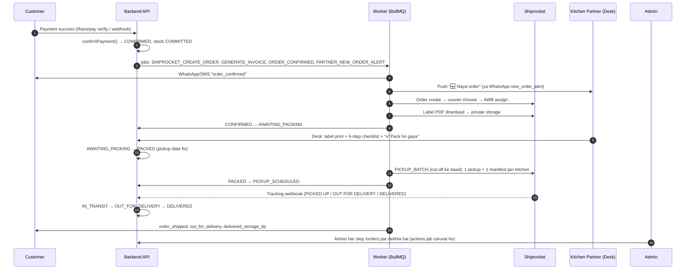

# 05 — Order Fulfilment: payment ke baad se delivery tak (Admin + Kitchen Partner)

Yeh file batati hai ki **customer ka payment confirm hone ke baad** order kaise kitchen tak pahunchta hai, partner kaise pack karta hai, courier kaise uthata hai aur delivery tak har step par **Admin side**, **Partner side**, **Customer side (website par kya dikhega)** aur **System khud kya karta hai**.

> Pichla step (customer checkout + payment): [04-customer-journey-storefront.md](04-customer-journey-storefront.md). Problems (NDR, RTO, refund, booking fail): [06-exceptions-refunds-ndr-rto.md](06-exceptions-refunds-ndr-rto.md). Saare messages: [08-notifications-alerts-monitoring.md](08-notifications-alerts-monitoring.md). Index: [README.md](README.md).

Money sab jagah ₹ me likha hai, par database me **integer paise** me store hota hai (₹1 = 100 paise).

---

## 0. Ek nazar me — poora flow



Order status ka poora diagram [README.md](README.md) me hai (source: [`packages/shared/src/order/transitions.ts`](../packages/shared/src/order/transitions.ts)).

| Stage | Order status | Kaun aage badhata hai |
| :-- | :-- | :-- |
| Payment confirm | `CONFIRMED` | Razorpay / customer verify (system) |
| AWB + label ready | `AWAITING_PACKING` | System (worker) |
| Partner ne pack kiya | `PACKED` | Kitchen Partner (ya Admin desk se) |
| Courier pickup book hua | `PICKUP_SCHEDULED` | System (`PICKUP_BATCH`) |
| Courier ne utha liya | `IN_TRANSIT` | Shiprocket tracking |
| Last-mile | `OUT_FOR_DELIVERY` | Shiprocket tracking |
| Deliver ho gaya | `DELIVERED` | Shiprocket tracking |

---

## 1. Stage 1 — Payment confirm hote hi (`CONFIRMED`)

### System khud kya karta hai

Code: [`apps/backend/src/modules/payments/payments.service.ts`](../apps/backend/src/modules/payments/payments.service.ts) (`confirmPayment`).

1. Ek hi DB transaction me: order `PENDING_PAYMENT → CONFIRMED`, `payment_status = PAID`, reserved stock **COMMITTED**.
2. Transaction commit hone ke **baad** (D-30) yeh 4 jobs queue me jaate hain (deterministic job id, isliye verify + webhook dono aaye toh bhi kaam ek hi baar hota hai):

| Job | Queue | Kya karta hai |
| :-- | :-- | :-- |
| `SHIPROCKET_CREATE_ORDER` | `orders` | Shiprocket me order + courier + AWB (Stage 2) |
| `GENERATE_INVOICE` | `documents` | GST tax invoice PDF number ke saath banata hai |
| `ORDER_CONFIRMED` | `notify` | Customer ko `order_confirmed` message |
| `PARTNER_NEW_ORDER_ALERT` | `notify` | Kitchen partner ko naye order ka alert |

**Invoice:** [`apps/backend/src/modules/orders/invoice.service.ts`](../apps/backend/src/modules/orders/invoice.service.ts). Agar Settings me `seller_details` (legal name, GSTIN, address) set nahi hai to production me invoice **nahi banega** (job fail); local/dev me **DRAFT invoice** ban jata hai. Settings ke liye dekho [01-setup-admin-partner-kitchen.md](01-setup-admin-partner-kitchen.md).

**Partner alert:** [`apps/backend/src/modules/notifications/notifications.service.ts`](../apps/backend/src/modules/notifications/notifications.service.ts) (`partnerNewOrderAlert`)

- Pehle us kitchen ke har active partner ke subscribed phone par **Web Push**: title `🆕 Naya order`, body `PK-XXXXXX — N jar`, tap karne par `/desk?order=PK-XXXXXX` khulta hai.
- Jis partner tak push nahi pahuncha (push ON nahi kiya, fail hua, ya server par VAPID keys set nahi) — use **WhatsApp** template `new_order_alert`: _"Naya order {{order_code}} — {{jars}} jar pack karne hain."_
- Roz **09:00 IST** `PARTNER_DAILY_DIGEST`: jis kitchen me packing baaki hai use `packing_digest` _"Aaj {{count}} order pack karne hain."_ (quiet hours wala template).

### Customer side (website par kya dikhega)

- Order page / `/track` par badge **Confirmed**, headline _"Confirmed — your jars are being packed"_ ([`apps/storefront/src/modules/tracking/components/ShipmentParts.tsx`](../apps/storefront/src/modules/tracking/components/ShipmentParts.tsx)).
- WhatsApp (ya SMS fallback, kyunki critical hai): `order_confirmed` — _"Hi {{customer_name}}, your order {{order_code}} is confirmed: {{items}}. Track: {{track_url}} — Pahadi Khatki"_.
- Is stage par customer khud **cancel** kar sakta hai (`CONFIRMED` / `AWAITING_PACKING` me hi) — details [04-customer-journey-storefront.md](04-customer-journey-storefront.md).

### Admin side

- Admin panel → **Orders** (`/orders`) → tab **Awaiting packing** me order aa jata hai (yeh tab `CONFIRMED` + `AWAITING_PACKING` dono dikhata hai). Upar KPI card **Awaiting packing** — _"Paid, at the kitchen"_.
- Admin ko is stage par kuch karna **nahi** padta.

### Partner side

- Phone par push / WhatsApp aata hai. Lekin order Desk ki list me **tabhi dikhega jab label ready ho jaye** (status `AWAITING_PACKING`) — Stage 2 dekho.

---

## 2. Stage 2 — Shiprocket booking, AWB aur label (`CONFIRMED → AWAITING_PACKING`)

### System khud kya karta hai

Code: [`apps/backend/src/modules/logistics/logistics.service.ts`](../apps/backend/src/modules/logistics/logistics.service.ts) (`bookShipment`, `fetchAndStoreLabel`).

1. **Kitchen check:** order ki pickup location (kitchen) par `shiprocket_pickup_name` set hona chahiye — warna job turant fail (permanent error) aur admin alert. Setup ke liye [01-setup-admin-partner-kitchen.md](01-setup-admin-partner-kitchen.md).
2. **Parcel size/weight** ([`packages/shared/src/logistics/box-rules.ts`](../packages/shared/src/logistics/box-rules.ts)):
   - 1 jar → product ka apna `package_*_cm` + `packed_weight_g` (product form me bharna zaroori; packed weight khaali hai to booking fail).
   - 2 jar (250 g equivalent) → box 20×15×10 cm, +60 g; 3–4 jar → 25×20×12 cm, +120 g. **Yeh box sizes abhi PROVISIONAL hain** (pending S-12).
   - 4 se zyada jar → ek hi shipment + order par ops issue `OVERSIZE_PARCEL: split into boxes (v2)`. Multi-box split **abhi system me nahi hai (v2 / pending S-14)**.
   - Courier bill karta hai max(dead weight, volumetric = L×B×H/5000).
3. **Shiprocket order create** → **serviceability check** → **courier select**: Settings `min_courier_rating` (default 4.0) aur `max_courier_etd_days` (default 7) pass karne wale me se. Koi pass na kare to sabse sasta courier + ops issue `COURIER_FALLBACK`. Koi bhi courier pincode serve na kare → permanent fail + admin alert.
4. **AWB assign** → courier name, freight, ETD save.
5. Alag job `FETCH_AND_STORE_LABEL` (`documents` queue): label PDF (4×6, D-37) download karke private storage me `labels/<ORDER_CODE>.pdf` → order **`CONFIRMED → AWAITING_PACKING`**.
6. Agar beech me order cancel ho gaya to booking khud cancel kar di jaati hai (D-53 i).
7. Retry: booking/label/pickup jobs 5 baar exponential backoff (30 s se) retry. Aakhri fail par: order par ops issue + `shipments.last_error` + admin alert `BOOKING_FAILED` (handling: [06-exceptions-refunds-ndr-rto.md](06-exceptions-refunds-ndr-rto.md)).
8. Har ghante `CHECK_WALLET_BALANCE`: Shiprocket wallet `shiprocket_wallet_min_paise` (default ₹2,000) se kam → admin alert `WALLET_LOW`.

> **Local vs production:** local par `SHIPPING_PROVIDER=sandbox` — ek nakli Shiprocket API ke andar hi `/api/v1/dev/shiprocket/` par chalta hai (couriers: "Sandbox Surface", "Sandbox Express", "Sandbox Budget"; label PDF par likha hota hai **"SANDBOX LABEL — NOT FOR SHIPPING"**, barcode nahi). Production me sandbox **refused** hai — `SHIPPING_PROVIDER=shiprocket` + real credentials chahiye (pending S-1…S-7). Sandbox memory me hai: **API restart hone par sandbox ke shipments bhool jata hai**.

### Admin side

- Order detail drawer (`/orders/PK-XXXXXX`) → tab **Shipping** → block **Shipment**: `Courier`, `AWB`, `Status`, `ETD`, `Pickup`, `Weight` (dead · charged), `Freight`, `Booking attempts` (+ `RTO freight` agar ho). Block **Courier scans** me har tracking event.
- Label ready hone par drawer me button **Label** (5 minute ka signed PDF link; har view audit log me `LABEL_VIEW`).
- Agar booking fail ho gayi: button **Retry booking** dikhta hai (sirf jab order `CONFIRMED` + `PAID` aur AWB nahi hai) → dialog _"Retry shipment booking?"_ me _"Last error: …"_ dikhta hai.

### Partner side

- Order Desk ki **Pack karna hai / To pack** list me aa jata hai, badge **Label taiyaar / Label ready**.

### Customer side (website par kya dikhega)

- Badge **Being packed**, headline wahi _"Confirmed — your jars are being packed"_. Koi naya message nahi.

---

## 3. Stage 3 — Partner Packing Desk par packing (`AWAITING_PACKING → PACKED`)

Packing Desk ek **PWA** hai (D-16) — admin app ka hi hissa, URL **`/desk`** (local: `http://localhost:5173/desk`). `KITCHEN_PARTNER` login karte hi seedha `/desk` par jata hai; ADMIN bhi sidebar → **Packing desk** se khol sakta hai. Partner ko sirf **apni kitchen** ke orders dikhte hain, aur customer ka **sirf first name + city, state** (D-40) — poora address label par hota hai.

Language: default **Hindi**, upar toggle se English (har phone par yaad rehta hai). Neeche labels dono me diye hain — **Hindi / English** ([`apps/admin/src/i18n/hi/desk.json`](../apps/admin/src/i18n/hi/desk.json), [`en/desk.json`](../apps/admin/src/i18n/en/desk.json)).

Bottom nav: **Orders · Batch (Batches) · Hisaab · Settings**.

### 3.1 Queue screen (`/desk`)

Code: [`apps/admin/src/modules/packing-desk/pages/PackingQueuePage.tsx`](../apps/admin/src/modules/packing-desk/pages/PackingQueuePage.tsx), [`OrderCard.tsx`](../apps/admin/src/modules/packing-desk/components/OrderCard.tsx).

- Upar: **🏔️ Aaj ke orders** — _"N pack karne hain"_ aur **Courier pickup cut-off** (Settings `pickup_cutoff_hour_ist`, default 11 baje IST).
- 3 tabs:

| Tab (Hindi / English) | Kaunse orders |
| :-- | :-- |
| **Pack karna hai / To pack** | `AWAITING_PACKING` (purane pehle) |
| **Pack ho gaye / Packed** | `PACKED` — courier ka intezaar |
| **Pickup** | `PICKUP_SCHEDULED` + neeche **Pickup manifest** list |

- Har order card par: bada order code, items + **kis batch se kitne jar uthane hain** (`Ye jar uthayein` — e.g. `PK-2610-CHK250-01 × 2`), _"{time} tak pack karein, {day}"_ (agle cut-off tak), late ho to **"Der ho gayi — abhi pack karein"**, courier + AWB, aur button **Ye order pack karein / Pack this order**.

**A4 sheet (kai label ek saath):** button **A4 sheet** → jin orders ka label taiyaar hai unhe chuno (ek A4 page par 4 label, ek sheet me max 20) → **🖨️ A4 sheet print karein** ya **📲 A4 share karein** → **Ho gaya / Done**.

### 3.2 Pack screen (`/desk/pack/:orderCode`)

Code: [`apps/admin/src/modules/packing-desk/pages/PackOrderPage.tsx`](../apps/admin/src/modules/packing-desk/pages/PackOrderPage.tsx).

1. **"1. Ye jar uthayein"** — sahi batch code wale jar uthao.
2. **"2. Label print karein"** — **🖨️ Label Print karein** (PDF naye tab me khulta hai, phone ke PDF viewer se Print) ya **📲 Label Share karein** (WhatsApp / printer app ko file). Browser tab block kare to **Label kholein**. Label ke liye internet chahiye. Web Bluetooth direct printing scope me **nahi** hai (D-37).
3. **"3. Packing checklist"** — 6 tick (SOP [`architecture/05-logistics-packaging-sop.md`](../architecture/05-logistics-packaging-sop.md), D-54 a):

| # | Hindi | English | Matlab |
| :-- | :-- | :-- | :-- |
| 1 | Sahi batch ka jar | Correct batch jar | Jar ka batch code upar wale se match |
| 2 | Jar ka wazan kiya | Jar weighed | Net wazan declared se kam nahi |
| 3 | Dhakkan tight + seal check | Cap tight + seal checked | Foam / induction seal + cap tight |
| 4 | Shrink band seal kiya | Shrink band sealed | PVC band heat-seal |
| 5 | Bubble wrap + hila ke dekha | Bubble wrap + shake test | 2–3 layer, jar hilna nahi chahiye |
| 6 | Label + FRAGILE sticker | Label + FRAGILE sticker | Shipping label + FRAGILE + THIS SIDE UP |

Checklist ke tick phone par save rehte hain (app band ho jaye to bhi, 14 din tak).

4. Saare 6 tick ke baad button **✅ Pack ho gaya / ✅ Mark packed** active hota hai (tab tak hint _"Pehle saare 6 step tick karein"_). Server bhi check karta hai ki 6 ke 6 `true` hain.
5. Toast: _"PK-XXXXXX pack ho gaya"_ + _"Courier pickup {date}"_. Card list se nikal jata hai (undo nahi hai).

**Galat cases (screen par upar message):**

| Situation | Message (Hindi) |
| :-- | :-- |
| Order cancel ho chuka | _"{code}: Ye order cancel ho chuka hai — pack mat karein"_ |
| Label abhi nahi bana | _"{code}: Abhi pack nahi ho sakta — label abhi baaki hai."_ |
| Dusri kitchen ka order | _"{code}: Ye order aapke kitchen ki list mein nahi hai."_ |
| Pehle hi pack ho chuka | Kuch error nahi — dobara tap safe hai (`changed: false`) |

### 3.3 Offline packing

- Internet nahi hai to bhi **Mark packed** dabao — request phone ke andar (IndexedDB outbox) save hoti hai, upar **⏳ Sync pending (N)** dikhta hai, internet aate hi apne aap bhej di jaati hai (ya **Abhi sync karein**). Same Idempotency-Key se replay hota hai, isliye double pack nahi hoga.
- Banner: _"You’re offline. Packing still works — it will sync when internet is back."_; list last saved copy se dikhti hai.
- Label / manifest ke liye internet chahiye.
- Service worker sirf production build me (ya `VITE_PWA_DEV=true`) register hota hai — local `pnpm dev` me offline shell / push test nahi hoga.

### 3.4 Desk Settings (`/desk/settings`)

- **New order alerts** → **🔔 Turn on new-order alerts** (push ke liye VAPID keys server par chahiye; nahi hain to message: _"Phone alerts aren’t set up on the server yet — new orders come on WhatsApp."_). iPhone par pehle Home Screen par add karna padta hai.
- **Install the app** (Android Chrome → Install app; iPhone Safari → Share → Add to Home Screen), Theme, **Sign out**.
- Real phone par test abhi baaki hai — pending D-1, D-2, D-7 ([`requirement/pending-requirements.md`](../requirement/pending-requirements.md)).

### System khud kya karta hai (Mark Packed par)

Code: [`apps/backend/src/modules/partner/partner.service.ts`](../apps/backend/src/modules/partner/partner.service.ts) (`markPacked`).

- `AWAITING_PACKING → PACKED` (actor `KITCHEN_PARTNER`, ya `ADMIN` agar admin ne desk se kiya), checklist status log me save.
- Job `SHIPROCKET_SCHEDULE_PICKUP` → pickup ka **din** fix karta hai ([`packages/shared/src/logistics/pickup-date.ts`](../packages/shared/src/logistics/pickup-date.ts)):
  - Mon–Sat, cut-off (default 11:00 IST) se **pehle** pack → **aaj** ka pickup.
  - Cut-off ke **baad** ya Sunday → **agla working day** (Sunday off).
  - Public holidays model nahi hain — **abhi system me nahi hai (pending S-15)**.

### Admin side

- Order **In transit** tab me chala jata hai (yeh tab `PACKED`, `PICKUP_SCHEDULED`, `IN_TRANSIT`, `OUT_FOR_DELIVERY` dikhata hai). Drawer → **Timeline** tab → **Status log** me "packed at the desk".
- Admin panel me alag "Mark packed" button **nahi** hai — admin ko pack karna ho to **Packing desk** (`/desk`) kholna padta hai.

### Customer side (website par kya dikhega)

- Badge **Packed**, headline _"Packed, sealed and waiting for the courier"_. Is step par koi WhatsApp message **nahi** jata.

---

## 4. Stage 4 — Courier pickup (`PACKED → PICKUP_SCHEDULED`)

### System khud kya karta hai

`PICKUP_BATCH` cron **har 15 minute** chalta hai ([`apps/backend/src/jobs/processors/index.ts`](../apps/backend/src/jobs/processors/index.ts)):

- Jab tak aaj ka cut-off nahi nikla, kuch nahi karta.
- Cut-off ke baad: har kitchen ke liye aaj (ya pehle) ke saare PACKED parcels ka **ek pickup request + ek manifest PDF** (D-36, D-53 e). Manifest private storage me save.
- Har order `PACKED → PICKUP_SCHEDULED`.
- Fail hua to agle run me dobara + admin alert `PICKUP_BATCH_FAILED`. Manifest fail ho jaye to pickup phir bhi book rehta hai (manifest Shiprocket panel se print).
- `POLL_TRACKING` (har 3 ghante): agar 48 ghante tak courier scan nahi aaya → admin alert `PICKUP_MISSED`.

### Partner side

- Order **Pickup** tab me; neeche **Pickup manifest** list: `{date} · {count} orders` → **🖨️ Print** / **📲 Share**. Pickup boy ko parcel do aur manifest par sign/scan confirm karo (SOP).

### Admin side

- Drawer → **Shipping** → `Pickup` field me date.

### Customer side (website par kya dikhega)

- Badge **Pickup scheduled**, headline same _"Packed, sealed and waiting for the courier"_.

---

## 5. Stage 5 — Courier tracking → delivery

### System khud kya karta hai

- Shiprocket tracking **webhook** `POST /api/v1/webhooks/courier-tracking` (header `x-api-key` = `SHIPROCKET_WEBHOOK_TOKEN`) + **har 3 ghante polling** fallback (D-35). Dono `processTracking()` use karte hain; duplicate event ignore.
- Har event `tracking_events` me save; mapping se order status badalta hai, sirf allowed transitions (`transitionOrder()`).
- Pehla scan miss ho gaya ho (seedha `DELIVERED` aaya) to system `PICKUP_SCHEDULED → IN_TRANSIT → DELIVERED` dono step karta hai.
- Ulta-pulta / not-allowed event → sirf store, status nahi badalta.

### Courier status → order status (source: [`packages/shared/src/logistics/shiprocket-status-map.ts`](../packages/shared/src/logistics/shiprocket-status-map.ts))

| Shiprocket status (text) | Order status | Customer message | Admin alert |
| :-- | :-- | :-- | :-- |
| `PICKED UP`, `SHIPPED`, `IN TRANSIT`, `REACHED AT DESTINATION HUB`, `REACHED DESTINATION HUB`, `MISROUTED`, `REACHED WAREHOUSE`, `IN FLIGHT`, `HANDOVER TO COURIER` | `IN_TRANSIT` | `order_shipped` | — |
| `OUT FOR DELIVERY` | `OUT_FOR_DELIVERY` | `out_for_delivery` | — |
| `DELIVERED` | `DELIVERED` | `delivered_storage_tip` | — |
| `UNDELIVERED`, `NDR`, `DELIVERY DELAYED` | `DELIVERY_FAILED` (NDR) | `delivery_attempt_failed` | `DELIVERY_FAILED` |
| `RTO INITIATED`, `RTO IN TRANSIT`, `RTO IN INTRANSIT`, `RTO OFD`, `RTO NDR` | `RTO_IN_TRANSIT` | — | `RTO_IN_TRANSIT` |
| `RTO DELIVERED`, `RTO ACKNOWLEDGED` | `RTO_DELIVERED` (no restock, D-31) | — | `RTO_DELIVERED` + ops issue |
| `LOST`, `DAMAGED`, `DESTROYED` | `LOST` | — | `LOST` + ops issue |
| `PICKUP EXCEPTION`, `PICKUP ERROR`, `CANCELED`/`CANCELLED`, `PARTIAL DELIVERED`, `DISPOSED OFF`, `UNTRACEABLE` | koi change nahi | — | haan (us reason ke naam se, e.g. `PICKUP_EXCEPTION`, `COURIER_CANCELLED`) |
| `PICKUP SCHEDULED`, `PICKUP RESCHEDULED`, `OUT FOR PICKUP`, `AWB ASSIGNED`, `MANIFEST GENERATED`, `PICKUP GENERATED`, `PICKUP QUEUED`, `SHIPMENT BOOKED`, `DELAYED` | koi change nahi (sirf event save) | — | — |

Text na mile to Shiprocket ka numeric `shipment_status_id` fallback (e.g. 42 PICKED UP, 18 IN TRANSIT, 17 OUT FOR DELIVERY, 7 DELIVERED, 21 UNDELIVERED). Yeh ids public docs se hain — real account se re-check pending S-6.

Allowed courier transitions: `PICKUP_SCHEDULED → IN_TRANSIT`; `IN_TRANSIT → OUT_FOR_DELIVERY / DELIVERED / RTO_IN_TRANSIT / LOST`; `OUT_FOR_DELIVERY → DELIVERED / DELIVERY_FAILED / IN_TRANSIT`; `DELIVERY_FAILED → OUT_FOR_DELIVERY / RTO_IN_TRANSIT`; `RTO_IN_TRANSIT → RTO_DELIVERED / LOST`.

**Weight dispute:** polling me courier ka charged weight declared se 10% zyada → ops issue `WEIGHT_DISCREPANCY` + admin alert.

### Customer side (website par kya dikhega) — har stage ka message

| Status | Website badge / headline | WhatsApp template (SMS fallback?) |
| :-- | :-- | :-- |
| `IN_TRANSIT` | **In transit** — _"On its way to {city}"_ | `order_shipped`: _"Your order {{order_code}} is on its way with {{courier}} (AWB {{awb}}), expected by {{etd}}. Track: {{track_url}}"_ (non-critical, SMS nahi) |
| `OUT_FOR_DELIVERY` | **Out for delivery** — _"Out for delivery in {city} today"_ | `out_for_delivery` (critical → SMS fallback) |
| `DELIVERED` | **Delivered** — _"Delivered in {city}"_ | `delivered_storage_tip`: _"Order {{order_code}} delivered! Keep the jar in a cool, dry place and always use a dry spoon 🏔️"_ |
| `DELIVERY_FAILED` | **Delivery attempt failed** — _"The courier couldn’t deliver today"_ | `delivery_attempt_failed` (critical) |

Template text: [`packages/shared/src/notifications/templates.ts`](../packages/shared/src/notifications/templates.ts). Customer language abhi `CUSTOMER_MESSAGE_LANGUAGE=en` (pending M-6).

### Admin side

- **In transit** tab → deliver hone par **Delivered** tab. NDR → **NDR** tab + **Needs attention** tab. RTO / Lost → **RTO** tab.
- Drawer → **Shipping** → **Courier scans** me har scan.

---

## 6. Admin Orders screen — poori reference (`/orders`)

Code: [`apps/admin/src/modules/orders/pages/OrdersListPage.tsx`](../apps/admin/src/modules/orders/pages/OrdersListPage.tsx), [`OrderDetailDrawer.tsx`](../apps/admin/src/modules/orders/components/OrderDetailDrawer.tsx), [`OrderActionDialogs.tsx`](../apps/admin/src/modules/orders/components/OrderActionDialogs.tsx).

> List me `PENDING_PAYMENT` aur `EXPIRED` (bina payment wale checkout attempts) **nahi** dikhte.

### 6.1 Upar KPI cards

**Awaiting packing** (Paid, at the kitchen) · **In transit** (With the courier) · **Needs attention** (Ops issues + failed deliveries) · **NDR · RTO** (Failed attempts · returning).

### 6.2 Tabs

| Tab | Kaunse status |
| :-- | :-- |
| **All** | sab (paid wale) |
| **Needs attention** | jis order par `ops_issue` laga hai **ya** `DELIVERY_FAILED` |
| **Awaiting packing** | `CONFIRMED`, `AWAITING_PACKING` |
| **In transit** | `PACKED`, `PICKUP_SCHEDULED`, `IN_TRANSIT`, `OUT_FOR_DELIVERY` |
| **NDR** | `DELIVERY_FAILED` |
| **RTO** | `RTO_IN_TRANSIT`, `RTO_DELIVERED`, `LOST` |
| **Delivered** | `DELIVERED` |
| **Cancelled** | `CANCELLED` |

Purana link `/ops-issues` ab `/orders?tab=attention` par redirect hota hai.

### 6.3 Filters, search, export

- **Search orders** — placeholder _"Order code, phone or AWB"_.
- Date range (from / to), column sort (Date, Amount), 25 per page. Saare filters URL me (`?tab=&q=&from=&to=&page=&sort=`) — link bookmark/share ho sakta hai.
- Table columns: **Order**, **Date (IST)**, **Customer**, **Items**, **Amount**, **Courier · AWB**, **Status**.
- **Export CSV** button (date range ke hisaab se `orders.csv`). Baaki exports: [07-money-settlements-reports.md](07-money-settlements-reports.md).

### 6.4 Order detail drawer (`/orders/PK-XXXXXX`)

Upar: order code, order status badge, payment status badge, total + date. `ops_issue` ho to warning **"Needs attention: …"**; cancel hua to **"Cancelled — {reason}"**.

**Action buttons** (sirf tab dikhte hain jab allowed ho; API phir se check karta hai aur audit log me likhta hai):

| Button | Kab dikhta hai | Dialog / kya hota hai |
| :-- | :-- | :-- |
| **Resolve issue** | order par ops issue ho | _"Mark issue resolved"_ → field **What was done?** (min 3 chars) → **Resolve** |
| **Retry booking** | `CONFIRMED` + `PAID` + AWB nahi | _"Retry shipment booking?"_ (attempt N) → **Retry booking**. Pehle wallet balance check karo agar error funds ka tha |
| **Refund** | captured payment me refundable bacha ho | **Amount** (₹, default poora bacha hua), **Reason** (Customer cancelled / Damaged in transit / Returned to origin (RTO) / Lost by courier / Goodwill gesture), **Notes** → **Refund ₹X**. Partial refund allowed. Details [06](06-exceptions-refunds-ndr-rto.md) |
| **Resend message** | hamesha | _"Resend a message"_ → **Message**: Order confirmed / Order shipped / Out for delivery / Delivered + storage tip / Delivery attempt failed / Order cancelled / Refund processed → **Send** (dedup bypass karke dobara bhejta hai) |
| **Label** | label ready ho | 4×6 label PDF (5 min link) |
| **Invoice** | invoice ban gaya ho | GST invoice PDF |
| **Cancel order** | status `CONFIRMED`, `AWAITING_PACKING`, `PACKED` ya `PICKUP_SCHEDULED` | _"Cancel PK-XXXXXX?"_ → **Reason** (min 3) + checkbox **Refund ₹X to the customer** → **Cancel order**. Jar stock me wapas, booking cancel job, customer ko `order_cancelled`, partner ko `order_cancelled_partner` (agar desk tak pahunch chuka tha) |

`IN_TRANSIT` ke baad admin cancel **nahi** kar sakta (state machine).

**Tabs:** **Overview** (Customer, Items & batches, totals: Total (incl. GST), GST included, Still refundable) · **Timeline** (Timeline + Status log) · **Payments** (Payments, Refunds) · **Shipping** (Shipment, Courier scans) · **Notes · messages** (Internal notes → **Add note**, customer ko nahi dikhte; **Messages sent** = notifications log).

---

## 7. Local par courier simulate kaise karein

Local me asli courier nahi aata, isliye **`POST /api/v1/dev/shipping/simulate`** courier ka scan "khelta" hai: sandbox shipment move karta hai aur signed webhook asli route `/api/v1/webhooks/courier-tracking` par bhejta hai. Yeh route **sirf** `SHIPPING_PROVIDER=sandbox` par register hota hai (production me refused), aur ise login/cookie nahi chahiye. Source: [`apps/backend/src/modules/dev-shipping/dev-shipping.routes.ts`](../apps/backend/src/modules/dev-shipping/dev-shipping.routes.ts).

Body: `{ "orderCode": "PK-XXXXXX", "status": "<Shiprocket text>", "location": "<optional>", "sendWebhook": true }` (`sendWebhook` default `true`). Order par AWB hona chahiye, warna `404 "No AWB for this order yet."`.

### 7.1 Pehle order ko `PICKUP_SCHEDULED` tak laana zaroori hai

Courier scan sirf `PICKUP_SCHEDULED` (ya aage) wale order par status badalta hai. `PACKED` order par simulate karoge to event **sirf save** hoga, status nahi badlega. Local recipe:

1. API + worker dono chal rahe hon (`pnpm dev`).
2. Order pay karo → 1–2 minute me Desk par aa jayega (`AWAITING_PACKING`).
3. **Cut-off se pehle** pack karo (Settings `pickup_cutoff_hour_ist` abhi ke ghante se **zyada** ho — e.g. shaam ko test kar rahe ho to 20 kar do). Toast me "Courier pickup {aaj ki date}" aana chahiye. Sunday ko pickup date Monday hogi — Sunday ko yeh flow aaj complete nahi hoga.
4. Pack ke baad Admin → **Settings** → `pickup_cutoff_hour_ist` ko abhi ke ghante ya usse kam (min 6) kar do — ab "cut-off nikal gaya".
5. Max 15 minute me `PICKUP_BATCH` chalega → order `PICKUP_SCHEDULED` (Desk → **Pickup** tab, manifest bhi). Baad me cut-off wapas 11 kar do.

> Dhyan: API restart (code change par auto-reload bhi) hone se sandbox ke shipments memory se mit jaate hain — tab simulate kaam nahi karega; naya order bana kar dobara karo.

### 7.2 Happy path → DELIVERED

```bash
# 1) Courier ne utha liya  → IN_TRANSIT  (customer: order_shipped)
curl -s -X POST http://localhost:4000/api/v1/dev/shipping/simulate \
  -H 'content-type: application/json' \
  -d '{"orderCode":"PK-XXXXXX","status":"PICKED UP","location":"Kullu"}'

# 2) (optional) beech ka scan — status IN_TRANSIT hi rehta hai
curl -s -X POST http://localhost:4000/api/v1/dev/shipping/simulate \
  -H 'content-type: application/json' \
  -d '{"orderCode":"PK-XXXXXX","status":"IN TRANSIT","location":"Delhi Hub"}'

# 3) Last-mile → OUT_FOR_DELIVERY  (customer: out_for_delivery)
curl -s -X POST http://localhost:4000/api/v1/dev/shipping/simulate \
  -H 'content-type: application/json' \
  -d '{"orderCode":"PK-XXXXXX","status":"OUT FOR DELIVERY","location":"Chennai"}'

# 4) Deliver → DELIVERED  (customer: delivered_storage_tip)
curl -s -X POST http://localhost:4000/api/v1/dev/shipping/simulate \
  -H 'content-type: application/json' \
  -d '{"orderCode":"PK-XXXXXX","status":"DELIVERED","location":"Chennai"}'
```

Response: `{ awb, status, webhook }` — `webhook.data.status` = `processed` (ya `duplicate` agar same scan dobara bheja). Naya order status admin drawer / `/track` par refresh karke dekho.

### 7.3 Exception scans (details [06](06-exceptions-refunds-ndr-rto.md))

```bash
# NDR: OUT_FOR_DELIVERY ke baad → DELIVERY_FAILED (NDR tab + admin alert)
curl -s -X POST http://localhost:4000/api/v1/dev/shipping/simulate \
  -H 'content-type: application/json' -d '{"orderCode":"PK-XXXXXX","status":"UNDELIVERED"}'
# Reattempt: DELIVERY_FAILED → OUT_FOR_DELIVERY, phir "DELIVERED"
curl -s -X POST http://localhost:4000/api/v1/dev/shipping/simulate \
  -H 'content-type: application/json' -d '{"orderCode":"PK-XXXXXX","status":"OUT FOR DELIVERY"}'
# RTO: DELIVERY_FAILED / IN_TRANSIT → RTO_IN_TRANSIT → RTO_DELIVERED
curl -s -X POST http://localhost:4000/api/v1/dev/shipping/simulate \
  -H 'content-type: application/json' -d '{"orderCode":"PK-XXXXXX","status":"RTO INITIATED"}'
curl -s -X POST http://localhost:4000/api/v1/dev/shipping/simulate \
  -H 'content-type: application/json' -d '{"orderCode":"PK-XXXXXX","status":"RTO DELIVERED"}'
# Lost (IN_TRANSIT / RTO_IN_TRANSIT se)
curl -s -X POST http://localhost:4000/api/v1/dev/shipping/simulate \
  -H 'content-type: application/json' -d '{"orderCode":"PK-XXXXXX","status":"LOST"}'
```

### 7.4 Messages local par kahan dekhein

WhatsApp/SMS local par mock hain — sab messages `GET http://localhost:4000/api/v1/dev/messages` par (aur admin drawer → **Notes · messages** → **Messages sent**). Job queues: Admin → **Queues & webhooks** (`/ops`) → **Job queues (bull-board)**. Details [08-notifications-alerts-monitoring.md](08-notifications-alerts-monitoring.md).

---

## 8. Kya abhi system me nahi hai (fulfilment area)

| Cheez | Status | Reference |
| :-- | :-- | :-- |
| NDR action (reattempt / address update) admin panel se | abhi system me nahi hai (v2) — Shiprocket panel se manually | pending R-3 |
| > 4 jar wale order ka multi-box split | v2 — ek shipment + `OVERSIZE_PARCEL` issue | pending S-14 |
| Multi-jar box sizes final | PROVISIONAL | pending S-12, `box-rules.ts` |
| Public holiday pickup calendar | nahi (sirf Sunday off) | pending S-15 |
| Real Shiprocket account, webhook register, 4×6 label setting, barcode check | pending | S-1…S-7 |
| RTO freight capture | pending | R-2 |
| Customer ko "packed" ka alag message | nahi hai (design ke hisaab se, doc 07 §6 me bhi nahi) | — |
| Admin console me "Mark packed" button | nahi — admin `/desk` use karta hai | — |
| Push alerts production | VAPID production keys + real phone test pending | D-1, D-2, D-7 |

Saare open items: [`requirement/pending-requirements.md`](../requirement/pending-requirements.md).
