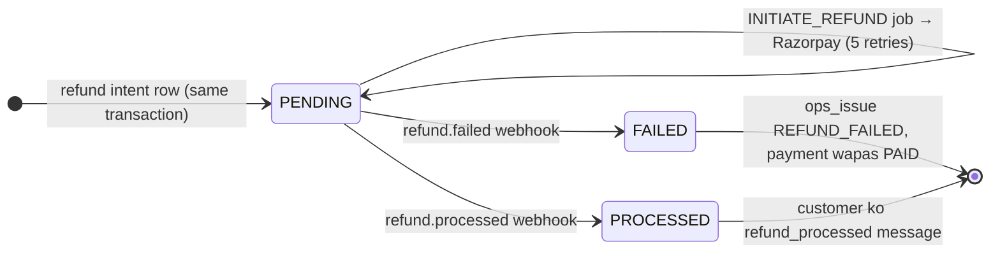
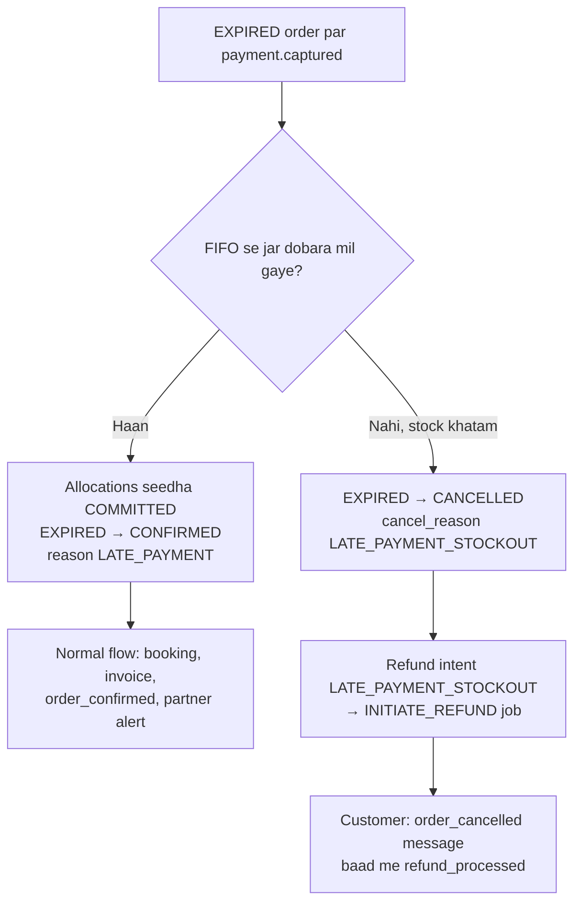

# 06. Jab kuch galat ho: payment fail, refund, NDR, RTO, damage, webhook failure

> Yeh file "happy path" ke bahar ke saare cases cover karti hai — har case me:
> **Kab hota hai → System khud kya karta hai → Admin ko kya dikhega → Admin ko kya karna hai → Customer ko kya dikhega.**
>
> Pichhli files: [04 — Customer journey](./04-customer-journey-storefront.md) · [05 — Fulfilment](./05-order-fulfilment-admin-partner.md).
> Aage: [07 — Paisa / settlements](./07-money-settlements-reports.md) · [08 — Notifications & alerts](./08-notifications-alerts-monitoring.md) · [09 — Test checklist](./09-end-to-end-test-checklist.md).
> Incident ke time step-by-step: [`docs/runbooks/`](../docs/runbooks/README.md).

Saari baatein code se verify ki gayi hain — main source files:
[`payments.service.ts`](../apps/backend/src/modules/payments/payments.service.ts),
[`refund-requests.ts`](../apps/backend/src/modules/payments/refund-requests.ts),
[`orders.service.ts`](../apps/backend/src/modules/orders/orders.service.ts),
[`logistics.service.ts`](../apps/backend/src/modules/logistics/logistics.service.ts),
[`admin.service.ts`](../apps/backend/src/modules/admin/admin.service.ts),
[`jobs/sweepers.ts`](../apps/backend/src/jobs/sweepers.ts),
[`OrderActionDialogs.tsx`](../apps/admin/src/modules/orders/components/OrderActionDialogs.tsx),
[`OrderStatusView.tsx`](../apps/storefront/src/modules/orders/components/OrderStatusView.tsx).

---

## 0. Ek nazar me — saare exception cases

| # | Case | Order status kahan jaata hai | Paisa (payment status) | Auto refund? |
| :-- | :-- | :-- | :-- | :-- |
| 1 | [Payment fail (bank decline)](#1-payment-fail-bank-ne-decline-kiya) | `PENDING_PAYMENT` hi rehta hai | `UNPAID` | Paisa kata hi nahi |
| 2 | [Pay kiya, browser band](#2-pay-kiya-phir-browser-band--network-gaya) | `CONFIRMED` (webhook se) | `PAID` | — |
| 3 | [Hold expire (pay nahi kiya)](#3-hold-expire--customer-ne-time-par-pay-nahi-kiya) | `EXPIRED` | `UNPAID` | — |
| 4 | [Late payment](#4-late-payment-expiry-ke-baad-paisa-aaya) | `CONFIRMED` ya `CANCELLED` | `PAID` / `REFUND_PENDING` | Haan, agar stock khatam |
| 5 | [Amount mismatch](#5-amount-mismatch) | `PENDING_PAYMENT` → `EXPIRED` | `REFUND_PENDING` | Haan |
| 6 | [Duplicate payment](#6-duplicate-payment-ek-order-par-do-baar-paisa) | Order par koi asar nahi | Order wala `PAID` hi | Haan, sirf doosra payment |
| 7 | [Customer cancel](#7-customer-ne-khud-cancel-kiya) | `CANCELLED` | `REFUND_PENDING` | Haan, full |
| 8 | [Admin cancel](#8-admin-ne-cancel-kiya) | `CANCELLED` | `REFUND_PENDING` | Haan (checkbox) |
| 9 | [Admin refund (full / partial)](#9-admin-refund--full-ya-partial) | Status nahi badalta | `REFUND_PENDING` → `PARTIALLY_REFUNDED` / `REFUNDED` | Admin karta hai |
| 10 | [Refund fail / atak gaya](#10-refund-fail-ya-atak-gaya) | — | `REFUND_PENDING` → wapas `PAID` | Admin ko dekhna hai |
| 11 | [Shiprocket booking fail / wallet low / pickup issue](#11-shiprocket-booking-fail-wallet-low-pickup-problem) | `CONFIRMED` par atka | `PAID` | Nahi — admin decide kare |
| 12 | [NDR (delivery attempt fail)](#12-ndr--delivery-attempt-fail-delivery_failed) | `DELIVERY_FAILED` | `PAID` | — |
| 13 | [RTO (parcel wapas)](#13-rto--parcel-wapas-kitchen-aa-raha-hai) | `RTO_IN_TRANSIT` → `RTO_DELIVERED` | `PAID` | Nahi — Q-04 pending |
| 14 | [Damaged / Lost](#14-damaged-jar-ya-lost-parcel) | `DELIVERED` rehta hai / `LOST` | `PAID` | Nahi — admin refund |
| 15 | [Webhook failure + replay](#15-webhook-failure-aur-replay) | — | — | — |
| 16 | [System alerts (worker down, backlog…)](#16-system-level-alerts-short) | — | — | — |

---

## 0.1 Teen cheezein jo har case me kaam aati hain

### (a) `ops_issue` = "Needs attention" flag

Jab system ko lagta hai ki **insaan ko dekhna padega**, woh order par ek `ops_issue` text likh deta hai
(`orders.ops_issue`). Yeh text:

- **Admin → Orders** list me tab **"Needs attention"** me order dikhata hai (filter: `ops_issue` set ho **ya** status `DELIVERY_FAILED`) — [`admin.repository.ts`](../apps/backend/src/modules/admin/admin.repository.ts) `TAB_SQL.attention`.
- Upar KPI card **"Needs attention"** (hint: _"Ops issues + failed deliveries"_) aur Dashboard par bhi count.
- Order drawer ke upar peeli (warning) patti: **"Needs attention: &lt;issue text&gt;"**.
- 1 ghante se zyada khula rahe toh `OPS_ISSUES_OPEN` admin alert (ops cron, har 10 min).
- Purana URL `/ops-issues` ab seedha `/orders?tab=attention` par redirect hota hai.

Kaam ho jaane par admin drawer me **"Resolve issue"** dabata hai → dialog **"Mark issue resolved"** → field **"What was done?"** (min 3 akshar) → **Resolve**. Isse sirf flag hat-ta hai; order status **nahi** badalta. (Audit log: `ORDER_ISSUE_RESOLVED`.)

`ops_issue` ke saare code jo system likhta hai:

| `ops_issue` text (shuru ka hissa) | Kab | Kahan likha jaata hai |
| :-- | :-- | :-- |
| `AMOUNT_MISMATCH paid=… expected=…` | Paisa order total se alag | `payments.service.ts` |
| `DUPLICATE_PAYMENT <paymentId>` | Paid order par doosra payment | `payments.service.ts` |
| `PAYMENT_ON_<STATUS>` | Aise status par paisa aaya jo paisa le hi nahi sakta | `payments.service.ts` |
| `REFUND_INIT_FAILED <reason>: …` | Razorpay ko refund bhejna 5 baar fail | `payments.service.ts › refundGaveUp` |
| `REFUND_FAILED <reason> <rfnd id>` | Razorpay ne refund `failed` bataya | `payments.service.ts › settleRefund` |
| `SHIPROCKET_CREATE_ORDER: …` / `FETCH_AND_STORE_LABEL: …` / `SHIPROCKET_SCHEDULE_PICKUP: …` / `SHIPROCKET_CANCEL_SHIPMENT: …` | Logistics job ki aakhri koshish bhi fail (dead letter) | `logistics.service.ts › jobGaveUp` |
| `COURIER_FALLBACK: …` | Koi courier rating/ETD rule pura nahi kar raha tha, sabse sasta liya | `logistics.service.ts › bookShipment` |
| `OVERSIZE_PARCEL: split into boxes (v2)` | > 4 jar ek box me | `logistics.service.ts` |
| `WEIGHT_DISCREPANCY: charged … g vs declared … g` | Courier ne declared se kaafi zyada weight charge kiya | `logistics.service.ts › pollTracking` |
| `RTO_DELIVERED: decide refund (Q-04); jars discarded, no restock (D-31)` | Parcel wapas kitchen pahuncha | `logistics.service.ts › processTracking` |
| `LOST: courier reported …` | Courier ne LOST / DAMAGED / DESTROYED bola | `logistics.service.ts › processTracking` |
| `MULTI_KITCHEN_SPLIT` | Ek order ke jar do kitchen se allocate hue | `checkout.service.ts` |

### (b) Refund ka lifecycle (har refund ka yahi raasta)



- Refund ka faisla jis transaction me hota hai (cancel, late payment, mismatch, duplicate, admin refund), usi me `refunds` table me **intent row** (`PENDING`) likhi jaati hai. Razorpay call **baad me** job `INITIATE_REFUND` karta hai (transaction ke bahar, D-30 / D-52 a).
- Idempotency key: system refunds `refund:<paymentId>:<reason>`, admin refunds `refund:<paymentId>:admin:<Idempotency-Key>` — double refund possible nahi.
- Order ka payment status: `PAID → REFUND_PENDING → REFUNDED` (poora) ya `PARTIALLY_REFUNDED` (thoda). Partial ke baad ek aur partial: `PARTIALLY_REFUNDED → REFUND_PENDING` ([`transitions.ts`](../packages/shared/src/order/transitions.ts)).
- Refund fail → payment status wapas `PAID` + `ops_issue`.
- `RECONCILE_REFUNDS` (har 30 min): sirf woh `PENDING` refunds dobara bhejta hai jinka Razorpay id abhi tak nahi bana (30 min se purane).
- Customer message `refund_processed`: _"Refund of {{amount}} for order {{order_code}} is processed. It reaches your account in 5–7 working days."_ (WhatsApp, SMS fallback — critical template).

> **Local par dhyan do:** mock Razorpay (`PAYMENT_GATEWAY=mock`) refund ko hamesha `pending` banata hai aur **koi `refund.processed` webhook nahi bhejta** — koi dev endpoint bhi nahi hai. Isliye locally refund `PENDING` / payment `REFUND_PENDING` par hi rukega; customer ko _"Refund of ₹X started…"_ dikhega. "Processed" wala hissa sirf integration test [`launch-simulations.test.ts`](../apps/backend/tests/integration/launch-simulations.test.ts) me chalta hai. Production me Razorpay ka webhook ise complete karega.

### (c) Admin order drawer ke action buttons

Admin → **Orders** → kisi row par click → drawer khulta hai ([`OrderDetailDrawer.tsx`](../apps/admin/src/modules/orders/components/OrderDetailDrawer.tsx)). Buttons sirf tab dikhte hain jab backend `actions` me allow kare:

| Button | Kab dikhta hai | Kya karta hai |
| :-- | :-- | :-- |
| **Resolve issue** | `ops_issue` set ho | Flag hatao + note (audit) |
| **Retry booking** | Status `CONFIRMED`, payment `PAID`, AWB nahi | Shiprocket booking naye job id se dobara |
| **Refund** | Captured payment ho aur kuch refundable bacha ho | Full / partial refund dialog |
| **Resend message** | Hamesha | 7 customer templates me se koi dobara bhejo |
| **Label** / **Invoice** | Label / invoice ready ho | 5-min signed PDF link |
| **Cancel order** | Status `CONFIRMED` / `AWAITING_PACKING` / `PACKED` / `PICKUP_SCHEDULED` | Cancel + (paid ho toh) full refund |

Drawer tabs: **Overview · Timeline · Payments · Shipping · Notes · messages**. "Payments" tab me **Payments** aur **Refunds** blocks; "Shipping" me **Shipment** aur **Courier scans**; Customer block me **WhatsApp / Call / Email** links (click-to-chat). Internal note: textbox _"Add a note for the team (not visible to the customer)"_ → **Add note**.

Orders list ke tabs ([`orderMeta.ts`](../apps/admin/src/modules/orders/components/orderMeta.ts)): **All · Needs attention · Awaiting packing · In transit · NDR · RTO · Delivered · Cancelled**. KPI cards: **Awaiting packing · In transit · Needs attention · NDR · RTO**.

---

## 1. Payment fail (bank ne decline kiya)

**Kab hota hai:** Customer ne Razorpay me pay try kiya, bank/UPI ne mana kar diya.
Local: mock dialog me **"Fail payment"** (_"The bank declines — you land on the retry state."_).

**System khud kya karta hai**
1. Razorpay `payment.failed` webhook aata hai → `payments` table me `FAILED` row (error code + description).
2. Order **`PENDING_PAYMENT` hi rehta hai**, jar abhi bhi reserved — customer dobara pay kar sakta hai jab tak hold bacha hai.

**Admin ko kya dikhega:** Kuch khaas nahi. Order **All** tab me `PENDING_PAYMENT` / `UNPAID`; drawer → Payments me failed attempt. Koi alert nahi.

**Admin ko kya karna hai:** Kuch nahi.

**Customer ko kya dikhega (website)**
- Checkout page par panel **"Payment not completed"** — _"… No money was taken. Your jars are still reserved for mm:ss — retry with UPI, a card or netbanking."_
- `/order/<code>` page par **"Complete your payment"** + timer + button **"Retry payment ₹X"**.
- Har attempt `payments` me alag row banti hai (UPI fail → retry → success = 2 rows).

---

## 2. Pay kiya, phir browser band / network gaya

**Kab hota hai:** Paisa kat gaya lekin browser ka success handler (`POST /payments/verify`) chala hi nahi.
Local: mock dialog me **"Pay, then close browser"** (_"Payment captured but never verified here — only the webhook confirms."_).

**System khud kya karta hai** — teen raaste, teeno same `confirmPayment()` (idempotent) chalate hain:
1. Razorpay `payment.captured` webhook → order `CONFIRMED`. (Mock me webhook ~2 s baad aata hai.)
2. Agar webhook bhi miss ho gaya: `EXPIRE_RESERVATIONS` sweeper (har 1 min) order expire karne **se pehle** Razorpay se payments poochta hai — captured mila toh `CONFIRMED` (`source: RECONCILE`).
3. Uske baad normal flow: booking, invoice, `order_confirmed` message, partner alert ([05](./05-order-fulfilment-admin-partner.md)).

**Admin ko kya dikhega:** Normal confirmed order. Agar 10 min tak `PENDING_PAYMENT` expiry ke baad bhi atka rahe → alert `PAYMENTS_STUCK` (_"… still PENDING_PAYMENT 10 min after expiry — expiry sweeper not running?"_).

**Admin ko kya karna hai:** Normally kuch nahi. Atak jaye toh runbook [payment-captured-not-confirmed.md](../docs/runbooks/payment-captured-not-confirmed.md) (worker chal raha hai? `GET /healthz/worker`; failed webhook? → Replay).

**Customer ko kya dikhega:** Order page par **"Confirming your payment…"** (_"We're waiting for your bank's final confirmation… this page updates by itself."_). Page 3 s me poll karta hai ~60 s tak; uske baad: _"This is taking longer than usual — that's okay."_ + **Check again** button. Confirm hote hi **"Your order is confirmed!"**.

---

## 3. Hold expire — customer ne time par pay nahi kiya

**Kab hota hai:** Checkout par jar reserve hue, par `reservation_ttl_minutes` (Admin → Settings → **"Checkout stock hold"**, default 15, range 5–60) ke andar payment nahi aaya.

**System khud kya karta hai**
1. `EXPIRE_RESERVATIONS` (har 1 min) → pehle Razorpay se check (case 2), kuch nahi mila toh:
2. Allocations `RELEASED`, stock wapas `+qty` (`RELEASE` movement), order `PENDING_PAYMENT → EXPIRED` (actor `SYSTEM`, reason `RESERVATION_EXPIRED`).
3. Customer ko koi message **nahi** jaata (paisa kata hi nahi).

**Admin ko kya dikhega:** Order **All** tab me `EXPIRED`. Stock wapas Inventory me.

**Admin ko kya karna hai:** Kuch nahi.

**Customer ko kya dikhega**
- Checkout par: **"Your jars were held for N minutes"** (N = setting `reservation_ttl_minutes`) + **Start again**.
- Order page par: **"Payment window ended — jars released"** — _"We held your jars for N minutes … Nothing was charged."_ + _"Paid just now? If the bank confirms it, we'll still fulfil the order if jars are left — otherwise you get a full refund automatically."_ + **Shop again**.

> Minutes ka number ab asli setting se aata hai (pehle "15" hard-coded tha — fixed).

---

## 4. Late payment (expiry ke baad paisa aaya)

**Kab hota hai:** Order `EXPIRED` ho chuka, phir bhi Razorpay se `payment.captured` aaya (UPI late confirm, etc.).

**System khud kya karta hai** (`confirmPayment` ka `EXPIRED` branch, SAVEPOINT ke andar):



- Stockout case me Sentry ko bhi event jaata hai (_"Payment taken for an order that could not be fulfilled — refund started"_).

**Admin ko kya dikhega:** Stock mila → normal confirmed order (Timeline me reason `LATE_PAYMENT`). Stockout → **Cancelled** tab, drawer me _"Cancelled — LATE_PAYMENT_STOCKOUT"_, Refunds block me refund.

**Admin ko kya karna hai:** Kuch nahi — sirf refund `PROCESSED` ho gaya ye confirm karo (warna [refund-failed.md](../docs/runbooks/refund-failed.md)). Chaho toh customer se WhatsApp par maafi.

**Customer ko kya dikhega:** Stockout case me order page: **"Paid after the jars ran out — full refund started"** — _"Your payment reached us after the reservation ended, and the last jars from this batch had already gone…"_ + refund notice + **Shop the current batch** / **Contact us**. Message `order_cancelled`: _"Your order {{order_code}} has been cancelled. Your refund of ₹X is on its way (5–7 working days)."_

---

## 5. Amount mismatch

**Kab hota hai:** Captured amount ≠ order ka `total_paise` (normally hona hi nahi chahiye — tampering / gateway bug).

**System khud kya karta hai** (D-52 c)
1. Payment status `UNPAID → PAID → REFUND_PENDING`, refund intent reason `AMOUNT_MISMATCH`.
2. `ops_issue = AMOUNT_MISMATCH paid=… expected=…`, Sentry event.
3. Order **confirm nahi hota** — `PENDING_PAYMENT` me rehta hai; hold khatam hone par sweeper use `EXPIRED` kar deta hai (jar wapas shelf par).

**Admin ko kya dikhega:** **Needs attention** tab me order, drawer me warning patti `AMOUNT_MISMATCH…`, Refunds block me refund.

**Admin ko kya karna hai:** Is order ko kabhi manually confirm mat karo. Refund processed hua ye check karo, customer ko dobara order karne bolo (WhatsApp link drawer me), phir **Resolve issue**.

**Customer ko kya dikhega:** Order page pehle **"Confirming your payment…"** par rehta hai, phir `EXPIRED` hone par **"Payment window ended — jars released … Nothing was charged."**

> ⚠️ **Gap:** is case me paisa kata hai aur refund chal raha hai, par page "Nothing was charged" bolta hai — `EXPIRED` view refund notice nahi dikhata ([`OrderStatusView.tsx`](../apps/storefront/src/modules/orders/components/OrderStatusView.tsx)). Customer ko koi `order_cancelled` message bhi nahi jaata (order cancel nahi hota); sirf refund process hone par `refund_processed`.

---

## 6. Duplicate payment (ek order par do baar paisa)

**Kab hota hai:** Order already `PAID`, aur usi Razorpay order par ek **doosra** payment capture hua.

**System khud kya karta hai** (D-52 b)
1. Doosre payment ke liye alag refund, reason `DUPLICATE_PAYMENT`. **Order ka status / payment status nahi badalta** (pehla payment valid hai).
2. `ops_issue = DUPLICATE_PAYMENT <paymentId>`.
3. Same webhook dobara aaye toh `ALREADY_PROCESSED` — kuch double nahi hota.

**Admin ko kya dikhega:** Order **Needs attention** me; Payments block me 2 captured payments; Refunds block me `DUPLICATE_PAYMENT` refund. (Drawer ke latest-refund summary me duplicate refund count nahi hota.)

**Admin ko kya karna hai:** Refund processed hua check karo → **Resolve issue**.

**Customer ko kya dikhega:** Order normal chalta rehta hai. Duplicate refund process hone par `refund_processed` message. Refund policy page (`/refund-cancellation`) bhi kehta hai: _"If you were charged twice for the same order, the duplicate payment is refunded in full."_

---

## 7. Customer ne khud cancel kiya

**Kab hota hai:** Customer apne order ko `CONFIRMED` ya `AWAITING_PACKING` me cancel karna chahta hai. `PACKED` ke baad online cancel **band** (sirf admin).

**Shart:** Customer **logged in (OTP) aur order ka owner** hona chahiye — order uske `user_id` se bana ho ya uske verified phone se (guest order) (D-52 k). Sirf `/track` par phone daal ke dekhne wala guest cancel **nahi** kar sakta.

**Customer ko kya dikhega / kya karta hai**
1. `/order/<code>` ya **My Orders** (`/account/orders/<code>`) par button **"Cancel order"** (sirf jab API `canCancel: true` de).
2. Dialog **"Cancel PK-XXXXXX?"** — _"Your jars go back to the batch and the full amount is refunded to your original payment method."_ — field **Reason** (min 3 akshar, _"Tell us why (a few words is fine)"_) → **Cancel order** / **Keep my order**.
3. Late ho gaya (order pack ho chuka) toh error: _"This order is already being packed and can no longer be cancelled here. Please contact us."_
4. Baad me page: **"Order cancelled"** + refund notice (_"Refund of ₹X started to your original payment method…"_).
5. Message `order_cancelled` (WhatsApp → SMS fallback).

**System khud kya karta hai**
1. Ek transaction me: jar wapas stock (`RESERVED`/`COMMITTED` allocations `RELEASED`), status `→ CANCELLED` (`cancel_reason = CUSTOMER_CANCEL`), paid tha toh full refund intent (`CUSTOMER_CANCEL`).
2. Commit ke baad: `INITIATE_REFUND`, `SHIPROCKET_CANCEL_SHIPMENT` (AWB ban chuka ho toh cancel; na bana ho toh no-op), `ORDER_CANCELLED` notify.
3. Partner ko `order_cancelled_partner` (_"Order {{order_code}} was cancelled — do NOT pack or hand it over."_) **sirf** tab jab order `AWAITING_PACKING` / `PACKED` / `PICKUP_SCHEDULED` se cancel hua ho.

**Admin ko kya dikhega:** **Cancelled** tab me order, drawer me _"Cancelled — CUSTOMER_CANCEL"_, Refunds block. Partner desk par woh order pack karne ki koshish kare toh: _"{code}: Ye order cancel ho chuka hai — pack mat karein"_.

**Admin ko kya karna hai:** Kuch nahi (refund processed ho jaye bas).

---

## 8. Admin ne cancel kiya

**Kab hota hai:** Customer ne phone/WhatsApp par cancel maanga (packing ke baad bhi), stock problem, fraud shak, pincode deliverable nahi, etc.
Admin cancel allowed: `CONFIRMED`, `AWAITING_PACKING`, `PACKED`, `PICKUP_SCHEDULED`. **`IN_TRANSIT` ke baad cancel nahi** — tab parcel courier ke paas hai (RTO / refund raasta use karo).

**Admin ko kya karna hai**
1. Orders → order kholo → **Cancel order**.
2. Dialog **"Cancel PK-XXXXXX?"** — _"Reserved jars go back to stock and the customer is told on WhatsApp / SMS."_
3. **Reason** (min 3 akshar; _"Shown in the status log and audit trail."_).
4. `PAID` order par checkbox **"Refund ₹X to the customer"** ticked aur **locked** ("Required") — paid order bina refund cancel nahi hota. Baaki payment status (jaise partly refunded) par checkbox nahi dikhta; note batata hai ki bacha paisa **Refund** button se lautao.
5. **Cancel order** → toast _"PK-XXXXXX cancelled — Full refund started."_

**System khud kya karta hai:** Case 7 jaisa hi, bas `cancel_reason = ADMIN_CANCEL`, refund reason `ADMIN_CANCEL`, audit log `ORDER_CANCEL`. Jar wapas stock — kyunki `PICKUP_SCHEDULED` tak jar kitchen se nikla hi nahi (D-31). Partner ko alert agar order kitchen tak pahunch chuka tha.

**Customer ko kya dikhega:** **"Order cancelled"** page + refund notice, aur `order_cancelled` message.

---

## 9. Admin refund — full ya partial

**Kab hota hai:** Delivered order me ek jar toota, RTO / lost parcel ka refund, goodwill, ya cancel ke alawa koi aur refund.

**Admin ko kya karna hai**
1. Orders → order → **Refund** (button tabhi dikhta hai jab kuch refundable bacha ho).
2. Dialog **"Refund PK-XXXXXX"** — _"Up to ₹X can still be refunded. Razorpay usually settles in 5–7 working days."_
3. **Amount** (₹ me likho, jaise `120` ya `120.50`; andar paise me jaata hai). **Full amount** link poora bhar deta hai. Refundable se zyada → _"Can't refund more than ₹X (what's left of the payment)"_.
4. **Reason** (dropdown, [`ADMIN_REFUND_REASONS`](../packages/shared/src/contracts/admin.ts)):

   | Value | Dropdown label |
   | :-- | :-- |
   | `CUSTOMER_CANCEL` | Customer cancelled |
   | `DAMAGED` | Damaged in transit |
   | `RTO` | Returned to origin (RTO) |
   | `LOST` | Lost by courier |
   | `GOODWILL` | Goodwill gesture |

5. **Notes** (min 3; _"For the audit log and the settlement statement."_) → **Refund ₹X** → toast _"Refund of ₹X started"_.

**System khud kya karta hai**
- Refundable = captured − (saare non-failed order refunds). Ek dialog = ek `Idempotency-Key` → double tap / retry se double refund nahi (_"Refund already requested."_).
- Payment status `PAID`/`PARTIALLY_REFUNDED → REFUND_PENDING`; Razorpay processed → `PARTIALLY_REFUNDED` ya `REFUNDED`. **Order status nahi badalta** (`DELIVERED` order `DELIVERED` hi rahega).
- Audit log `ORDER_REFUND`. Settlement me refund revenue se kam hota hai ([07](./07-money-settlements-reports.md), D-56 a).

**Customer ko kya dikhega:** `refund_processed` message; order/track page par refund card (_"Refund of ₹X completed. Your bank may take a day or two to show it."_ jab processed).

---

## 10. Refund fail ya atak gaya

**Kab hota hai**
- (a) Razorpay ko refund request 5 koshish me bhi nahi gayi (network / Razorpay balance) → `ops_issue = REFUND_INIT_FAILED …`.
- (b) Razorpay ne `refund.failed` bheja (bank reject, payment 6 mahine se purana) → refund `FAILED`, payment status wapas `PAID`, `ops_issue = REFUND_FAILED …`.

**System khud kya karta hai:** (a) me `RECONCILE_REFUNDS` har 30 min un `PENDING` refunds ko dobara bhejta hai jinka Razorpay id nahi bana. (b) me **apne aap dobara try nahi hota**.

**Admin ko kya dikhega:** **Needs attention** tab, drawer patti `REFUND_FAILED…` / `REFUND_INIT_FAILED…`, Refunds block me status. Job failure **Queues & webhooks → Job queues** (bull-board) me.

**Admin ko kya karna hai** ([refund-failed.md](../docs/runbooks/refund-failed.md))
1. Razorpay dashboard me refund / payment dekho.
2. Transient fail → bull-board me job **retry** (same idempotency key, double nahi hoga).
3. Bank ne reject kiya → customer ko manually UPI/bank transfer karo, UTR ke saath **Add note**. (Payment status `PAID` wapas aa chuka hai, isliye **Refund** button phir dikhega — runbook ke hisaab se doosra refund mat banao jab manual pay kar diya.)
4. Phir **Resolve issue**.

**Customer ko kya dikhega:** Refund notice: _"Your refund of ₹X hit a snag at the bank. We're retrying and our team has been alerted — no action needed from you."_

> ⚠️ Text "We're retrying" bolta hai, par `refund.failed` ke baad system khud retry **nahi** karta — admin ko action lena padta hai.

---

## 11. Shiprocket booking fail, wallet low, pickup problem

**Kab hota hai** — `SHIPROCKET_CREATE_ORDER` job (payment ke turant baad) fail:
- Kitchen ka `pickup_locations.shiprocket_pickup_name` set nahi (_"kitchen … has no Shiprocket pickup name"_) — turant dead letter.
- Product ka packed weight missing (_"a product has no packed weight"_).
- Pincode par koi courier nahi (_"no courier serves pincode …"_).
- Shiprocket wallet khaali (_"Insufficient wallet balance"_) / Shiprocket down (5 retries, exponential back-off 30 s se).

**System khud kya karta hai**
1. Retry (5 baar). Aakhri fail (ya non-retryable) → `ops_issue = SHIPROCKET_CREATE_ORDER: <error>`, `shipments.last_error`, Sentry, admin alert **`BOOKING_FAILED`**.
2. Order **`CONFIRMED` par atka** rehta hai (label nahi bana → partner desk par order pack-ready nahi; desk error _"Abhi pack nahi ho sakta — label abhi baaki hai."_).
3. Customer ko **automatic cancel / refund nahi** hota (pending R-5).
4. Doosre logistics alerts:

   | Alert kind | Kab |
   | :-- | :-- |
   | `WALLET_LOW` | Har ghante `CHECK_WALLET_BALANCE`: balance < Settings → **"Shiprocket wallet alert below"** (`shiprocket_wallet_min_paise`) — _"Shiprocket wallet ₹… is below ₹… — AWBs will fail"_ |
   | `PICKUP_BATCH_FAILED` | Cut-off ke baad pickup/manifest call fail |
   | `PICKUP_MISSED` | `PICKUP_SCHEDULED` ke 48 ghante baad bhi courier scan nahi |
   | `AWB_CANCEL_FAILED` | Cancel hue order ka AWB cancel nahi ho paya |
   | `PICKUP_EXCEPTION`, `PICKUP_ERROR`, `COURIER_CANCELLED`, `PARTIAL_DELIVERED`, `DISPOSED_OFF`, `UNTRACEABLE` | Courier se aise status aaye — order status nahi badalta, sirf alert |
   | `WEIGHT_DISCREPANCY` | Charged weight declared se kaafi zyada |

**Admin ko kya dikhega:** WhatsApp/e-mail alert (`[Pahadi Khatki ops] BOOKING_FAILED: …`), **Needs attention** tab, drawer me button **Retry booking**.

**Admin ko kya karna hai** ([shiprocket-down-wallet-empty.md](../docs/runbooks/shiprocket-down-wallet-empty.md))
1. Wajah theek karo — wallet recharge / pickup name set / product me packed weight.
2. Drawer → **Retry booking** → dialog **"Retry shipment booking?"** (_"Books PK-… with Shiprocket again (attempt N). Check the wallet balance first if the last error was about funds."_, saath me _"Last error: …"_) → **Retry booking**. Naya job id banta hai (`ship-<id>-retry-<ts>`), booking idempotent.
3. Pincode deliverable hi nahi → **Cancel order** (refund checkbox ON).
4. Phir **Resolve issue**.

**Customer ko kya dikhega:** Order page _"Your order is confirmed!"_ par hi rehta hai; koi naya message nahi jab tak admin cancel na kare.

> ⚠️ Dead-letter ke baad `RECONCILE_CONFIRMED` (har 5 min) wahi job id `ship-<id>` dobara add karta hai — par failed job 30 din BullMQ me rehta hai, isliye woh re-add kuch nahi karta. **Retry booking admin ko dabana hi padega.** (Runbook kehta hai reconcile bhi re-queue karega — sirf dead letter se pehle sach hai.)

---

## 12. NDR — delivery attempt fail (`DELIVERY_FAILED`)

**Kab hota hai:** Courier ne `OUT_FOR_DELIVERY` ke baad `UNDELIVERED` / `NDR` / `DELIVERY DELAYED` bheja (customer nahi mila, phone band, address galat). `DELAYED` (id 22) sirf transit delay hai — NDR **nahi**.

**System khud kya karta hai**
1. `OUT_FOR_DELIVERY → DELIVERY_FAILED` (actor `SHIPROCKET`).
2. Customer ko `delivery_attempt_failed` (critical: WhatsApp → SMS): _"The courier could not deliver order {{order_code}}. Reply or chat with us to reattempt: {{help_url}}"_ (`help_url` = track link).
3. Admin alert kind `DELIVERY_FAILED` (_"Order PK-… → DELIVERY_FAILED (UNDELIVERED)"_).
4. Courier dobara try kare: `DELIVERY_FAILED → OUT_FOR_DELIVERY` (phir `DELIVERED`). Courier RTO kare: `→ RTO_IN_TRANSIT` (case 13).

**Admin ko kya dikhega:** Orders → **NDR** tab aur **Needs attention** tab (dono me), KPI **NDR · RTO**, Dashboard Operations me **NDR rate** (30 din, shipped ka %).

**Admin ko kya karna hai**
1. Drawer → Customer block → **WhatsApp** / **Call** se customer se baat (sahi address / time).
2. **Reattempt / address update Shiprocket panel me manually** karo — system me NDR action button **abhi nahi hai (v2 / pending — R-3)**, dekho [`pending-requirements.md`](../requirement/pending-requirements.md).
3. Zaroorat ho toh **Resend message → "Delivery attempt failed"**.
4. Order `DELIVERY_FAILED` rehne tak "Needs attention" me rahega — **Resolve issue** isse nahi hatata (filter status par bhi hai); courier ka agla scan hi hatayega.

**Customer ko kya dikhega:** `/track` aur order page par warning: _"The courier tried to deliver but couldn't complete it. They usually re-attempt on the next working day. Phone unreachable or address needs a fix? Chat with us and we'll sort it out with the courier."_ Status label: **"Delivery attempt failed"**.

> ⚠️ Transition map me `DELIVERY_FAILED → DELIVERED` / `→ IN_TRANSIT` allowed nahi hai. Agar courier reattempt par seedha `DELIVERED` bheje (beech me `OUT FOR DELIVERY` scan na aaye), event store hoga par order `DELIVERY_FAILED` me hi atka rahega. Admin ke paas status manually aage badhane ka button bhi nahi hai.

---

## 13. RTO — parcel wapas kitchen aa raha hai

**Kab hota hai:** NDR ke baad customer nahi mila / refuse kiya → courier `RTO INITIATED` / `RTO IN TRANSIT` / `RTO OFD` / `RTO NDR` → order `RTO_IN_TRANSIT`; kitchen pahunchne par `RTO DELIVERED` / `RTO ACKNOWLEDGED` → `RTO_DELIVERED`.

**System khud kya karta hai**
1. Dono par admin alert (`RTO_IN_TRANSIT`, `RTO_DELIVERED`). Customer ko koi automatic message **nahi** (07 §6).
2. `RTO_DELIVERED` par: status log reason _"courier: RTO DELIVERED — no restock (D-31)"_, metadata `restock: false`; **koi stock movement nahi** (jar reservation par hi minus ho chuka tha — D-53 f).
3. `ops_issue = RTO_DELIVERED: decide refund (Q-04); jars discarded, no restock (D-31)`.
4. **Refund automatic nahi** — policy (Q-04: full refund ya freight kaat ke) abhi decide nahi hui (R-1).

**Admin ko kya dikhega:** **RTO** tab (`RTO_IN_TRANSIT`, `RTO_DELIVERED`, `LOST`), `RTO_DELIVERED` par **Needs attention** bhi. Dashboard **RTO rate**.

**Admin ko kya karna hai**
1. Kitchen partner se confirm karo parcel aaya; jar **dobara mat becho** (food safety) — discard. Stock adjust bhi **mat** karo (pehle hi minus hai; adjust karoge toh double deduction).
2. Refund decide karo → **Refund** → reason **"Returned to origin (RTO)"**, amount (full ya partial), notes.
3. **Resolve issue** with note.
4. RTO freight settlement me minus hota hai — par `rto_freight_paise` abhi capture nahi hota (R-2, pending).

**Customer ko kya dikhega:** Status label **"Returning to us"** / **"Returned to us"**; order page refund notice (refund na hua ho toh _"Your refund is being prepared — you'll get an SMS when it's on its way."_). Refund policy page ka RTO rule **pending value** dikhata hai (_"Undelivered order refund rule"_).

---

## 14. Damaged jar ya lost parcel

### 14.1 Customer ko toota / leak jar mila (order `DELIVERED`)

**Kab hota hai:** Delivery ke baad customer WhatsApp / contact page par photo bhejta hai.

**System khud kya karta hai:** Kuch automatic nahi — customer-side **koi damage claim form nahi** hai.

**Admin ko kya karna hai**
1. Photo / evidence check (claim window aur evidence rule policy me abhi **pending** — R-1).
2. **Refund** → reason **"Damaged in transit"** → sirf toote jar ka amount (partial) ya full → notes.
3. Replacement bhejna: refund page "replacement (subject to stock)" kehta hai, par **replacement order banane ka koi feature abhi system me nahi hai (v2 / pending)** — manually naya order hi karna padega.

**Customer ko kya dikhega:** Order `DELIVERED` hi rahega; refund card + `refund_processed` message.

### 14.2 Courier ne LOST / DAMAGED / DESTROYED bola

**System khud kya karta hai:** Courier status `LOST`, `DAMAGED`, `DESTROYED` → order `LOST` (sirf `IN_TRANSIT` ya `RTO_IN_TRANSIT` se allowed; `OUT_FOR_DELIVERY` / `DELIVERY_FAILED` se aaye toh sirf event store hota hai). `ops_issue = LOST: courier reported …`, admin alert `LOST`. Customer ko koi message nahi, **auto refund nahi**.

**Admin ko kya dikhega:** **RTO** tab + **Needs attention**.

**Admin ko kya karna hai:** Shiprocket par lost claim (manual, system ke bahar) → **Refund** reason **"Lost by courier"** → **Resolve issue**.

**Customer ko kya dikhega:** Status **"Lost in transit"**, refund notice.

---

## 15. Webhook failure aur replay

**Kab hota hai:** Razorpay ya courier webhook aaya, store ho gaya, par processing me **business error** (jaise order nahi mila, courier update ka AWB humare shipments me nahi — `UNKNOWN_AWB`).

**System khud kya karta hai**
1. Har webhook pehle `webhook_events` me save (provider + event id unique) — kuch khota nahi.
2. Business error → `last_error` likho, provider ko **200** (warna Razorpay infinite retry), Sentry. Infra error (DB down) → 5xx, provider khud retry karta hai.
3. Ops cron (har 10 min): last 1 ghante me fail → alert `WEBHOOK_FAILURES` (_"N webhook(s) failed in the last hour — Queues & webhooks"_). `UNKNOWN_AWB` ka alag alert.
4. Bad signature / token wale requests (400 / 401) **save nahi hote** — sirf API logs me.

**Admin ko kya dikhega:** Sidebar → System → **Queues & webhooks** (`/ops`) — _"Background jobs and incoming Razorpay / courier events. Replaying a webhook runs the same idempotent handler again."_
- KPI: **Failed webhooks · With errors · Providers · Oldest failure**.
- View switch: **Webhook failures** | **Job queues** (bull-board iframe; blank rahe toh _"open it in a new tab"_ link).
- Har row: badge **Failed** / **Processed** + button **Replay**.

**Admin ko kya karna hai** ([webhooks-failing.md](../docs/runbooks/webhooks-failing.md))
1. `last_error` padho, wajah theek karo (code fix / data fix).
2. **Replay** → dialog **"Replay this webhook?"** → **Replay** → toast _"Webhook replayed"_. Idempotent — duplicate kabhi double apply nahi hota. Audit `WEBHOOK_REPLAY`.
3. Razorpay webhook aaya hi nahi → sweeper khud reconcile karta hai; Shiprocket → `POLL_TRACKING` har 3 ghante status kheench leta hai.

**Customer ko kya dikhega:** Kuch nahi (order thodi der `"Confirming your payment…"` ya tracking purana dikh sakta hai).

---

## 16. System-level alerts (short)

Poori list [08 — Notifications & alerts](./08-notifications-alerts-monitoring.md) me. Exception se jude:

| Alert kind | Matlab | Runbook |
| :-- | :-- | :-- |
| `PAYMENTS_STUCK` | `PENDING_PAYMENT` expiry ke 10 min baad bhi | [payment-captured-not-confirmed.md](../docs/runbooks/payment-captured-not-confirmed.md) |
| `WEBHOOK_FAILURES`, `UNKNOWN_AWB` | Webhook processing fail | [webhooks-failing.md](../docs/runbooks/webhooks-failing.md) |
| `WALLET_LOW`, `BOOKING_FAILED`, `PICKUP_BATCH_FAILED`, `PICKUP_MISSED`, `AWB_CANCEL_FAILED` | Shiprocket side | [shiprocket-down-wallet-empty.md](../docs/runbooks/shiprocket-down-wallet-empty.md) |
| `OPS_ISSUES_OPEN` | Koi `ops_issue` 1 ghante se khula | Order kholo, issue text padho |
| `DELIVERY_FAILED`, `RTO_IN_TRANSIT`, `RTO_DELIVERED`, `LOST` | Courier exception | Upar case 12–14 |
| `LEDGER_MISMATCH` | Stock ledger gadbad — stock adjust **mat** karo | [stock-ledger-mismatch.md](../docs/runbooks/stock-ledger-mismatch.md) |
| `SERVER_ERRORS_SPIKE`, `JOBS_FAILED`, `QUEUE_BACKLOG` | Worker / API problem | [worker-queue-5xx.md](../docs/runbooks/worker-queue-5xx.md) |

Alert WhatsApp par `ADMIN_ALERT_PHONES` ke har number ko jaata hai (template `admin_alert`: `[Pahadi Khatki ops] {{kind}}: {{message}}`), koi na pahunche toh `ADMIN_ALERT_EMAIL`. Ek kind ka 10 min me pehla alert turant, baaki ka ek summary (_"N more … alert(s) in the last 10 minutes"_). Locally WhatsApp mock hai → `GET /api/v1/dev/messages`.

**Golden rule (runbooks README):** `orders.status`, `payments.status`, `inventory_batches.available_stock` ko **kabhi SQL se haath se mat badlo** — sirf admin actions / jobs se.

---

## 17. Local par exception cases kaise try karein

Maan ke chalo API `http://localhost:4000` par hai (`PORT=4000`), `PAYMENT_GATEWAY=mock`, `SHIPPING_PROVIDER=sandbox`. Order code format `PK-XXXXXX`.

Razorpay order id nikalna (late / duplicate payment ke liye):

```bash
docker compose exec postgres psql -U pk -d pahadi_khatki -c \
  "SELECT order_code, status, payment_status, gateway_order_id FROM orders WHERE order_code = 'PK-XXXXXX';"
```

Mock payment bhejna (Razorpay modal + webhook ki jagah):

```bash
curl -s -X POST http://localhost:4000/api/v1/dev/payments/simulate \
  -H 'content-type: application/json' \
  -d '{"razorpayOrderId":"order_XXXXXXXX","outcome":"success"}'
```

Courier scan bhejna:

```bash
curl -s -X POST http://localhost:4000/api/v1/dev/shipping/simulate \
  -H 'content-type: application/json' \
  -d '{"orderCode":"PK-XXXXXX","status":"UNDELIVERED","location":"Delhi"}'
```

| Scenario | Local par kaise trigger karein | Expected result |
| :-- | :-- | :-- |
| Payment fail | Checkout → mock dialog **Fail payment** | "Payment not completed", timer chalta rahe, **Retry payment ₹X**; order `PENDING_PAYMENT` |
| Browser band | Mock dialog **Pay, then close browser** | ~2 s me webhook se `CONFIRMED`; page "Confirming…" → "Your order is confirmed!" |
| Hold expire | Settings → **Checkout stock hold** = 5; order banao, pay mat karo, mock dialog band karo; 5–6 min ruko | Order `EXPIRED`, stock wapas, page "Payment window ended — jars released" |
| Late payment (stock bacha) | Expired order ka `gateway_order_id` lo → `dev/payments/simulate` success | `EXPIRED → CONFIRMED`, reason `LATE_PAYMENT`, AWB/label normal |
| Late payment stockout | Expire hone do → us product ka bacha stock Inventory → **Adjust stock** se 0 karo (ya doosre order me khareed lo) → simulate success | `CANCELLED`, `LATE_PAYMENT_STOCKOUT`, refund `PENDING`, `order_cancelled` mock outbox me |
| Duplicate payment | Paid order ka `gateway_order_id` par simulate success **dobara** | Order same; naya refund `DUPLICATE_PAYMENT`; Needs attention me `DUPLICATE_PAYMENT …` |
| Amount mismatch | HTTP se trigger nahi hota (simulate amount nahi leta) — sirf integration tests | — |
| Customer cancel | Storefront OTP login (`[DEV OTP]` API console me) → My Orders → order (`CONFIRMED`/`AWAITING_PACKING`) → **Cancel order** | `CANCELLED`, stock wapas, refund `PENDING`, `order_cancelled` outbox me |
| Admin cancel | Admin → Orders → order (`PACKED` tak) → **Cancel order**, refund ON | `CANCELLED`, toast "Full refund started", partner ko `order_cancelled_partner` (agar kitchen tak tha) |
| Admin partial refund | Delivered order → **Refund** → ₹100, reason "Damaged in transit" | Payment `REFUND_PENDING`; order `DELIVERED` hi; doosri baar refundable kam dikhe |
| Booking fail | `pickup_locations.shiprocket_pickup_name` NULL rakh ke order pay karo | Order `CONFIRMED` par atka, ops_issue `SHIPROCKET_CREATE_ORDER: kitchen … has no Shiprocket pickup name`, alert `BOOKING_FAILED`; psql se name set karo → **Retry booking** → `AWAITING_PACKING` |
| NDR | Order `OUT_FOR_DELIVERY` tak le jao (`PICKED UP` → `OUT FOR DELIVERY`) → simulate `UNDELIVERED` | `DELIVERY_FAILED`, NDR + Needs attention tab, `delivery_attempt_failed` outbox me, /track par warning |
| NDR reattempt | NDR ke baad simulate `OUT FOR DELIVERY` → `DELIVERED` | `OUT_FOR_DELIVERY` → `DELIVERED`, NDR tab se hat jaye |
| RTO | NDR ke baad simulate `RTO INITIATED` → `RTO DELIVERED` | `RTO_IN_TRANSIT` → `RTO_DELIVERED`, ops_issue "decide refund (Q-04)…", stock **nahi** badla |
| Lost | `IN_TRANSIT` order par simulate `LOST` | `LOST`, ops_issue `LOST: courier reported LOST`, RTO tab |
| Webhook replay | Optional: `.env` me `SHIPROCKET_WEBHOOK_TOKEN` (24+ char) set karke API restart, phir `POST /api/v1/webhooks/courier-tracking` with `x-api-key` aur ek anjaan `awb` | Queues & webhooks me **Failed** row (`UNKNOWN_AWB`), **Replay** karne par phir bhi business error (AWB hai hi nahi) |
| Refund processed | Locally possible nahi (mock refund `pending` hi rehta hai) | Sirf `launch-simulations.test.ts` me |

Mock messages dekhne ke liye: `GET http://localhost:4000/api/v1/dev/messages`.

---

## 18. Kya abhi system me nahi hai / docs se alag hai

| # | Baat | Reference |
| :-- | :-- | :-- |
| 1 | **NDR actions (reattempt / address update)** system me nahi — Shiprocket panel se manually (v2) | R-3, [`pending-requirements.md`](../requirement/pending-requirements.md) |
| 2 | **RTO refund policy (Q-04)** + damage claim window / evidence pending; RTO par auto refund nahi | R-1 |
| 3 | **`rto_freight_paise` capture** nahi hota (settlement me RTO freight minus nahi ho paata) | R-2 |
| 4 | **Undeliverable pincode**: checkout copy "If we can't deliver, you get a full refund" kehti hai, par booking fail par auto cancel + refund nahi — admin manually karega | R-5, [`AddressSection.tsx`](../apps/storefront/src/modules/checkout/components/AddressSection.tsx) |
| 5 | Multi-box split (> 4 jar) v2 — abhi sirf `OVERSIZE_PARCEL` ops issue | S-14 |
| 6 | Replacement order feature nahi (refund page "replacement" ka zikr karta hai) | [`refund.tsx`](../apps/storefront/src/modules/content/legal/refund.tsx) |
| 7 | Customer-side damage claim form nahi — WhatsApp / contact se hi | — |
| 8 | Admin ke paas `DELIVERY_FAILED → OUT_FOR_DELIVERY / RTO_IN_TRANSIT` ka button nahi (transition map ADMIN ko allow karta hai, par koi API/UI nahi) | [`transitions.ts`](../packages/shared/src/order/transitions.ts) |
| 9 | `DELIVERY_FAILED → DELIVERED` / `→ IN_TRANSIT` aur `OUT_FOR_DELIVERY/DELIVERY_FAILED → LOST` map me nahi — courier seedha aisa bheje toh order atak sakta hai | [`transitions.ts`](../packages/shared/src/order/transitions.ts), [`logistics.service.ts`](../apps/backend/src/modules/logistics/logistics.service.ts) `applyTransitions` |
| 10 | Amount mismatch par customer page "Nothing was charged" dikhata hai (galat) aur koi cancel message nahi | [`OrderStatusView.tsx`](../apps/storefront/src/modules/orders/components/OrderStatusView.tsx) |
| 11 | Refund FAILED par customer text "We're retrying" — system auto retry nahi karta | [`OrderStatusView.tsx`](../apps/storefront/src/modules/orders/components/OrderStatusView.tsx), [`payments.service.ts`](../apps/backend/src/modules/payments/payments.service.ts) |
| 12 | ✅ **Fixed** — "15 minutes" storefront me hardcoded; setting `reservation_ttl_minutes` 5–60 ho sakti hai | `CheckoutView.tsx`, `ConsentSection.tsx`, `OrderStatusView.tsx` |
| 13 | ✅ **Fixed** — Runbook `refund-failed.md` idempotency key `refund:<orderId>:<reason>` likhta hai — code me `refund:<paymentId>:<reason>`; aur kehta hai `RECONCILE_REFUNDS` "re-asks Razorpay for anything not final" — code sirf bina gateway id wale `PENDING` refunds dobara bhejta hai (gateway par pending refund ka status poll nahi hota) | [`refund-failed.md`](../docs/runbooks/refund-failed.md), [`payments.repository.ts`](../apps/backend/src/modules/payments/payments.repository.ts) `listStuckRefunds` |
| 14 | ✅ **Fixed** — Runbook `shiprocket-down-wallet-empty.md` button names "Retry shipment" / "Add note" / "Resend notification" — UI me **Retry booking** / **Add note** / **Resend message**; aur dead-letter ke baad `RECONCILE_CONFIRMED` re-queue no-op hai (same job id 30 din rehta hai) | [`shiprocket-down-wallet-empty.md`](../docs/runbooks/shiprocket-down-wallet-empty.md), [`queues.ts`](../apps/backend/src/jobs/queues.ts) |
| 15 | ✅ **Fixed** — Runbooks "Ops → Webhooks / Ops → Audit log / Payments & refunds" kehte hain — UI me sidebar **Queues & webhooks** (view **Webhook failures**), **Audit log** (System group), drawer tab **Payments** | [`nav-items.ts`](../apps/admin/src/components/navigation/nav-items.ts), [`OpsPage.tsx`](../apps/admin/src/modules/queues/pages/OpsPage.tsx) |
| 16 | Local mock Razorpay me refund kabhi `processed` nahi hota — koi dev endpoint nahi | [`razorpay/mock.ts`](../apps/backend/src/integrations/razorpay/mock.ts), [`dev-payments.routes.ts`](../apps/backend/src/modules/dev-payments/dev-payments.routes.ts) |
| 17 | Shiprocket sandbox fault injection (wallet 0, unserviceable pincode, 5xx) sirf tests se — HTTP control endpoint nahi | [`shiprocket/sandbox.ts`](../apps/backend/src/integrations/shiprocket/sandbox.ts) |
| 18 | Manually ship kiye order (Shiprocket down, runbook ka fallback) ka AWB system me daalne ka feature nahi — order `CONFIRMED` me hi rahega, tracking auto nahi | [`shiprocket-down-wallet-empty.md`](../docs/runbooks/shiprocket-down-wallet-empty.md) |
