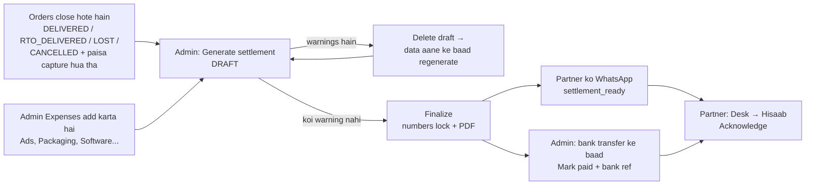

# 07 — Paisa, Settlements aur Reports (Dashboard → Expenses → Settlement → Hisaab → Exports)

> Is file me: admin ka **Dashboard**, **Expenses**, **Settlements** (kitchen partner ke saath profit ka hisaab), partner ka **Hisaab** screen, **Customers**, **Exports (CSV)** aur **Audit log**.
> Saare amounts DB me **integer paise** me store hote hain (D-26) — screen par ₹ me dikhte hain (`₹399.00` = `39900` paise). CSV exports me rupees 2 decimal ke saath aate hain.
>
> Pichhla step: [05 — Order fulfilment](./05-order-fulfilment-admin-partner.md) · Exceptions/refunds: [06](./06-exceptions-refunds-ndr-rto.md) · Messages: [08](./08-notifications-alerts-monitoring.md) · Test script: [09](./09-end-to-end-test-checklist.md) · Index: [README](./README.md)

---

## 1. Kaun kya dekh sakta hai (roles)

| Screen | URL (admin app, `:5173`) | Sidebar menu (group) | Kaun |
| :-- | :-- | :-- | :-- |
| Dashboard | `/` | **Dashboard** (Operations) | Sirf `ADMIN` (partner `/` kholega to `/desk` par chala jayega) |
| Customers | `/customers`, `/customers/:phone` | **Customers** (Operations) | Sirf `ADMIN` |
| Expenses | `/expenses` | **Expenses** (Finance) | Sirf `ADMIN` |
| Settlements | `/settlements`, `/settlements/:settlementId` | **Settlements** (Finance) | Sirf `ADMIN` |
| Exports | `/exports` | **Exports** (Finance) | Sirf `ADMIN` |
| Audit log | `/audit-log` | **Audit log** (System) | Sirf `ADMIN` |
| Hisaab (partner ka statement) | `/desk/hisaab`, `/desk/hisaab/:settlementId` | Desk bottom nav **Hisaab** | `KITCHEN_PARTNER` (+ ADMIN) |

Source: [router](../apps/admin/src/app/router/index.tsx), [nav-items.ts](../apps/admin/src/components/navigation/nav-items.ts). D-40: partner live revenue dashboard, customer list, settings **nahi** dekh sakta — sirf apna finalized hisaab.



---

## 2. Dashboard (`/`)

### Admin side — screen par kya hai

Header: **"Welcome back, &lt;naam&gt;"** + "Live numbers, refreshed … IST." Right side me toggle **Incl. GST / Ex-GST** (revenue kaise dikhe).
Agar admin ka 2FA off hai to warning: _"Two-factor authentication is off for your admin account. Turn it on"_ → `/account` (dekho [01 — Setup](./01-setup-admin-partner-kitchen.md)).

**"Today at a glance" — 4 KPI cards**

| Card | Kya ginta hai (code) | Hint line |
| :-- | :-- | :-- |
| **Awaiting packing** | Orders jinka status `AWAITING_PACKING` hai | "N in transit with the courier" (`PICKUP_SCHEDULED` + `IN_TRANSIT` + `OUT_FOR_DELIVERY`) |
| **Needs attention** | Orders jinpar `ops_issue` laga hai **ya** status `DELIVERY_FAILED` (NDR) | "Ops issues · N NDR" / "Nothing stuck" |
| **Revenue today** / **Revenue today (ex-GST)** | Aaj (IST) confirm hue orders ka `total_paise` (gross) ya `total − tax` (ex-GST) | "This month ₹… · N orders" |
| **Sellable stock** | Un batches ka `available_stock` jinki expiry ≥ aaj + (`min_remaining_shelf_days` + `transit_buffer_days`) | "N batches expire in 30 days" / "No batch expires in 30 days" |

**"Trends" card** — pills: **Orders per day** / **Revenue per day** (pichhle 30 din) / **Revenue by product** (is mahine, top 12).
Note screen par hi likha hai: _"Chart revenue is incl. GST (daily / per-product ex-GST isn't reported by the API yet)."_ → charts me ex-GST **abhi system me nahi hai**.

**"Operations" section** (Phase 10, D-57 g) — "Orders in the last 24 hours · refunds and delivery health over 30 days."

| Item | Matlab |
| :-- | :-- |
| **Refunds · 30 days** | Pichhle 30 din ke refunds (count + processed ₹), `DUPLICATE_PAYMENT` ko chhod kar |
| **NDR rate** | 30 din me ship hue orders me se kitne `DELIVERY_FAILED` hue (%) |
| **RTO rate** | 30 din me ship hue orders me se kitne `RTO_IN_TRANSIT` gaye (%) |
| Hourly chart | Pichhle 24 IST ghante, har ghante confirm hue orders |
| Button **Send test alert** | Confirm dialog "Send a test alert?" → har admin ko test WhatsApp + e-mail; audit log me `ALERT_TEST` |

> Conversion rate dashboard me **nahi** hai — backend ke paas page-views nahi; GA4 funnel se dekhna hai (D-57 g, pending H-14 in [pending-requirements](../requirement/pending-requirements.md)).

### System khud kya karta hai

- Dashboard revenue = **confirmed orders, IST confirm-day ke hisaab se**, `EXPIRED` ko chhod kar ([admin.repository.ts `dashboardNumbers`](../apps/backend/src/modules/admin/admin.repository.ts)).
- Dashboard ka "ex-GST" = simple `total − tax`. **Dhyan do:** yeh refunds ko nahi ghatata aur cancelled-after-payment orders bhi isme gine jaate hain (sirf "Revenue by product" `CANCELLED` ko hatata hai). **Asli profit ka number settlement me hai** (section 4), dashboard sirf "aaj kitna bika" ka andaza hai.

---

## 3. Expenses (`/expenses`)

Shared kharche (ads, packaging material, software, compliance…) jo settlement me **profit pool se minus** hote hain.

### Admin side — expense add karna

1. Sidebar → **Expenses** → button **Add expense**.
2. Dialog **"Add an expense"** ke fields:

| Field | Kya bharna hai | Rule |
| :-- | :-- | :-- |
| **Category** | `Ads`, `Packaging`, `Raw material`, `Logistics`, `Software`, `Compliance`, `Other` | Zaroori ("Pick a category") |
| **Amount** | ₹ me, e.g. `4999` ya `499.50` | > 0; paise me save hota hai |
| **Date** | Kharcha kis din hua | Aaj se aage ki date nahi |
| **Paid by** | **Business account** (default) ya koi staff member | Hint: "Out-of-pocket costs are reimbursed in the settlement" |
| **Description** | 3–500 characters | Zaroori |
| **Receipt** (optional) | PDF, JPG, PNG ya WebP, max 5 MB | Private storage me jaata hai (presigned upload) |

3. **Add expense** dabao → toast "Expense added". Edit ke liye pencil icon → "Edit expense" → **Save changes**. Receipt dobara lagane ke liye "Replace receipt".

**Upar ke KPI cards:** **Total recorded** (filter lagao to "Total (filtered)"), **Out of pocket** (staff ne apni jeb se diya — is page par), **Missing receipts**, **Locked**.
Filters: Category pills + date range. Table columns: Date · Category · Description · Paid by · Amount · Receipt.

### Edit / delete rules (code: [settlements.service.ts](../apps/backend/src/modules/settlements/settlements.service.ts))

- Expense jab tak **kisi bhi settlement me nahi** hai → edit / delete / receipt upload sab allowed (audit: `EXPENSE_CREATE` / `EXPENSE_UPDATE` / `EXPENSE_DELETE`).
- Jaise hi kisi settlement (DRAFT bhi) ne use claim kiya → **Locked** (row me lock icon). API error: _"This expense is part of a settlement — delete that DRAFT first (finalized ones are permanent)."_
  - DRAFT delete karoge to expense phir se unlock ho jayega. FINALIZED/PAID ke baad hamesha ke liye lock.
- **Partner-paid reimbursement:** "Paid by" me agar `KITCHEN_PARTNER` role wala user chuna hai to woh amount settlement me partner ko **wapas** milta hai ("Expenses the partner paid"). Admin ne apni jeb se diya ho to woh sirf shared expense ki tarah ghatta hai — alag se reimburse nahi hota (admin ka hissa remainder hai).

> Partner khud expense add **nahi** kar sakta — expenses API sirf `ADMIN` ke liye hai. Partner ka kharcha admin ko batana hoga, admin "Paid by = partner" ke saath daalega.

---

## 4. Settlements (`/settlements`) — partner ke saath profit ka hisaab

### 4.1 Formula (jaisa code me hai)

Code: [settlement-calc.ts](../apps/backend/src/modules/settlements/settlement-calc.ts) · Decisions: D-41 + **D-56** ([08-decisions-log](../architecture/08-decisions-log.md)) · Doc: [04 §Finance](../architecture/04-admin-operations-portal.md).

**Har order ke liye:**

```text
kept            = total − refunds                (DUPLICATE_PAYMENT aur FAILED refunds nahi gine jaate)
Revenue ex-GST  = kept × (total − tax) / total   (half-up rounding)  ← refunds yahin andar ghat gaye
Raw cost        = Σ (allocation qty × batch cost_per_unit)   — sirf COMMITTED allocations
Packaging       = jars × packaging_cost_per_jar_paise        — sirf agar order PACK hua tha
Freight         = shipments.freight_paise                    — sirf agar order SHIP hua tha
Gateway fee     = Σ captured payments ka (fee + fee_tax)     — Razorpay se
RTO freight     = shipments.rto_freight_paise                — sirf RTO orders
Order Net       = Revenue ex-GST − Raw cost − Packaging − Freight − Gateway fee − RTO freight
```

**Poore cycle ke liye:**

```text
Net profit pool = Σ Order Net − Shared expenses (period ke saare unsettled expenses)
Partner share   = floor(Net profit × partner_split_bp / 10000)   (loss me bhi neeche round)
Admin share     = Net profit − Partner share                     (remainder — ek paisa bhi gum nahi)
Partner payout  = Raw cost (wapas) + Partner share + Partner ne jo expenses diye
```

> Refunds ko **dobara minus nahi** kiya jaata (D-56 a). Screen par isliye line dikhti hai: **"Refunds (already netted from revenue)"** — sirf info, minus nahi.

### 4.2 Worked example (₹ me — DB me paise)

Assumptions: GST 5% (⚠️ Q-01 abhi CA se confirm baaki), free shipping, `packaging_cost_per_jar_paise` = 3200 (₹32, default), `partner_split_bp` = 5000 (50%). Local mock Razorpay fee = 2% + 18% GST on fee ([mock.ts](../apps/backend/src/integrations/razorpay/mock.ts)). Period: 1–15 Oct.

| | Order A (1 jar, Delivered) | Order B (2 jars, Delivered, ₹100 GOODWILL refund) | Order C (1 jar, Cancelled before packing, full refund) |
| :-- | --: | --: | --: |
| Total (incl. GST) | ₹399.00 | ₹798.00 | ₹399.00 |
| Tax (5% included) | ₹19.00 | ₹38.00 | ₹19.00 |
| Refunds | ₹0 | ₹100.00 | ₹399.00 |
| **Revenue ex-GST** | 399 × 380/399 = **₹380.00** | 698 × 760/798 = **₹664.76** | 0 → **₹0.00** |
| (−) Raw cost | ₹120.00 | ₹240.00 | ₹0 (stock wapas gaya, RELEASED) |
| (−) Packaging | ₹32.00 | ₹64.00 | ₹0 (pack nahi hua) |
| (−) Freight | ₹85.00 | ₹95.00 | ₹0 (ship nahi hua) |
| (−) Gateway fee | ₹7.98 + ₹1.44 = ₹9.42 | ₹15.96 + ₹2.87 = ₹18.83 | ₹9.42 (Razorpay fee wapas nahi deta) |
| (−) RTO freight | ₹0 | ₹0 | ₹0 |
| **Order Net** | **₹133.58** | **₹246.93** | **−₹9.42** |

Expenses in period: Ads ₹200 (Business account) + Packaging tape ₹50 (partner ne diya) → Shared expenses = ₹250.

| Cycle line | Hisaab | Amount |
| :-- | :-- | --: |
| Orders net | 133.58 + 246.93 − 9.42 | ₹371.09 |
| (−) Shared expenses (ads, software…) | 200 + 50 | ₹250.00 |
| **(=) Net profit pool** | | **₹121.09** |
| Partner share (50%, rounded down) | floor(12109 × 5000 / 10000) = 6054 paise | ₹60.54 |
| Admin share (remainder) | 12109 − 6054 | ₹60.55 |
| Raw cost reimbursement | 120 + 240 | ₹360.00 |
| Expenses the partner paid | | ₹50.00 |
| **Partner payout** | 360.00 + 60.54 + 50.00 | **₹470.54** |

> Agar cycle me loss ho (Net profit negative), dono shares negative dikhte hain aur note aata hai: _"This cycle made a loss — both shares are negative. Nothing is carried forward silently."_

### 4.3 Kaunse orders settlement me aate hain (eligible)

Code: `listEligibleOrderFacts` in [settlements.repository.ts](../apps/backend/src/modules/settlements/settlements.repository.ts).

- Status `DELIVERED`, `RTO_DELIVERED`, `LOST`, ya `CANCELLED` **jisme payment CAPTURED hua tha** (bina paise wala cancel nahi aata).
- Order kis din "close" hua (IST date) — Delivered → `delivered_at`, Cancelled → `cancelled_at`, baaki → us status ka log time. Yeh date period ke andar honi chahiye.
- Jo order pehle kisi settlement me aa chuka hai woh dobara nahi aata (`settlement_items.order_id UNIQUE`).
- Expenses: `incurred_on` period me ho aur kisi settlement me na ho.
- Bilkul same period (same start + end) ka doosra settlement → error _"A settlement for exactly this period already exists."_ Period me kuch bhi na ho → _"Nothing to settle in this period."_

### 4.4 Admin side — step by step

**List page** (`/settlements`): header "Settlements" — "Transparent profit sharing with the kitchen partner — GST-exclusive, to the paisa, read-only once finalized."
KPI cards: **Drafts** · **Payout due** (finalized, not paid) · **Paid in &lt;year&gt;** · **Awaiting partner ack**. Filter pills: All / Draft / Finalized / Paid. Columns: Period · Orders · Jars · Net profit · Partner payout · Status (+ warning count) · Partner ack (date ya "Pending").

**Step 1 — Generate**

1. Button **Generate settlement** → dialog **"Generate a settlement"**.
2. Quick presets: latest complete fortnight (1–15 / 16–month end) ya **Last month**; ya **From** / **To** date khud chuno (future date nahi).
3. **Partner share** (optional, %) — khaali chhodo to Settings wala default (`partner_split_bp`) lagega.
4. **Generate draft** → toast "Draft settlement ready" → detail page khulta hai.

System khud: pehle Razorpay se missing gateway fee fetch karta hai (`fetchPayment`, transaction ke bahar), phir ek transaction me orders + expenses lock karke DRAFT banata hai, expenses ko claim karta hai, audit `SETTLEMENT_GENERATE`.

**Step 2 — Review (detail page `/settlements/:id`)**

- Stepper: **Draft → Finalized → Paid → Partner acknowledged**.
- KPI: **Orders · jars**, **Net profit pool**, **Partner payout**, **Admin share**.
- Tabs: **Statement** (upar wala breakdown) · **Orders** (har order ki line: Order, Closed as, Closed, Jars, Revenue ex-GST, Raw cost, Packaging, Freight, Gateway, Refunds, RTO, Net) · **Expenses** · **Warnings**.
- Buttons: **Delete draft**, **Export CSV**, **Finalize**.

**Warnings (finalize block):**

| Warning code | Screen par | Kyun aata hai | Kya karna hai |
| :-- | :-- | :-- | :-- |
| `MISSING_FREIGHT` | "Freight not billed by Shiprocket yet" | Order ship hua par `freight_paise` nahi hai | Data aane do → **Delete draft** → dobara generate |
| `MISSING_GATEWAY_FEE` | "Razorpay fee not reported yet" | Razorpay se fee abhi nahi mili | Wahi — delete + regenerate |

Banner: _"Finalize is blocked — N orders missing cost data. … delete this draft and regenerate once they're in."_ (D-56 b)

**Step 3 — Finalize**

1. **Finalize** → confirm "Finalize this settlement?" ("Locks every number and the N expense(s), generates the PDF statement and notifies the partner.") → **Finalize**.
2. Toast "Settlement finalized — The partner can now see and acknowledge it."
3. System: PDF statement banata hai (private storage `settlements/…pdf`), status FINALIZED, audit `SETTLEMENT_FINALIZE`, aur har active partner ko WhatsApp job `settlement_ready` (quiet hours follow karta hai):
   - en: _"Settlement for {{period}} is ready — your payout {{payout}}. Please review and acknowledge in the desk app."_
   - hi: _"{{period}} ka hisaab taiyaar hai — aapka payout {{payout}}. Desk app me dekh kar acknowledge karein."_
   - Local par yeh message mock outbox me dikhega: `GET /api/v1/dev/messages` (dekho [08](./08-notifications-alerts-monitoring.md)).
4. Ab button **Statement PDF** aata hai; "Finalized numbers are locked — read-only." Finalized settlement delete nahi ho sakta (_"Finalized settlements are permanent."_).

**Step 4 — Mark paid**

1. Bank / UPI se partner ko payout bhejo (yeh system ke bahar hota hai — **bank transfer automation abhi system me nahi hai**).
2. **Mark paid** → dialog "Mark as paid" → **Bank / UPI reference** (min 4 characters), **Paid on**, **Time (IST)** (optional) → **Mark paid**. Toast "Settlement marked paid". Undo nahi hota. Audit `SETTLEMENT_PAID`.

### 4.5 Partner side — Desk → Hisaab

1. Partner phone par desk app (`/desk`) → bottom nav **Hisaab** (`/desk/hisaab`). Sirf FINALIZED / PAID statements dikhte hain, DRAFT kabhi nahi.
2. Har card: period, "{orders} orders · {jars} jars", **Your payout** / "Aapko milega", badge **Payment pending** ("Payment baaki") ya **Paid** ("Payment ho gaya"), aur **Please check** ("Check karein") ya **Acknowledged**.
3. Card kholo (`/desk/hisaab/:id`): "Your share: {pct} of the net profit", PDF button **Statement PDF** / "Hisaab PDF", tabs **Hisaab · Orders · Expenses** ("Kharche"). Breakdown simple shabdon me: "Sales without GST" / "Bikri (GST ke bina)", "Courier charges", "Online payment fee (incl. GST)", "Raw material cost back", "Expenses you paid", "Your payout"…
4. Section **"Is this hisaab correct?"** / "Kya yeh hisaab sahi hai?" → button **"Yes, I checked it — Acknowledge"** / **"Haan, maine check kiya — Acknowledge"**.
5. Ek hi baar hota hai — baad me "You acknowledged this statement on {date}." Doobara try → _"This statement was already acknowledged."_ Audit `SETTLEMENT_ACKNOWLEDGE`. Admin list me "Partner ack" column me date aa jati hai.

Labels: [i18n en](../apps/admin/src/i18n/en/desk.json) / [hi](../apps/admin/src/i18n/hi/desk.json) (`hisaab.*`).

---

## 5. Customers (`/customers`)

**Kya dikhta hai:** "Everyone who has paid for an order — account holders and guest phones — with lifetime value and RTO risk." Customers pehle paid order ke baad hi list me aate hain.

- KPI cards: **Repeat buyers**, **Avg lifetime value**, **RTO risk** ("Had a parcel returned — call before dispatch").
- Search "Name or phone"; sort pills **Recent / Top spenders / Most orders**.
- Columns: Customer · Type (**Account** / **Guest**) · Orders · Lifetime value · Last order · RTO · Risk (badge "RTO risk · N" jab RTO count > 0, warna "Good").
- Detail `/customers/:phone`: **Lifetime value** ("Paid, incl. GST"), **Orders**, **Returned (RTO)**, **Last order**; tabs **Orders** / **Addresses** (guest ka address order par hi save hota hai).
- Button **Export customers (PII)** → confirm "Export customer data?" → CSV download, audit me `EXPORT` (`pii: true`).

---

## 6. Exports (`/exports`) — CA aur records ke liye CSV

Header: "CSV downloads for your CA and your records. Dates are IST calendar days; every export is logged."
KPI "This month for the books": **Orders this month**, **Sales incl. GST**, **Taxable value**, **GST collected**.
Period pills: **Last month / This month / This FY / Custom**. Har row par **CSV** button.

| Export (screen title) | `type` | Columns | Period |
| :-- | :-- | :-- | :-- |
| **GST summary** | `gst` | month, hsn, gst_rate_percent, orders, quantity, taxable_value, gst, invoice_value | Period use hota hai |
| **Orders** | `orders` | …status, customer, city, state, items, subtotal, shipping, tax, total, refunded, courier, awb… | Period use hota hai |
| **Inventory ledger** | `inventory-ledger` | at_ist, batch_code, product, kitchen, movement, quantity_delta, order_code, reason | Period use hota hai |
| **Customers** | `customers` | phone, name, email, orders, lifetime_value, last_order_ist, rto_count | All time (PII — audited) |
| **Settlement** | `settlement` | har order line (status, jars, revenue, raw cost, packaging, freight, gateway, refunds, rto, net…) | Settlement detail page → **Export CSV** |

- Endpoint: `GET /api/v1/admin/exports/:type?from=&to=&settlementId=` ([exports.service.ts](../apps/backend/src/modules/admin/exports.service.ts)). Date na do to sab kuch aata hai ("No dates chosen — dated exports include everything.").
- CSV Excel-friendly (BOM), formula-injection safe, har download audit me `EXPORT` (D-56 k).
- Orders page (`/orders`) par bhi **Export CSV** button hai (same `orders` export).
- Bade exports ke liye streaming **abhi system me nahi hai** (in-memory CSV; pending A-6).
- GSTR filing khud system nahi karta — CSV CA ko dena hai.

---

## 7. Audit log (`/audit-log`)

"Every admin change — refunds, cancellations, settings, settlements, staff — with who did it and the before/after values."

- Filter pills (entity type): All · Orders · Settlements · Expenses · Settings · Staff · Products · Batches · Webhooks · Exports. Search "Entity ID, e.g. PK-7KQ2M9". 50 rows per page.
- Columns: When (IST) · By (system ho to "System") · Action · Entity · Changed · IP. Row kholo → before/after JSON.
- Is file se related actions: `SETTLEMENT_GENERATE`, `SETTLEMENT_DELETE`, `SETTLEMENT_FINALIZE`, `SETTLEMENT_PAID`, `SETTLEMENT_ACKNOWLEDGE`, `EXPENSE_CREATE`, `EXPENSE_UPDATE`, `EXPENSE_DELETE`, `EXPORT`, `SETTING_UPDATE`, `ORDER_REFUND`, `ALERT_TEST`.

---

## 8. Settings jo paise ko affect karti hain

Settings page (`/settings`) — poori list [01 — Setup](./01-setup-admin-partner-kitchen.md) me.

| Key | Screen label | Default | Kaha lagta hai |
| :-- | :-- | :-- | :-- |
| `partner_split_bp` | Kitchen partner profit share | 5000 (= 50%) | Naye settlement ka default split (generate dialog me override ho sakta hai) |
| `packaging_cost_per_jar_paise` | Packaging cost per jar | 3200 (= ₹32, estimate) | Settlement me har packed jar ka packaging cost |
| `min_remaining_shelf_days` + `transit_buffer_days` | — | — | Dashboard "Sellable stock" ka buffer |

Setting change ka asar ~30 sec me worker tak (cache, D-56 i). Already bane settlement par asar nahi — DRAFT delete karke regenerate karna padega.

---

## 9. Local vs production

| Cheez | Local (dev) | Production |
| :-- | :-- | :-- |
| Gateway fee | Mock Razorpay: 2% + 18% GST (generate ke time fetch) | Asli Razorpay `fetchPayment` fee / tax |
| Freight | Shiprocket sandbox / mock booking ka rate | Shiprocket billed freight |
| RTO freight | Hamesha 0 | **Abhi capture nahi hota** (pending R-2) — RTO order par yeh 0 hi rahega |
| PDF statement, receipts | Local private-storage twin | R2 private bucket (signed URL) |
| `settlement_ready` WhatsApp | `GET /api/v1/dev/messages` mock outbox | Asli WhatsApp (keys pending) |

---

## 10. Jo abhi built nahi / pending (see [pending-requirements](../requirement/pending-requirements.md))

- **Q-05 settlement cycle** weekly ya monthly — decide nahi hua; UI kisi bhi period ke liye chalta hai (A-2, B-10).
- **D-41 formula sign-off** + 50% split confirm — D-41 abhi `PROPOSED` (A-3).
- Real packaging cost per jar (abhi ₹32 estimate) (A-4).
- `rto_freight_paise` capture (R-2) — code me koi jagah ise set nahi karti.
- Real settlement cycle staging par (A-1); soft launch settlement dry-run (H-12).
- Charts me ex-GST daily/per-product — abhi system me nahi hai.
- Conversion rate dashboard me nahi (GA4 se, H-14).
- Exports streaming (A-6). Payout ka automatic bank transfer — abhi system me nahi hai (manual + "Mark paid").
- GST rate (Q-01) CA se confirm — example me 5% sirf assumption.
