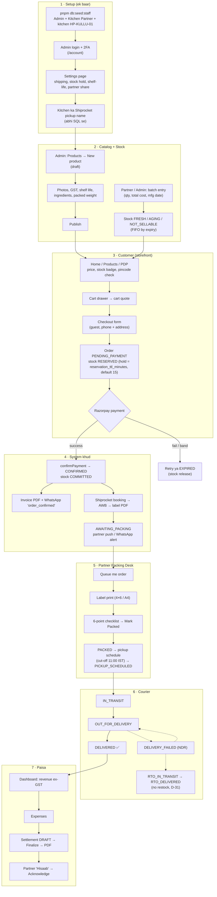
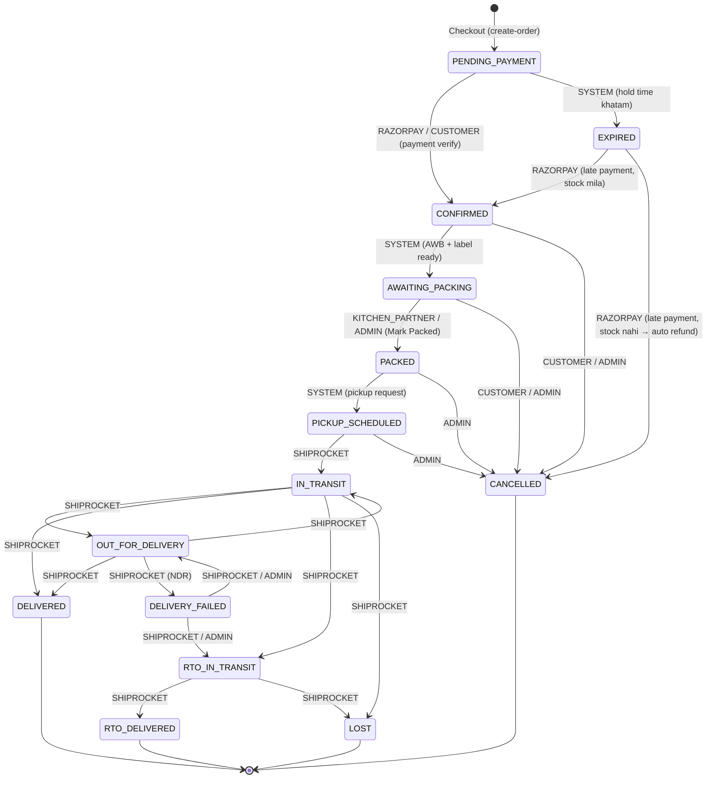

# 🧭 Pahadi Khatki — End-to-End Workflow (shuru se aakhir tak)

> **Yeh folder kis liye hai:** owner / admin / partner ko ek jagah samjhana ki **product list karne se le kar customer ke ghar jar pahunchne aur partner ke hisaab (settlement) tak** poora system kaise chalta hai — admin side kya karta hai, website (storefront) par customer ko kya dikhta hai, aur system (worker) khud kya karta hai.
>
> Har screen ka naam, button, field, status aur message template **code se verify** kiya gaya hai (Oct 2026, Phase 10 ke baad). Jo cheez abhi bani nahi hai, use saaf likha hai: **"abhi system me nahi hai (v2 / pending)"** — details [`requirement/pending-requirements.md`](../requirement/pending-requirements.md) me.
>
> Docs aur code me conflict ho toh [`architecture/08-decisions-log.md`](../architecture/08-decisions-log.md) (D-xx) jeetega.

---

## 📚 Files (is order me padho)

| #   | File                                                                       | Kya milega                                                                                                         |
| :-- | :------------------------------------------------------------------------- | :----------------------------------------------------------------------------------------------------------------- |
| 0   | `README.md` (yeh file)                                                     | Actors, poora lifecycle diagram, order status diagram, local par chalane ke steps                                  |
| 1   | [01-setup-admin-partner-kitchen.md](01-setup-admin-partner-kitchen.md)     | Pehli baar setup: staff seed, admin login + 2FA, Staff page, kitchen (pickup location) mapping, **Settings** page  |
| 2   | [02-product-listing-catalog.md](02-product-listing-catalog.md)             | Product banana (har field), draft vs publish, website par product kaise dikhta hai                                 |
| 3   | [03-inventory-batches-stock.md](03-inventory-batches-stock.md)             | Batch entry, FRESH / AGING / NOT_SELLABLE, FIFO, adjustments, ledger, stock hold                                   |
| 4   | [04-customer-journey-storefront.md](04-customer-journey-storefront.md)     | Customer: browse → cart → checkout → payment → order page → OTP login → My Orders → /track → cancel → invoice      |
| 5   | [05-order-fulfilment-admin-partner.md](05-order-fulfilment-admin-partner.md) | Payment ke baad: auto booking (AWB + label), Orders console, partner Packing Desk, pickup, courier statuses        |
| 6   | [06-exceptions-refunds-ndr-rto.md](06-exceptions-refunds-ndr-rto.md)       | Gadbad wale cases: payment fail, late payment, refund, NDR, RTO, damaged/lost, webhook fail, Shiprocket fail       |
| 7   | [07-money-settlements-reports.md](07-money-settlements-reports.md)         | Dashboard, revenue ex-GST, expenses, partner settlement (formula + ₹ example), customers, exports, audit log       |
| 8   | [08-notifications-alerts-monitoring.md](08-notifications-alerts-monitoring.md) | Har WhatsApp / SMS / push / e-mail message, admin alerts, ops alerts, health URLs                              |
| 9   | [09-end-to-end-test-checklist.md](09-end-to-end-test-checklist.md)         | Local par "ek order shuru se aakhir tak" test script (checkboxes) + exception scenarios                            |

---

## 👥 Actors — kaun kya karta hai

| Actor                               | Kahan kaam karta hai                                                               | Mukhya kaam                                                                                                     |
| :---------------------------------- | :--------------------------------------------------------------------------------- | :-------------------------------------------------------------------------------------------------------------- |
| **Admin** (`ADMIN`)                 | Admin portal — `http://localhost:5173` (production: admin domain)                  | Products, Inventory, Orders, Customers, Refund/Cancel, Expenses, Settlements, Exports, Settings, Staff, Audit log, Queues & webhooks |
| **Kitchen Partner** (`KITCHEN_PARTNER`) | Same portal, lekin login ke baad seedha **Packing desk** PWA (`/desk`) — phone par, Hindi default | Batch entry (`/desk/batches`), order packing + label print, **Mark Packed**, apna **Hisaab** (settlement) dekhna + acknowledge |
| **Customer** (`CUSTOMER`)           | Storefront website — `http://localhost:3000`                                       | Product dekhna, cart, guest checkout, payment, order page, OTP login → My Orders, `/track`, cancel (packing se pehle) |
| **System / Worker**                 | `apps/backend/src/worker.ts` (BullMQ jobs + cron)                                  | Invoice PDF, Shiprocket booking (AWB + label), pickup scheduling, tracking poll, messages bhejna, expiry sweepers, alerts |
| **Razorpay**                        | Payment gateway (local: **mock dialog**, `PAYMENT_GATEWAY=mock`)                   | Payment capture → webhook `payment.captured` → order `CONFIRMED`; refunds                                        |
| **Shiprocket**                      | Courier aggregator (local: **sandbox** inside API, `SHIPPING_PROVIDER=sandbox`)    | AWB, label PDF, pickup, tracking webhook (`POST /api/v1/webhooks/courier-tracking`)                             |
| **WhatsApp / SMS**                  | Meta Cloud API + MSG91 (local: **mock outbox**, `WHATSAPP_PROVIDER=mock`, `SMS_PROVIDER=mock`) | Customer status messages, partner new-order alert (push na ho toh), admin alerts                    |

> Roles aur permissions ka ek hi source: [`packages/shared/src/auth/permissions.ts`](../packages/shared/src/auth/permissions.ts). Partner sirf **apne kitchen** ke orders / batches dekh sakta hai (`user_pickup_locations`).

---

## 🗺️ Poora lifecycle — ek nazar me



---

## 🔄 Order status diagram

Source: [`packages/shared/src/order/transitions.ts`](../packages/shared/src/order/transitions.ts) (= [`architecture/07-order-state-machine.md`](../architecture/07-order-state-machine.md) §1.2, D-29). Status sirf `transitionOrder()` se badalta hai — koi bhi galat transition `409 ILLEGAL_TRANSITION` deta hai. Label ke saath **kaun** status badal sakta hai woh likha hai.



**Payment status alag column hai** (D-28): `UNPAID → PAID → REFUND_PENDING → PARTIALLY_REFUNDED / REFUNDED` (aur `REFUND_PENDING → PAID` agar refund fail ho; `PARTIALLY_REFUNDED → REFUND_PENDING` dusre partial refund ke liye).

| Cheez                                  | Values (code se)                                                                                                              |
| :------------------------------------- | :---------------------------------------------------------------------------------------------------------------------------- |
| Terminal order statuses                | `DELIVERED`, `RTO_DELIVERED`, `CANCELLED`, `LOST` (EXPIRED bhi aage nahi badhta — sirf late payment ka case)                  |
| Customer khud cancel kar sakta hai     | `CONFIRMED`, `AWAITING_PACKING` (packing se pehle) — `cancellableBy('CUSTOMER')`                                              |
| Admin cancel kar sakta hai             | `CONFIRMED`, `AWAITING_PACKING`, `PACKED`, `PICKUP_SCHEDULED` — `cancellableBy('ADMIN')`                                      |
| Refund reasons                         | `CUSTOMER_CANCEL`, `ADMIN_CANCEL`, `LATE_PAYMENT_STOCKOUT`, `AMOUNT_MISMATCH`, `RTO`, `DAMAGED`, `LOST`, `DUPLICATE_PAYMENT`, `GOODWILL` |
| Stock allocation statuses              | `RESERVED` (checkout par hold) → `COMMITTED` (payment ke baad) / `RELEASED` (expire / cancel)                                 |
| Actors (status log me)                 | `SYSTEM`, `CUSTOMER`, `ADMIN`, `KITCHEN_PARTNER`, `RAZORPAY`, `SHIPROCKET`                                                     |

Order code format: `PK-` + 6 characters (Crockford Base32), jaise `PK-7KQ2M9` (D-27). Paisa hamesha **integer paise** me store hota hai (₹449 = `44900`), screen par ₹ me dikhta hai (D-26).

---

## 🧪 Local vs Production — kya nakli (mock) hai

| Cheez            | Local (default `.env.example`)                                                                 | Production                                         |
| :--------------- | :--------------------------------------------------------------------------------------------- | :------------------------------------------------- |
| Payment          | `PAYMENT_GATEWAY=mock` → storefront par **mock Razorpay dialog** (pass / fail / close options) | `razorpay` — asli Razorpay Checkout (pending P-1)  |
| Courier          | `SHIPPING_PROVIDER=sandbox` → API ke andar nakli Shiprocket; status aage badhane ke liye `POST /api/v1/dev/shipping/simulate` | `shiprocket` (pending S-1…S-8) |
| WhatsApp / SMS   | `WHATSAPP_PROVIDER=mock`, `SMS_PROVIDER=mock` → Redis outbox, dekhne ke liye `GET /api/v1/dev/messages` | Meta Cloud API / MSG91 (pending M-1, M-2) |
| Customer OTP     | `OTP_PROVIDER=mock` → OTP **API console me `[DEV OTP]`** line me print hota hai                 | MSG91 (TRAI DLT ke baad)                           |
| Images / PDFs    | `STORAGE_DRIVER=local` → `.uploads`, `.uploads-private`                                         | Cloudflare R2 (pending I-3)                        |
| Partner push     | VAPID keys khaali = push off → alert WhatsApp fallback par                                     | VAPID keys set (pending D-1)                       |
| Admin 2FA        | Optional (`ADMIN_TOTP_REQUIRED=true` karo toh lagu)                                            | **Hamesha mandatory** (D-57)                       |
| Invoice          | `seller_details` khaali → PDF par **"DRAFT - NOT A TAX INVOICE"** watermark                   | `seller_details` set hue bina invoice banta hi nahi |

Saare `/api/v1/dev/*` routes production me band hain (mock providers production me refuse hote hain).

---

## 🖥️ Local par chalane ke liye (quick start)

Prerequisites: Node.js 24, pnpm 12 (`corepack enable`), Docker. (Root [`README.md`](../README.md) bhi dekho.)

```bash
# 1. Dependencies + env files
pnpm install
cp .env.example .env
cp apps/storefront/.env.example apps/storefront/.env.local
cp apps/admin/.env.example apps/admin/.env.local

# 2. PostgreSQL 17 (:5433) + Redis 7 (:6380)
docker compose up -d --wait

# 3. Database migrations
pnpm db:up

# 4. Pehla Admin + Kitchen Partner + kitchen HP-KULLU-01 (naam/email/password poochega,
#    ya SEED_ADMIN_NAME / SEED_ADMIN_EMAIL / SEED_ADMIN_PASSWORD / SEED_PARTNER_* env se)
pnpm db:seed:staff

# 5. Six demo SKUs + demo batches + placeholder photos + publish (sirf local, STORAGE_DRIVER=local)
pnpm db:seed:catalog -- --demo --publish

# 6. Kitchen ka Shiprocket pickup nickname (iske bina booking job fail hota hai).
#    UI se: Admin → Kitchens → HP-KULLU-01 → Edit → Shiprocket pickup name. Ya SQL se:
docker compose exec postgres psql -U pk -d pahadi_khatki \
  -c "UPDATE pickup_locations SET shiprocket_pickup_name = 'Kullu Kitchen' WHERE code = 'HP-KULLU-01';"

# 7. Sab kuch ek saath: storefront :3000 · admin :5173 · API :4000 · worker
pnpm dev
```

| URL                                         | Kya hai                                            |
| :------------------------------------------ | :------------------------------------------------- |
| http://localhost:3000                       | Storefront (customer website)                      |
| http://localhost:5173                       | Admin portal + `/desk` Packing Desk (partner)      |
| http://localhost:4000/healthz · `/readyz` · `/healthz/worker` | API liveness / readiness / worker heartbeat |
| http://localhost:4000/api/v1/dev/messages   | Mock WhatsApp / SMS outbox (sirf dev)              |

Notes:

- `pnpm db:seed:catalog` bina flags ke = six products **draft** (unpublished) — admin ko khud photos + GST + shelf life + packed weight bhar ke publish karna hoga. `--publish` sirf `--demo` ke saath chalta hai, aur `--demo` production me refuse hota hai. Demo values (GST 5 %, shelf life 180 din, nutrition) **PLACEHOLDER** hain.
- `pnpm db:seed:catalog -- --demo` se pehle `pnpm db:seed:staff` zaroori hai (demo batches ek ADMIN ke naam se log hote hain).
- Step 6 ka nickname sandbox me kuch bhi ho sakta hai; production me Shiprocket panel me registered pickup nickname hi daalna hai (pending S-2).
- Seed kiye kitchen ka address `ADDRESS PENDING — update before Shiprocket setup` hai — production se pehle asli address Admin → **Kitchens** se update karna hai ([01](01-setup-admin-partner-kitchen.md#3-kitchen--pickup-location)).

Pura step-by-step test: [09-end-to-end-test-checklist.md](09-end-to-end-test-checklist.md).
